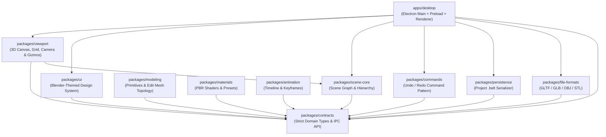

# Blender-ELT 🎨📐

> A modern, extensible Blender-inspired 3D desktop application built with TypeScript, Three.js, React Three Fiber, and Electron.

---

## 🏗️ Architecture



---

## 📦 Packages Breakdown

| Package                         | Path                    | Description                                                                                                    |
| :------------------------------ | :---------------------- | :------------------------------------------------------------------------------------------------------------- |
| **`@blender-elt/contracts`**    | `packages/contracts`    | Domain types, scene graph nodes, materials, modeling schemas, and desktop IPC contracts.                       |
| **`@blender-elt/scene-core`**   | `packages/scene-core`   | Scene graph state management, node hierarchy operations, and default scene builder.                            |
| **`@blender-elt/commands`**     | `packages/commands`     | Extensible command pattern with full undo/redo stack management.                                               |
| **`@blender-elt/modeling`**     | `packages/modeling`     | Geometric primitive generators (Cube, Sphere, Plane, Cylinder, Cone, Torus) and mesh topology.                 |
| **`@blender-elt/materials`**    | `packages/materials`    | PBR material configurations, presets library (Clay, Gold, Chrome, Glass, etc.), and Three.js material factory. |
| **`@blender-elt/animation`**    | `packages/animation`    | Animation timeline, track management, and keyframe interpolation algorithms.                                   |
| **`@blender-elt/file-formats`** | `packages/file-formats` | 3D file format converters and export utilities (GLTF, GLB, OBJ, STL).                                          |
| **`@blender-elt/persistence`**  | `packages/persistence`  | Native `.belt` project file serialization, parsing, and migration logic.                                       |
| **`@blender-elt/viewport`**     | `packages/viewport`     | 3D Canvas view, interactive Orbit controls, transform gizmos, and viewport shading modes.                      |
| **`@blender-elt/ui`**           | `packages/ui`           | Blender-styled UI components: Menus, Panels, Outliner tree, and Properties inspector.                          |
| **`@blender-elt/desktop`**      | `apps/desktop`          | Electron application orchestrating Main, Preload, and Renderer processes with Vite.                            |

---

## 🚀 Getting Started

### Prerequisites

- **Node.js**: `>= 20.0.0` (LTS recommended)
- **pnpm**: `>= 9.0.0`

### Installation

```bash
# Clone the repository
git clone <repo-url>
cd blender-elt

# Install monorepo dependencies
pnpm install
```

---

## 🛠️ Workspace Scripts

| Command             | Action                                                             |
| :------------------ | :----------------------------------------------------------------- |
| `pnpm dev`          | Start development servers across the workspace with hot reloading. |
| `pnpm build`        | Compile and build all workspace packages and apps.                 |
| `pnpm typecheck`    | Run TypeScript type checks across all packages.                    |
| `pnpm lint`         | Run ESLint across all source files.                                |
| `pnpm test`         | Execute unit and integration test suites.                          |
| `pnpm test:e2e`     | Run end-to-end desktop application tests.                          |
| `pnpm format`       | Automatically format all files with Prettier.                      |
| `pnpm format:check` | Verify code formatting with Prettier.                              |
| `pnpm clean`        | Remove build artifacts and node_modules for a fresh start.         |
| `pnpm package`      | Package the desktop application for distribution.                  |

---

## 📄 License

MIT
