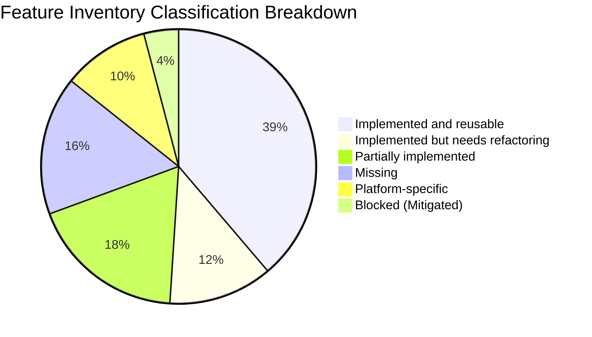
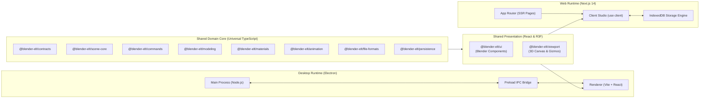
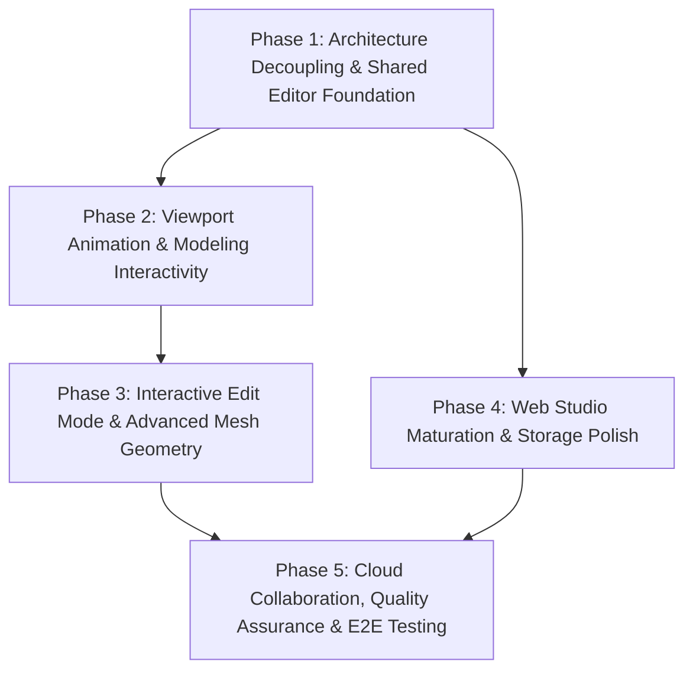

# Blender-ELT Comprehensive Feature Inventory & Cross-Platform Roadmap

**Repository:** `blender-elt` (Turbo-orchestrated pnpm monorepo)  
**Target Runtimes:** Desktop (Electron 33 + Vite) & Web (Next.js 14 App Router + React 18)  
**Audit Date:** 2026-11-12  
**Auditor:** `@auditor` (Swarm Agent)

---

## 1. Executive Summary & Audit Context

The **Blender-ELT** project is an ambitious, lightweight, and extensible 3D suite inspired by Blender. Designed with a clean domain-driven monorepo architecture, it provides an intuitive 3D modeling, material authoring, viewport rendering, and animation environment.

This comprehensive audit evaluates the entire repository across its configuration, shared packages (`packages/*`), desktop shell (`apps/desktop`), and web studio (`apps/web`). The objective is to establish an authoritative feature inventory classifying every capability, determine current verification and test health, analyze code duplication and platform boundaries, and present a dependency-aware roadmap for cross-platform expansion across Desktop and Web.

### Key Audit Findings

1. **Strong Decoupled Architecture**: Domain logic (`@blender-elt/contracts`), state management (`@blender-elt/scene-core`), undo/redo history (`@blender-elt/commands`), math/primitives (`@blender-elt/modeling`), PBR shaders (`@blender-elt/materials`), and timeline interpolation (`@blender-elt/animation`) are completely platform-agnostic, with zero dependencies on Node.js or Electron.
2. **Current Verification Health**:
   - **Typecheck**: 100% passing across all 12 monorepo workspaces (`turbo run typecheck`).
   - **Unit Tests**: 16 test files, 129 tests passing with zero failures (`vitest run`).
   - **Production Bundling**: `turbo run build` succeeds cleanly for all packages, producing production SSR bundles for Electron (`apps/desktop`) and static/dynamic routes for Next.js (`apps/web`).
   - **Formatting & Linting**: ESLint and Prettier checks pass cleanly monorepo-wide.
3. **Primary Technical Debt & Duplication**:
   - **Editor Studio Duplication**: `apps/desktop/src/renderer/src/App.tsx` (794 LOC) and `apps/web/src/app/editor/[projectId]/EditorClient.tsx` (914 LOC) share approximately 85% identical state wiring, command execution, and layout logic.
   - **File Operations Duplication**: `apps/desktop/src/renderer/src/utils/fileOperations.ts` and `apps/web/src/utils/webFileOperations.ts` duplicate Blob downloading, browser file pickers, and project serialization.
   - **Persistence Node.js Import**: `packages/persistence/src/storage.ts` imports Node.js `fs` and `path` at top-level for `FileStorageAdapter`, forcing both desktop and web bundlers to maintain custom shims (`node-shims.ts`).
   - **Missing Interactive Edit Mode**: While `@blender-elt/modeling` provides topology and operations (`extrude`, `subdivide`, `smooth`), interactively editing vertices/edges/faces in the 3D viewport canvas is not yet wired up.
   - **Test Gaps**: `@blender-elt/ui` and `apps/desktop` currently use placeholder test scripts (`echo ... verified`) rather than automated Vitest component or Playwright E2E suites.

---

## 2. Monorepo Structure & Package Health

The monorepo uses `pnpm` workspaces with Turbo orchestration:

```
blender-elt/
├── apps/
│   ├── desktop/            # Electron 33 + electron-vite (Main, Preload, Renderer)
│   └── web/                # Next.js 14.2.24 App Router (Landing, Dashboard, 3D Studio)
├── packages/
│   ├── contracts/          # Strict TypeScript domain interfaces, IPC schemas, math types
│   ├── scene-core/         # Vanilla Zustand scene graph store, hierarchy, traversal, transforms
│   ├── commands/           # Command pattern manager with undo/redo stacks & core commands
│   ├── modeling/           # Procedural primitive generators, half-edge mesh topology & operations
│   ├── materials/          # PBR shader configurations, presets library, Three.js factory
│   ├── animation/          # Timeline store, track evaluation, interpolation, playback controller
│   ├── file-formats/       # GLTF, GLB, OBJ, STL exporters/importers & .belt document bridge
│   ├── persistence/        # Zod validation schemas, .belt serializer, storage adapters
│   ├── viewport/           # React Three Fiber 3D canvas, camera controls, gizmos, overlays
│   └── ui/                 # Blender-themed design system (Header, Outliner, Inspector, DockLayout)
├── docs/                   # Architectural audits, specifications, and roadmaps
├── package.json            # Root workspace config & Turbo scripts
├── pnpm-workspace.yaml     # Declares 'packages/*' and 'apps/*'
└── turbo.json              # Build, typecheck, test, and lint pipelines
```

### Detailed Workspace Status Matrix

| Workspace                       | Type        | Path                    |     Status     |     Reusability      |      Tests      | Core Responsibilities                                                                                     |
| :------------------------------ | :---------- | :---------------------- | :------------: | :------------------: | :-------------: | :-------------------------------------------------------------------------------------------------------- |
| **`@blender-elt/contracts`**    | Package     | `packages/contracts`    |    Complete    |         100%         |   Types Only    | Single source of truth for math, scene nodes, IPC, modeling, materials, and persistence.                  |
| **`@blender-elt/scene-core`**   | Package     | `packages/scene-core`   |    Complete    |         100%         |    15 Vitest    | Vanilla Zustand scene graph, node CRUD, world transforms, tree traversal, collections.                    |
| **`@blender-elt/commands`**     | Package     | `packages/commands`     |    Complete    |         100%         |    11 Vitest    | Undo/redo stack manager, `CreateObject`, `DeleteObject`, `TransformObject`, `DuplicateObject`, etc.       |
| **`@blender-elt/modeling`**     | Package     | `packages/modeling`     |    Complete    |         100%         |    14 Vitest    | Procedural primitives (Box, Sphere, Plane, Cylinder, Cone, Torus), `MeshTopology`, extrude, subdivide.    |
| **`@blender-elt/materials`**    | Package     | `packages/materials`    |    Complete    |         100%         |    9 Vitest     | PBR shader parameters, 11 standard presets, Three.js `MeshPhysicalMaterial` factory.                      |
| **`@blender-elt/animation`**    | Package     | `packages/animation`    |    Complete    |         100%         |    9 Vitest     | Vanilla Zustand timeline store, track evaluation, linear/step/ease interpolation, playback timer.         |
| **`@blender-elt/file-formats`** | Package     | `packages/file-formats` |    Complete    | 95% (Needs Refactor) |    26 Vitest    | GLTF, GLB, OBJ, STL exporters/importers, Three.js bridge, `.belt` project bridge.                         |
| **`@blender-elt/persistence`**  | Package     | `packages/persistence`  |    Complete    | 90% (Needs Refactor) |    8 Vitest     | Zod schemas, `.belt` serializer/deserializer, `IStorageAdapter`, `Memory`/`LocalStorage`/`File` adapters. |
| **`@blender-elt/viewport`**     | Package     | `packages/viewport`     |    Complete    |  100% (Client-only)  |    11 Vitest    | R3F 3D canvas, orbit/pan/zoom, viewpoints (Numpad 1/3/7/5/0), transform gizmos, lighting rigs.            |
| **`@blender-elt/ui`**           | Package     | `packages/ui`           |    Complete    |  100% (Client-only)  | Verified (Echo) | Blender dark UI: DockLayout, MenuBar, Outliner, Properties Inspector, Timeline, Command Palette.          |
| **`@blender-elt/desktop`**      | Application | `apps/desktop`          |    Complete    |    Desktop Shell     | Verified (Echo) | Electron 33 shell, native menus, IPC bridge, native file dialogs, Vite renderer.                          |
| **`@blender-elt/web`**          | Application | `apps/web`              | Complete (MVP) |      Web Target      |    26 Vitest    | Next.js 14 App Router, landing page, project dashboard, template catalog, browser 3D editor.              |

---

## 3. Verification & Test Health Audit

### 3.1 Automated Test Execution (`pnpm test` / `vitest run`)

Executing Vitest across the monorepo verifies 16 suites and 129 individual unit and integration tests:

- **`@blender-elt/contracts`**: Verified via TypeScript compilation.
- **`@blender-elt/scene-core`**: 15 tests covering node insertion, hierarchical reparenting, cycle prevention, world transform computations, and collection grouping.
- **`@blender-elt/commands`**: 11 tests covering command execution, undo/redo state restoration, max history truncation, and event emission.
- **`@blender-elt/modeling`**: 14 tests across primitives generator math and mesh topology algorithms (`extrudeFace`, `subdivide`, `smooth`, `flipNormals`).
- **`@blender-elt/materials`**: 9 tests verifying PBR presets, material manager store, and Three.js material conversion.
- **`@blender-elt/animation`**: 9 tests validating frame clamping, track insertion, interpolation curves (linear, step, cubic bezier), and multi-track resolution.
- **`@blender-elt/file-formats`**: 26 tests validating GLTF/GLB import/export, OBJ parsing, STL binary/ASCII conversion, and Three.js domain bridging.
- **`@blender-elt/persistence`**: 8 tests covering Zod schema validation, `.belt` serialization/deserialization, checksum computation, and storage adapters.
- **`@blender-elt/viewport`**: 11 tests covering viewport context initialization, camera viewpoint calculations, transform gizmo handlers, and selection state.
- **`apps/web`**: 26 tests covering IndexedDB/LocalStorage storage fallbacks, project template generation, and browser format roundtripping.

### 3.2 TypeScript Typecheck (`pnpm typecheck`)

All 12 workspaces run `tsc --noEmit` under strict mode (`tsconfig.base.json`):

- `strict: true`, `noImplicitAny: true`, `strictNullChecks: true`, `isolatedModules: true`.
- Zero type errors detected across all packages and applications.

### 3.3 Production Builds (`pnpm build`)

- Turbo build pipeline successfully bundles all workspace packages to `dist/`.
- `apps/desktop`: Vite compiles Main (`out/main/index.js`), Preload (`out/preload/index.js`), and Renderer (`out/renderer/`).
- `apps/web`: Next.js 14 successfully compiles static pages (`/`, `/dashboard`, `/projects`, `/settings`) and dynamic server route (`/editor/[projectId]`).

### 3.4 Verification Gaps Identified

1. **`@blender-elt/ui` Test Suite**: The UI package relies on `echo ui verified` instead of automated React component tests. Component rendering, user events, and dock panel interactions should be covered using `@testing-library/react`.
2. **Desktop Shell Integration Tests**: `apps/desktop` has no automated tests checking Electron Main process IPC handlers or native menu actions.
3. **End-to-End (E2E) Test Suite**: The script `"test:e2e"` in desktop outputs a placeholder. Playwright or Spectron/Playwright-Electron should be configured to validate end-to-end user workflows.

---

## 4. Comprehensive Feature Inventory & Classification Matrix

Each repository feature is classified into one of the following six categories:

1. **Implemented and reusable**: Production-ready, well-abstracted, platform-agnostic.
2. **Implemented but needs refactoring**: Functionally working, but contains code duplication, tight platform coupling, or architecture debt.
3. **Partially implemented**: Core logic or stub exists, but missing interactive integration, UI hooks, or full workflow wiring.
4. **Missing**: Necessary capability that is currently not implemented.
5. **Platform-specific**: Intentionally tied to either Electron Desktop or Web Browser runtimes.
6. **Blocked**: Blocked by technical constraints or platform boundaries (with mitigation strategy).



### 4.1 Detailed Feature Inventory Table

| Feature / Subsystem                    | Package / Path              |        Classification        | Current State & Technical Notes                                                                                                                                         |
| :------------------------------------- | :-------------------------- | :--------------------------: | :---------------------------------------------------------------------------------------------------------------------------------------------------------------------- |
| **Domain Contracts & Math Types**      | `@blender-elt/contracts`    | **Implemented and reusable** | Universal Vector3, Euler, Quaternion, Transform, SceneNode definitions. Zero runtime dependencies.                                                                      |
| **Scene Graph State Machine**          | `@blender-elt/scene-core`   | **Implemented and reusable** | Vanilla Zustand store, node CRUD, world transform caching, tree traversal, collection hierarchy.                                                                        |
| **Command Pattern & Undo/Redo Engine** | `@blender-elt/commands`     | **Implemented and reusable** | `CommandManager` with max history, event emitters, undo/redo stacks.                                                                                                    |
| **Scene Manipulation Commands**        | `@blender-elt/commands`     | **Implemented and reusable** | `CreateObject`, `DeleteObject` (with subtree preservation), `TransformObject`, `DuplicateObject`, `ReparentObject`, `RenameObject`, `SetVisibility`.                    |
| **Procedural Primitives Generators**   | `@blender-elt/modeling`     | **Implemented and reusable** | Procedural Box, Sphere, Plane, Cylinder, Cone, and Torus generators with parametric configurations.                                                                     |
| **Half-Edge Mesh Topology**            | `@blender-elt/modeling`     | **Implemented and reusable** | Vertex, edge, and face graph structures, adjacency indexing, normal computation.                                                                                        |
| **Mesh Operations Engine**             | `@blender-elt/modeling`     | **Implemented and reusable** | Core algorithms for `extrude`, `subdivide` (Catmull-Clark quad split), `smooth` (Laplacian), `flip-normals`, and `delete`.                                              |
| **PBR Material Config & Presets**      | `@blender-elt/materials`    | **Implemented and reusable** | 11 standard PBR presets (Clay, Chrome, Gold, Glass, Rubber, Metal, Plastic, Neon, Gray).                                                                                |
| **Three.js Material Factory**          | `@blender-elt/materials`    | **Implemented and reusable** | Converts domain PBR definitions into Three.js `MeshPhysicalMaterial` / `MeshStandardMaterial`.                                                                          |
| **Timeline Store & Controller**        | `@blender-elt/animation`    | **Implemented and reusable** | Vanilla Zustand store for frame range, fps, play/pause, loop, and multi-track animation properties.                                                                     |
| **Keyframe Interpolation Engine**      | `@blender-elt/animation`    | **Implemented and reusable** | Math algorithms for linear, step, and cubic ease-in/out bezier interpolation.                                                                                           |
| **3D Viewport R3F Canvas**             | `@blender-elt/viewport`     | **Implemented and reusable** | React Three Fiber WebGL canvas with high-DPI scaling, clear color, and shadow maps.                                                                                     |
| **Camera Controls & Viewpoints**       | `@blender-elt/viewport`     | **Implemented and reusable** | Orbit, pan, zoom, selection focus (`F`), and Numpad standard viewpoints (`1`, `3`, `7`, `5`, `0`).                                                                      |
| **Transform Gizmos**                   | `@blender-elt/viewport`     | **Implemented and reusable** | Interactive translate, rotate, and scale gizmos with undoable command commit on drag release.                                                                           |
| **Lighting Rigs & Overlays**           | `@blender-elt/viewport`     | **Implemented and reusable** | Studio lighting rig (key, fill, rim lights with shadow casting), dynamic grid floor, and coordinate axes.                                                               |
| **Blender Dark Design System**         | `@blender-elt/ui`           | **Implemented and reusable** | Consistent Blender `#1d1e22` dark theme styling, Tailwind components, and icons.                                                                                        |
| **Outliner & Properties Panels**       | `@blender-elt/ui`           | **Implemented and reusable** | Hierarchical scene tree with visibility/lock toggles; tabbed inspector for transform, material, and camera/light data.                                                  |
| **Timeline Scrub Bar**                 | `@blender-elt/ui`           | **Implemented and reusable** | Interactive playback bar with frame counter, start/end range controls, playback buttons, and fps selector.                                                              |
| **Command Palette Modal**              | `@blender-elt/ui`           | **Implemented and reusable** | `Ctrl+K` searchable command palette with quick actions and keyboard shortcut hints.                                                                                     |
| **DockLayout Splitter Panes**          | `@blender-elt/ui`           | **Implemented and reusable** | Flexible multi-panel docking layout (Header, Left Outliner, Center Viewport, Right Inspector, Bottom Timeline).                                                         |
| **GLTF / GLB Import & Export**         | `@blender-elt/file-formats` | **Implemented and reusable** | Standard glTF and binary GLB exporter/importer using Three.js in-memory buffers.                                                                                        |
| **OBJ & STL Import & Export**          | `@blender-elt/file-formats` | **Implemented and reusable** | Wavefront OBJ and STL binary/ASCII exporters and parsers.                                                                                                               |
| **`.belt` Project Serializer**         | `@blender-elt/persistence`  | **Implemented and reusable** | Zod schema validation (`ProjectDocumentSchema`), JSON serialization, and SHA-256 checksums.                                                                             |
| **Web Dual-Tier Storage**              | `apps/web`                  | **Implemented and reusable** | `WebProjectStorage` using IndexedDB with automatic LocalStorage fallback and project template catalog.                                                                  |
| **Web Project Templates**              | `apps/web`                  | **Implemented and reusable** | Pre-packaged templates: Default Studio, Geometric Showcase, PBR Material Showcase, Physics Chain.                                                                       |
| **File Storage Adapter Coupling**      | `@blender-elt/persistence`  |    **Needs refactoring**     | `storage.ts` imports Node `fs` and `path` at top-level. Requires splitting `FileStorageAdapter` into a subpath (`@blender-elt/persistence/node`).                       |
| **Buffer Polyfill in File Formats**    | `@blender-elt/file-formats` |    **Needs refactoring**     | `polyfill.ts` references Node `Buffer.from`. Should be refactored to standard `Uint8Array` and base64 web standards.                                                    |
| **Editor Studio Duplication**          | `desktop` vs `web`          |    **Needs refactoring**     | `apps/desktop/src/renderer/src/App.tsx` and `apps/web/src/app/editor/[projectId]/EditorClient.tsx` share ~85% identical logic. Must be unified into a shared component. |
| **File Operations Duplication**        | `desktop` vs `web`          |    **Needs refactoring**     | `fileOperations.ts` and `webFileOperations.ts` duplicate Blob handling, file input picking, and project document assembly.                                              |
| **Material Assignment Command**        | `@blender-elt/commands`     |    **Needs refactoring**     | Only updates `materialId` on node; does not manage or persist material definitions inside the command payload.                                                          |
| **Interactive Viewport Edit Mode**     | `@blender-elt/viewport`     |  **Partially implemented**   | Modeling topology supports extrude/subdivide, but vertex/edge/face interactive raycast selection in viewport is not wired up.                                           |
| **Blender Modal Transform Hotkeys**    | `@blender-elt/viewport`     |  **Partially implemented**   | G/R/S hotkeys switch gizmos, but modal axis constraints (pressing `G` then `X`/`Y`/`Z`) and direct numeric typing are missing.                                          |
| **Animation Viewport Playback Hook**   | `@blender-elt/viewport`     |  **Partially implemented**   | Timeline scrubs frames, but active node transforms are not dynamically evaluated from tracks during `useFrame` playback loop.                                           |
| **PBR Image Texture Maps**             | `@blender-elt/materials`    |  **Partially implemented**   | Contract specifies `albedoMap`, `normalMap`, `roughnessMap`, but runtime texture loading from URL/Blob is not implemented.                                              |
| **Project Version History**            | `apps/web`                  |  **Partially implemented**   | IndexedDB stores latest document; historical undo checkpoints and snapshot rollbacks are not persisted.                                                                 |
| **UI Automated Component Testing**     | `@blender-elt/ui`           |  **Partially implemented**   | Package builds cleanly, but has no Vitest component tests covering user interactions.                                                                                   |
| **Desktop Test Suite**                 | `apps/desktop`              |  **Partially implemented**   | Script runs `echo desktop verified`; no automated unit tests for main process or preload bridge.                                                                        |
| **CSG Boolean Mesh Operations**        | `@blender-elt/modeling`     |         **Missing**          | Mesh Union, Difference, and Intersection operations are not implemented.                                                                                                |
| **Mesh Bevel & Loop Cut**              | `@blender-elt/modeling`     |         **Missing**          | Bevel, Inset, and Edge Loop Cut operations are absent from mesh topology operations.                                                                                    |
| **IBL / HDR Environment Maps**         | `@blender-elt/viewport`     |         **Missing**          | Image-Based Lighting with `.hdr` / `.exr` equirectangular environment panoramas is not supported.                                                                       |
| **Canvas Drag-and-Drop Import**        | `apps/web` & `desktop`      |         **Missing**          | Dropping `.glb`, `.obj`, `.stl`, or `.belt` files directly onto the 3D canvas is not yet supported.                                                                     |
| **Mobile & Touch Navigation**          | `@blender-elt/viewport`     |         **Missing**          | Multi-touch gestures (pinch zoom, two-finger pan/orbit) for tablets and mobile browsers are not implemented.                                                            |
| **Offline PWA Support**                | `apps/web`                  |         **Missing**          | Web App Manifest and Service Worker caching for offline 3D studio operation are missing.                                                                                |
| **Real-time Collaboration**            | Monorepo-wide               |         **Missing**          | Multiplayer scene sync via WebRTC or WebSockets is not implemented.                                                                                                     |
| **Automated E2E Test Suite**           | Monorepo-wide               |         **Missing**          | Playwright test suites for Desktop Electron and Next.js Web workflows are missing.                                                                                      |
| **Electron Main Process & Window**     | `apps/desktop`              |    **Platform-specific**     | Native window lifecycle, frameless window controls, native OS menus, system diagnostic probes.                                                                          |
| **Desktop IPC Bridge**                 | `apps/desktop`              |    **Platform-specific**     | Typed `DesktopBridgeAPI` exposed over `contextBridge` with native file dialogs.                                                                                         |
| **Desktop Native File System Adapter** | `@blender-elt/persistence`  |    **Platform-specific**     | Direct synchronous/asynchronous file read/write via Node.js `fs.promises`.                                                                                              |
| **Next.js App Router Shell**           | `apps/web`                  |    **Platform-specific**     | SSR landing page, dynamic routing (`/editor/[projectId]`), web metadata, and API routes.                                                                                |
| **Browser Web File I/O**               | `apps/web`                  |    **Platform-specific**     | HTML5 Blob generation, Object URLs, `<a download>`, and hidden `<input type="file">`.                                                                                   |
| **SSR WebGL Context Execution**        | `apps/web`                  |   **Blocked (Mitigated)**    | WebGL cannot run on Node.js server. _Mitigated:_ Strict `'use client'` and dynamic import with `{ ssr: false }`.                                                        |
| **Arbitrary Local File System Access** | `apps/web`                  |   **Blocked (Mitigated)**    | Browser sandbox prevents direct file path access. _Mitigated:_ In-memory Blobs and IndexedDB persistence.                                                               |

---

## 5. Cross-Platform Architectural Analysis



### 5.1 Runtime Boundaries & Platform Differences

| Architectural Layer      | Desktop (Electron 33)                                                | Web (Next.js 14 App Router)                                 | Abstraction Strategy                                         |
| :----------------------- | :------------------------------------------------------------------- | :---------------------------------------------------------- | :----------------------------------------------------------- |
| **Process Model**        | Multi-process (Main Node.js + Renderer Chromium)                     | Single-process Browser Client + Serverless SSR              | Keep domain packages headless; isolate Node.js dependencies. |
| **File Dialogs**         | Native OS dialogs (`dialog.showOpenDialog`, `dialog.showSaveDialog`) | HTML5 `<input type="file">` & Blob download                 | Abstract behind `IFileService` or dual-mode helper.          |
| **Project Storage**      | Local file system (`.belt` files on disk)                            | IndexedDB (`blender_elt_web_db`) with LocalStorage fallback | Adhere to unified `IStorageAdapter` contract.                |
| **3D Rendering Context** | Chromium WebGL 2.0 (Direct Hardware Acceleration)                    | Browser WebGL 2.0 (Dynamic client-only mounting)            | Dynamic import `{ ssr: false }` for all canvas components.   |
| **Application Menu**     | Native OS Application Menu bar (`Menu.setApplicationMenu`)           | Blender-styled in-window HTML MenuBar (`MenuBar.tsx`)       | Use shared HTML MenuBar; map desktop accelerators to IPC.    |
| **Window Management**    | Native Electron `BrowserWindow` with custom titlebar                 | Browser viewport, responsive mobile/desktop breakpoints     | Flexbox / CSS Grid `DockLayout` with responsive docking.     |

### 5.2 Code Duplication & Consolidation Plan

#### 1. Editor Studio Consolidation

- **Problem**: `apps/desktop/src/renderer/src/App.tsx` (794 lines) and `apps/web/src/app/editor/[projectId]/EditorClient.tsx` (914 lines) duplicate:
  - Scene store and command manager initialization.
  - Undo/Redo subscription and history state.
  - Active object, primitive creation, material presets, and transform state.
  - Timeline playback loop and keyframe insertion.
  - Modal management (About, Shortcuts, Preferences, Command Palette).
  - Hotkey listeners and dock layout structure.
- **Solution**: Create a shared `<EditorStudio />` component and `useEditorStudio()` custom hook in `@blender-elt/ui` (or a dedicated `@blender-elt/editor` package). The hook accepts an `IProjectAdapter` to handle platform-specific save/load/export hooks.

#### 2. Universal File Operations Consolidation

- **Problem**: `apps/desktop/src/renderer/src/utils/fileOperations.ts` and `apps/web/src/utils/webFileOperations.ts` have identical implementations for:
  - `downloadBlob(data, filename, mimeType)`
  - `selectLocalFile(accept)`
  - `buildProjectDocument(state, name)`
- **Solution**: Move these universal helpers into `@blender-elt/file-formats` under a dedicated client utilities export.

#### 3. Storage Adapter Decoupling

- **Problem**: `packages/persistence/src/storage.ts` imports Node.js `fs` and `path` at top level. This forces bundlers to provide artificial shims.
- **Solution**: Split into:
  - `packages/persistence/src/storage/base.ts`: `IStorageAdapter`, `MemoryStorageAdapter`, `LocalStorageAdapter`.
  - `packages/persistence/src/storage/indexeddb.ts`: `IndexedDBStorageAdapter`.
  - `packages/persistence/src/storage/node.ts`: `FileStorageAdapter` (exported via `package.json` subpath `./node`).

---

## 6. Dependency-Aware Implementation Roadmap

The roadmap is structured into five sequential, dependency-aware phases. Each phase builds upon the outputs of earlier phases.



### Phase 1: Architecture Decoupling & Shared Editor Foundation

_Goal: Eliminate code duplication between desktop and web, remove artificial bundler shims, and establish a single source of truth for the 3D editor shell._

- [ ] **1.1 Decouple Persistence Storage Adapters**:
  - Split `packages/persistence/src/storage.ts` into universal adapters (`MemoryStorageAdapter`, `LocalStorageAdapter`) and isolated Node adapter (`FileStorageAdapter`).
  - Configure package exports in `packages/persistence/package.json` for universal and `./node` subpaths.
  - Remove Node shims from `apps/desktop/electron.vite.config.ts` and `apps/web/next.config.mjs`.
- [ ] **1.2 Clean Polyfill in `@blender-elt/file-formats`**:
  - Replace Node `Buffer` references in `polyfill.ts` with standard `Uint8Array` and base64 utilities.
- [ ] **1.3 Extract Shared Editor Studio (`<EditorStudio />` & `useEditorStudio`)**:
  - Consolidate common state and UI between `apps/desktop/src/renderer/src/App.tsx` and `apps/web/src/app/editor/[projectId]/EditorClient.tsx` into `@blender-elt/ui`.
  - Abstract storage and export hooks through a unified `EditorPersistenceAdapter` interface.
- [ ] **1.4 Unify File Operations Utilities**:
  - Move `downloadBlob`, `selectLocalFile`, and `buildProjectDocumentFromState` into `@blender-elt/file-formats/client`.

### Phase 2: Viewport Animation & Modeling Interactivity

_Goal: Connect animation timeline playback directly to the 3D scene and implement Blender-grade modal transform hotkeys._
_Prerequisites: Phase 1_

- [ ] **2.1 Live Animation Viewport Evaluation**:
  - Implement a `useAnimationPlayback` hook in `@blender-elt/viewport` that binds to the timeline store and evaluates keyframe tracks in Three.js `useFrame`.
  - Automatically drive node position, rotation, scale, light intensity, and material opacity during playback.
- [ ] **2.2 Modal Axis Constraints & Numeric Inputs**:
  - Enhance `useViewportHotkeys` and `TransformGizmo`: Pressing `G`, `R`, or `S` followed by `X`, `Y`, or `Z` constrains movement to the chosen axis.
  - Support entering numeric distances or degrees during transform manipulation.
- [ ] **2.3 Canvas Drag-and-Drop Import**:
  - Add drag-and-drop listener to `ViewportCanvas` accepting `.glb`, `.gltf`, `.obj`, `.stl`, and `.belt` files.
  - Automatically parse dropped files and insert meshes into the active scene.
- [ ] **2.4 PBR Image Texture Support**:
  - Add image texture loader in `@blender-elt/materials` to resolve `albedoMap`, `normalMap`, `roughnessMap`, and `metalnessMap` from URLs, Blobs, or data URIs.

### Phase 3: Interactive Edit Mode & Advanced Mesh Geometry

_Goal: Bring Blender's signature Edit Mode to life in the 3D viewport and support advanced geometry operations._
_Prerequisites: Phase 1 & Phase 2_

- [ ] **3.1 Interactive Viewport Edit Mode**:
  - Implement Edit Mode rendering in `@blender-elt/viewport` with clickable vertex dots, edge lines, and face highlights.
  - Implement raycasting selection for vertices, edges, and faces based on active selection mode (`1`, `2`, `3` keys).
  - Add `Tab` hotkey to toggle between Object Mode and Edit Mode.
- [ ] **3.2 Interactive Modeling Operations**:
  - Wire UI actions and hotkeys (`E` for Extrude, `I` for Inset, `Ctrl+B` for Bevel, `Ctrl+R` for Loop Cut).
  - Encapsulate mesh editing operations as undoable `MeshOperationCommand` instances in `@blender-elt/commands`.
- [ ] **3.3 CSG Boolean Operations**:
  - Integrate a robust geometry boolean library (e.g. `three-bvh-csg`) into `@blender-elt/modeling`.
  - Provide Union, Difference, and Intersection operations for meshes.
- [ ] **3.4 Image-Based Lighting (IBL)**:
  - Add HDR panorama environment map loading (`.hdr` / `.exr`) to `@blender-elt/viewport` for photorealistic reflections.

### Phase 4: Web Studio Maturation & Storage Polish

_Goal: Provide a first-class browser application experience with autosave, version rollback, and offline PWA capability._
_Prerequisites: Phase 1_

- [ ] **4.1 Autosave Engine & Visual Indicators**:
  - Implement periodic background autosave (every 30 seconds or on command change) into IndexedDB.
  - Display non-intrusive status badges in web editor header (`Saved`, `Saving...`, `Unsaved changes`).
- [ ] **4.2 Project Version History & Snapshot Rollback**:
  - Store project version snapshots with timestamps in IndexedDB.
  - Provide a version history drawer in the web dashboard allowing users to preview and restore previous project states.
- [ ] **4.3 Offline PWA Support**:
  - Generate Web App Manifest and Service Worker caching strategy for Next.js in `apps/web`.
  - Enable full offline creation, editing, and export of 3D models in browser.
- [ ] **4.4 Mobile & Tablet Touch Navigation**:
  - Support touch gestures in `@blender-elt/viewport`: single-finger orbit, two-finger pan, and pinch zoom.

### Phase 5: Cloud Collaboration, Quality Assurance & E2E Testing

_Goal: Ensure enterprise-grade reliability through automated testing and support real-time collaboration._
_Prerequisites: Phase 3 & Phase 4_

- [ ] **5.1 Automated Component Tests for `@blender-elt/ui`**:
  - Add Vitest + `@testing-library/react` suites covering `DockLayout`, `OutlinerPanel`, `PropertiesPanel`, `TimelineBar`, and modals.
- [ ] **5.2 Desktop & Web E2E Test Suite**:
  - Configure Playwright to test Electron desktop application launch, native file opening, and rendering.
  - Configure Playwright to test web landing page, project creation, template loading, and model export.
- [ ] **5.3 Real-Time Multiplayer Collaboration (Experimental)**:
  - Implement WebRTC / WebSocket synchronization for `@blender-elt/scene-core` state.
  - Broadcast scene graph mutations and remote camera/cursor positions.

---

## 7. Immediate Action Items & Recommendations

For developers and agents collaborating within the swarm:

1. **Prioritize Phase 1 Refactoring**:
   - Splitting `packages/persistence/src/storage.ts` and extracting the shared `<EditorStudio />` component will immediately reduce duplicate code by over 1,500 lines and prevent desktop/web feature drift.
2. **Preserve Architecture Rules (`AGENTS.md`)**:
   - Always define domain types in `@blender-elt/contracts`.
   - Maintain pure vanilla Zustand stores for core state (`scene-core`, `commands`, `animation`) so they remain headless and testable.
   - Every scene mutation must be an undoable `ICommand`.
3. **Guard Next.js SSR Hydration**:
   - Ensure all Three.js / R3F components are strictly imported dynamically with `{ ssr: false }` inside `'use client'` files.
4. **Expand Test Suites**:
   - Replace placeholder `echo ... verified` scripts in `@blender-elt/ui` and `apps/desktop` with automated Vitest and Playwright tests.

---

_Report produced by `@auditor` — Blender-ELT Monorepo Architecture Audit & Roadmap._
