# Blender-ELT Animation System: Architecture & Subsystem Specification

**Document Version:** 1.0.0  
**Target Packages:** `@blender-elt/contracts`, `@blender-elt/animation`, `@blender-elt/commands`, `@blender-elt/scene-core`, `@blender-elt/persistence`, `@blender-elt/viewport`, `@blender-elt/ui`  
**Applications:** `apps/desktop`, `apps/web`  
**Status:** Production Architecture

---

## 1. Executive Summary & Design Philosophy

The **Blender-ELT Animation System** provides an industry-standard, Blender-inspired 3D animation, timeline, dope sheet, and graph editing subsystem designed to execute with complete parity across Electron desktop and Next.js web applications.

```mermaid
flowchart TD
    subgraph UI_Layer["UI & Presentation Layer (@blender-elt/ui)"]
        ES[EditorStudio.tsx]
        ABP[AnimationBottomPanel.tsx]
        TB[TimelineBar.tsx]
        DS[DopeSheetView.tsx]
        GE[GraphEditorView.tsx]
        KMM[KeyframeMenuModal.tsx]
    end

    subgraph Viewport_Layer["3D Viewport Layer (@blender-elt/viewport)"]
        VC[ViewportCanvas.tsx]
        AVB[AnimationViewportBridge.tsx]
        UAS[useAnimationSync.ts]
        TG[TransformGizmo.tsx]
        ARV[ArmatureVisualizer.tsx]
    end

    subgraph Command_Layer["Command & Undo/Redo Layer (@blender-elt/commands)"]
        CM[CommandManager]
        ITKC[InsertTransformKeyframeCommand]
        IKC[InsertKeyframeCommand]
        DKC[DeleteKeyframeCommand]
        MKC[MoveKeyframeCommand]
        SIC[SetInterpolationCommand]
        SKTC[SetKeyframeTangentsCommand]
        STMC[SetTrackMutedCommand]
        STLC[SetTrackLockedCommand]
    end

    subgraph Engine_Layer["Headless Core Engine (@blender-elt/animation)"]
        TS[TimelineStore: Zustand Vanilla Store]
        PE[PlaybackEngine: rAF Delta-Time Accumulator]
        BCE[BezierCurveEvaluator: Newton-Raphson]
        EXT[ExtrapolationEngine: Cyclic / Linear / Constant]
        MOD[FCurveModifierStack: Noise / Cycles / Limits / Stepped]
        IK[InverseKinematicsSolver: 2-Bone Analytical & FABRIK]
        TRK[Tracks & Channels Evaluator]
    end

    subgraph Scene_Layer["Scene Graph State Machine (@blender-elt/scene-core)"]
        SS[SceneStore: Nodes & Transforms]
        NODES[SceneNode: Mesh, Camera, Light, Armature, Bone]
    end

    subgraph Persistence_Layer["Persistence & Serialization (@blender-elt/persistence)"]
        SCHEMA[Zod ProjectDocumentSchema v1.1.0]
        SERIAL[ProjectSerializer: .belt JSON]
    end

    %% Interactions
    ES --> ABP
    ABP --> TB & DS & GE
    ES --> KMM
    KMM -->|Hotkey I Menu| ITKC
    TG -->|Drag End + AutoKey| ITKC

    ITKC --> CM
    DKC --> CM
    MKC --> CM
    SIC --> CM
    SKTC --> CM
    STMC --> CM
    STLC --> CM

    CM --> TS
    CM --> SS

    VC --> AVB
    AVB --> UAS
    UAS -->|Sample Frame Transforms| TRK
    TRK --> TS
    TRK --> BCE --> EXT --> MOD
    UAS -->|Apply 60fps Transforms| NODES
    UAS -->|Update Node Transform| SS

    PE -->|Tick Playhead| TS
    SERIAL --> SCHEMA
    SERIAL --> TS
    SERIAL --> SS
```



---

## 2. Core Architectural Pillars

### 2.1 Single Source of Truth (`@blender-elt/contracts`)

All animation structures, channels, actions, keyframe flags, Bezier handles, extrapolation curves, modifier schemas, armature bones, and constraint definitions are strictly declared in `packages/contracts/src/animation.ts` and `packages/contracts/src/scene.ts`. No package is permitted to define ad-hoc interfaces or use `any` types.

### 2.2 Headless Engine & React Decoupling

The core animation engine (`@blender-elt/animation`) is implemented with zero DOM and zero React dependencies:

- **State Store:** Vanilla Zustand store (`createTimelineStore`) managing playback controls, current frame, frame bounds, target FPS, actions, channels, keyframe selection, and auto-keying flags.
- **Evaluation Math:** Pure numerical algorithms for cubic Bezier roots (Newton-Raphson), Hermite tangents, cyclical period offsets, and analytical IK geometry.
- **Playback Engine:** High-resolution delta-time accumulator running on `requestAnimationFrame` with high-resolution `performance.now()` fallback.

### 2.3 Command Pattern & Full Undo/Redo Reversibility (`@blender-elt/commands`)

Every user mutation to keyframe data—whether inserting via hotkey `I`, auto-keying from gizmo drag, moving keys in the Dope Sheet, modifying tangents in the Graph Editor, or toggling track mute/lock—is encapsulated in an undoable `ICommand`. Symmetric `undo()` and `redo()` are verified with unit tests.

### 2.4 High-Performance Viewport Synchronization (`@blender-elt/viewport`)

Animation playback and scrubbing directly update Three.js `Object3D` references in `sceneObjectsRef` and the reactive `sceneStore`. Direct matrix synchronization eliminates React rendering bottlenecks during 60fps playback while simultaneously maintaining state reactivity in inspectors and outliners.

---

## 3. Package Structure & Dependency Hierarchy

```
┌────────────────────────────────────────────────────────┐
│                      apps/desktop                      │
│                      apps/web                          │
└──────────┬─────────────────────────────────┬───────────┘
           │                                 │
           ▼                                 ▼
┌────────────────────────────────────────────────────────┐
│                   @blender-elt/ui                      │
│ (EditorStudio, TimelineBar, DopeSheetView, GraphEditor)│
└──────────┬─────────────────────────────────┬───────────┘
           │                                 │
           ▼                                 ▼
┌───────────────────────┐       ┌────────────────────────┐
│ @blender-elt/viewport │       │ @blender-elt/commands  │
│ (Bridge, Visualizers) │       │ (Animation Commands)   │
└──────────┬────────────┘       └────────────┬───────────┘
           │                                 │
           ▼                                 ▼
┌───────────────────────┐       ┌────────────────────────┐
│ @blender-elt/animation│◄──────┤@blender-elt/persistence│
│ (Math, Stores, Loops) │       │(Zod Schema v1.1.0)     │
└──────────┬────────────┘       └────────────┬───────────┘
           │                                 │
           ▼                                 ▼
┌───────────────────────┐       ┌────────────────────────┐
│@blender-elt/scene-core│       │@blender-elt/materials  │
│(Nodes, Matrix Ops)    │       │@blender-elt/modeling   │
└──────────┬────────────┘       └────────────┬───────────┘
           │                                 │
           └────────────────┬────────────────┘
                            ▼
           ┌─────────────────────────────────┐
           │     @blender-elt/contracts      │
           │  (Single Source of Truth Types) │
           └─────────────────────────────────┘
```

---

## 4. Subsystem Module Breakdown

### 4.1 `@blender-elt/contracts`

- `animation.ts`: `IKeyframe`, `BezierHandle`, `KeyframeHandleType`, `KeyframeInterpolation`, `ExtrapolationMode`, `IAnimationChannel`, `IAnimationAction`, `IActionGroup`, `INLAStrip`, `INLATrack`, `IFCurveModifier`, `IBonePose`, `IConstraint`, `AnimationTimeline`.
- `scene.ts`: `ArmatureNode`, `BoneNode`, `IBone`, `BoneTransform`.

### 4.2 `@blender-elt/animation`

- `timeline-store.ts`: Vanilla Zustand store (`TimelineStore`, `timelineStore` singleton) with actions, channels, keyframe CRUD, multi-key selection, auto-keying, and serialization export (`getTimeline()`, `loadTimeline()`, `reset()`).
- `bezier-evaluator.ts`: Newton-Raphson root solver, Catmull-Rom smooth handles, Bernstein polynomial evaluation.
- `extrapolation.ts`: Constant clamping, linear tangent projection, cyclic modulo, cyclic offset accumulation.
- `modifiers.ts`: F-Curve modifier stack pipeline (`noise`, `cycles`, `limits`, `stepped`, `generator`).
- `playback-controller.ts`: `PlaybackEngine` (rAF delta accumulator) and `PlaybackController`.
- `tracks.ts`: `evaluateChannel`, `evaluateTrack`, `evaluateNodeTransform`, `createTrack`, `createChannel`, `recalculateAutoHandles`.
- `ik-solver.ts`: Two-Bone analytical inverse kinematics and FABRIK N-link iterative solver.

### 4.3 `@blender-elt/commands`

- `animation-commands.ts`:
  - `InsertKeyframeCommand`
  - `DeleteKeyframeCommand`
  - `MoveKeyframeCommand`
  - `SetInterpolationCommand`
  - `SetKeyframeTangentsCommand`
  - `SetTrackMutedCommand`
  - `SetTrackLockedCommand`
  - `InsertTransformKeyframeCommand` (Atomic macro for Location, Rotation, Scale, or LocRotScale)
- `registry.ts`: Default shortcut mappings (`I`, `Alt+I`, `Space`, `Left`, `Right`, `Up`, `Down`, `Shift+Alt+K`).

### 4.4 `@blender-elt/viewport`

- `animation/useAnimationSync.ts`: Frame synchronization hook subscribing to `timelineStore`.
- `animation/AnimationViewportBridge.tsx`: R3F declarative bridge component mounted within `ViewportCanvas`.
- `animation/ArmatureVisualizer.tsx`: 3D visualizer rendering octahedral bones, spherical joint nodes, and hierarchical skeletal chains.

### 4.5 `@blender-elt/ui`

- `TimelineBar.tsx`: Playhead scrubber, keyframe dots, auto-key toggle, frame range inputs, playback controls.
- `DopeSheetView.tsx`: Channel tree, summary rows, keyframe diamonds (`◆`), box selection, retiming drag.
- `GraphEditorView.tsx`: Interactive SVG/Canvas curve canvas, RGB axis color coding, cubic Bezier tangents, handle menu (`V`).
- `AnimationBottomPanel.tsx`: Unified tabbed bottom drawer switching between Timeline, Dope Sheet, and Graph Editor.
- `KeyframeMenuModal.tsx`: Blender-style modal context popup triggered by hotkey `I`.
- `EditorStudio.tsx`: Root studio controller wiring gizmo drag auto-keying, hotkeys, and persistence roundtrip.

### 4.6 `@blender-elt/persistence`

- `schema.ts`: Zod schema validation for `AnimationTimelineSchema`, `AnimationActionSchema`, `AnimationChannelSchema`, `KeyframeSchema`, `FCurveModifierSchema`.
- `serializer.ts`: Backward-compatible `.belt` JSON serialization, migrating legacy `1.0.0` tracks to `1.1.0` action channels.

---

## 5. Architectural Quality Guarantees

1. **Zero Data Loss:** Saving a `.belt` document persists the full `AnimationTimeline` (all actions, channels, keyframes, handle coordinates, and playback parameters).
2. **Sub-Pixel & Sub-Frame Precision:** All time coordinates support fractional frames for smooth retiming and playback interpolation.
3. **No Memory Leaks:** Playback loops, store subscriptions, and Three.js geometry buffers are systematically disposed upon component unmount.
4. **Deterministic Evaluation:** Given a set of keyframes and a frame $t$, curve evaluation produces identical results across platforms, architectures, and framerates.
