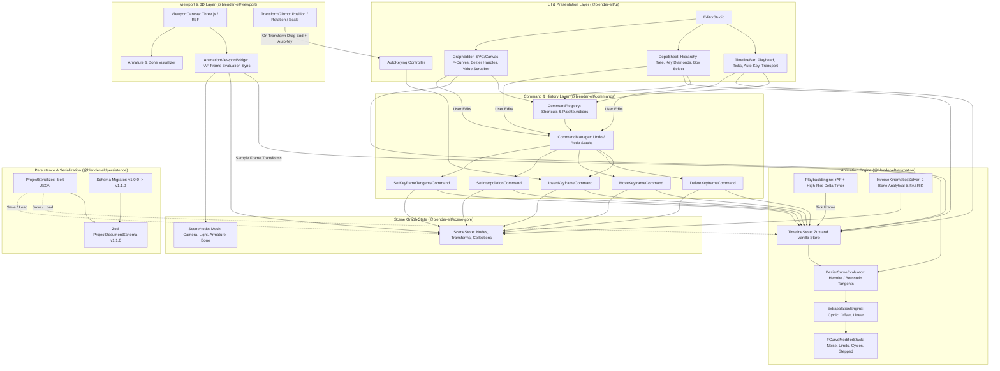
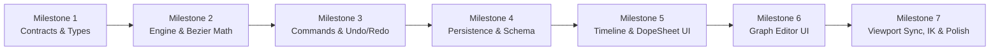

# Blender-ELT Animation System: Monorepo Audit & Architecture Specification

**Document Version:** 1.0.0  
**Target Workspaces:** `@blender-elt/contracts`, `@blender-elt/animation`, `@blender-elt/commands`, `@blender-elt/scene-core`, `@blender-elt/persistence`, `@blender-elt/file-formats`, `@blender-elt/viewport`, `@blender-elt/ui`, `apps/desktop`, `apps/web`  
**Author:** `@auditor` (Repository Audit & Architecture Specialist)  
**Reviewers:** `@verifier` (Quality & Verification Specialist), `@coordinator`  
**Status:** Approved for Phased Implementation

---

## Table of Contents

1. [Executive Summary & System Architecture Overview](#1-executive-summary--system-architecture-overview)
2. [Comprehensive Monorepo Audit Findings (Areas 1–10)](#2-comprehensive-monorepo-audit-findings-areas-110)
   - [2.1 Package Structure, Turborepo Pipelines & pnpm Workspaces](#21-package-structure-turborepo-pipelines--pnpm-workspaces)
   - [2.2 Electron Desktop Architecture (`apps/desktop`)](#22-electron-desktop-architecture-appsdesktop)
   - [2.3 Next.js Web Architecture (`apps/web`)](#23-nextjs-web-architecture-appsweb)
   - [2.4 Scene Graph & Node Types (`packages/scene-core`, `@blender-elt/contracts`)](#24-scene-graph--node-types-packagesscene-core-blender-eltcontracts)
   - [2.5 Viewport Interaction Patterns across Modes](#25-viewport-interaction-patterns-across-modes)
   - [2.6 Existing Animation Engine & UI Code](#26-existing-animation-engine--ui-code)
   - [2.7 State Management & Command History (`packages/commands`)](#27-state-management--command-history-packagescommands)
   - [2.8 Persistence & Project File Serialization (`packages/persistence`, `.belt`)](#28-persistence--project-file-serialization-packagespersistence-belt)
   - [2.9 Viewport Rendering, Gizmos & Studio Layout (`packages/viewport`, `packages/ui`)](#29-viewport-rendering-gizmos--studio-layout-packagesviewport-packagesui)
   - [2.10 Existing Test Suite Coverage & Verification Baseline](#210-existing-test-suite-coverage--verification-baseline)
3. [Contract Definitions Specification (`@blender-elt/contracts`)](#3-contract-definitions-specification-blender-eltcontracts)
   - [3.1 Actions, NLA Clips & Channel Hierarchy](#31-actions-nla-clips--channel-hierarchy)
   - [3.2 F-Curves, Channels & Property Paths](#32-f-curves-channels--property-paths)
   - [3.3 Keyframe Data Structure, Tangents & Handle Types](#33-keyframe-data-structure-tangents--handle-types)
   - [3.4 Extrapolation & Interpolation Curves](#34-extrapolation--interpolation-curves)
   - [3.5 F-Curve Modifiers Stack](#35-f-curve-modifiers-stack)
   - [3.6 Rigging, Bones & Pose Channel Types](#36-rigging-bones--pose-channel-types)
   - [3.7 Constraint System Types (IK, LookAt, CopyTransforms)](#37-constraint-system-types-ik-lookat-copytransforms)
4. [Animation Engine Architecture (`@blender-elt/animation`)](#4-animation-engine-architecture-blender-eltanimation)
   - [4.1 High-Precision Bezier & Tangent Curve Evaluator](#41-high-precision-bezier--tangent-curve-evaluator)
   - [4.2 Extrapolation Mathematics & Cyclic Offsets](#42-extrapolation-mathematics--cyclic-offsets)
   - [4.3 F-Curve Modifier Evaluation Stack](#43-f-curve-modifier-evaluation-stack)
   - [4.4 High-Resolution Playback Engine (`requestAnimationFrame` & Delta-Time)](#44-high-resolution-playback-engine-requestanimationframe--delta-time)
   - [4.5 Reactive Timeline Zustand Store](#45-reactive-timeline-zustand-store)
   - [4.6 Rigging & Inverse Kinematics (IK) Solver](#46-rigging--inverse-kinematics-ik-solver)
5. [Command Pattern & Undo/Redo Engine (`@blender-elt/commands`)](#5-command-pattern--undoredo-engine-packagescommands)
   - [5.1 InsertKeyframeCommand & Multi-Channel Grouping](#51-insertkeyframecommand--multi-channel-grouping)
   - [5.2 DeleteKeyframeCommand](#52-deletekeyframecommand)
   - [5.3 MoveKeyframeCommand & Collision Semantics](#53-movekeyframecommand--collision-semantics)
   - [5.4 SetInterpolation & SetKeyframeTangents Commands](#54-setinterpolation--setkeyframetangents-commands)
   - [5.5 Track Mute, Lock & Action Switch Commands](#55-track-mute-lock--action-switch-commands)
   - [5.6 Command Registry Integration & Hotkey Bindings](#56-command-registry-integration--hotkey-bindings)
6. [Persistence & Serialization Engine (`@blender-elt/persistence`)](#6-persistence--serialization-engine-packagespersistence)
   - [6.1 Zod Schemas for Animation & Actions](#61-zod-schemas-for-animation--actions)
   - [6.2 Schema Versioning (`1.0.0` -> `1.1.0`) & Backward Compatibility](#62-schema-versioning-100---110--backward-compatibility)
   - [6.3 ProjectDocument Roundtrip Integrity](#63-projectdocument-roundtrip-integrity)
7. [UI & Viewport Architecture (`@blender-elt/ui` & `@blender-elt/viewport`)](#7-ui--viewport-architecture-packagesui--packagesviewport)
   - [7.1 Unified Bottom Animation Panel Switcher](#71-unified-bottom-animation-panel-switcher)
   - [7.2 Enhanced TimelineBar Component](#72-enhanced-timelinebar-component)
   - [7.3 DopeSheet View Component](#73-dopesheet-view-component)
   - [7.4 Graph Editor Component (Canvas / SVG F-Curve & Tangent Handles)](#74-graph-editor-component-canvas--svg-f-curve--tangent-handles)
   - [7.5 Auto-Keying Engine & Viewport Synchronization Hook](#75-auto-keying-engine--viewport-synchronization-hook)
   - [7.6 Blender Hotkey Integration (`I`, `Alt+I`, `Space`, `Up/Down`, `Left/Right`)](#76-blender-hotkey-integration-i-alti-space-updown-leftright)
8. [Phased Implementation Roadmap (Milestones 1–7)](#8-phased-implementation-roadmap-milestones-17)
9. [Verification, Test Matrix & Quality Gates](#9-verification-test-matrix--quality-gates)

---

## 1. Executive Summary & System Architecture Overview

The **Blender-ELT Animation System** establishes an industry-standard, Blender-inspired 3D animation, timeline, and graph editing subsystem across the desktop (Electron) and web (Next.js) applications. Designed to mirror Blender's core animation workflow, the system empowers artists and developers to author, manipulate, evaluate, and persist keyframe animation with mathematical precision, instant viewport feedback, and non-destructive undo/redo reversibility.

### Core Architectural Principles

1. **Single Source of Truth (`@blender-elt/contracts`):** All animation primitives—actions, tracks, channels, keyframes, tangents, handle types, extrapolation modes, modifiers, bone poses, and constraints—are strictly defined within `@blender-elt/contracts`. Local duplicates and `any` types are prohibited.
2. **Headless State & React Decoupling:** The animation engine, curve evaluators, timeline store, and playback loop reside in `@blender-elt/animation` as vanilla Zustand stores and pure mathematical modules. They operate without DOM or React dependencies, enabling 100% headless testing and node-level portability.
3. **Rigorous Command Pattern (`@blender-elt/commands`):** Every keyframe insertion, deletion, transformation, or curve interpolation mutation executes as an undoable `ICommand`. No animation data mutates outside the `CommandManager`.
4. **Desktop & Web Parity:** Both `apps/desktop` and `apps/web` consume the shared `EditorStudio` component from `@blender-elt/ui`, guaranteeing identical animation workflows, hotkeys, and performance characteristics across platforms.
5. **Right-Handed, Y-Up Coordinates with Radians:** In alignment with Three.js and glTF standards, internal rotation values use radians, converted to degrees only in user-facing inputs.

### System Architecture Diagram



---

## 2. Comprehensive Monorepo Audit Findings (Areas 1–10)

A deep inspection of the repository across all 10 architectural facets revealed solid foundations in monorepo orchestration, state management, and geometric modeling, alongside critical gaps in animation command encapsulation, persistence typing, and curve evaluation.

```
┌──────────────────────────────────────┬─────────────┬────────────────────────────────────────────────────────┐
│ Architectural Area                   │ Health      │ Audit Summary & Key Takeaways                         │
├──────────────────────────────────────┼─────────────┼────────────────────────────────────────────────────────┤
│ 1. Turborepo & pnpm Workspaces       │ Excellent   │ Clean caching, strict tsconfig, fast builds/typechecks │
│ 2. Electron Desktop Architecture     │ Excellent   │ Proper contextIsolation, secure IPC, typed bridge      │
│ 3. Next.js Web Architecture          │ Excellent   │ Direct EditorStudio parity, IndexedDB storage bridge   │
│ 4. Scene Graph & Node Types          │ Good        │ Pure Zustand hierarchy; lacks Armature/Bone node types │
│ 5. Viewport Interaction Patterns     │ Good        │ Edit/Sculpt bridges work well; lacks Auto-Keying/Pose  │
│ 6. Existing Animation Subsystem      │ Incomplete  │ Basic lerp only; hardcoded Bezier; no tangents/handles │
│ 7. Command Pattern & Undo/Redo       │ Critical    │ ZERO animation commands exist; mutations bypass Ctrl+Z │
│ 8. Persistence (.belt format)        │ Warning     │ timeline typed as `z.any()`; buildProject ignores anim │
│ 9. Viewport Controls & Layout        │ Warning     │ Local React state desync; no frame update to meshes    │
│ 10. Existing Test Suite              │ Good (40/40)│ High test pass rate; animation tests severely limited  │
└──────────────────────────────────────┴─────────────┴────────────────────────────────────────────────────────┘
```

### 2.1 Package Structure, Turborepo Pipelines & pnpm Workspaces

- **Structure:** Turborepo 2.11.10 orchestrating 11 packages in `packages/*` and 2 applications in `apps/*` under pnpm 10.33.4.
- **Pipelines (`turbo.json`):** Strict task dependencies (`build`, `typecheck`, and `test` depend on `^build`). Remote caching disabled; local cache replaying is instantaneous (FULL TURBO).
- **TypeScript Base (`tsconfig.base.json`):** `target: ES2022`, `module: ESNext`, `moduleResolution: bundler`, `strict: true`, `declaration: true`, `declarationMap: true`.
- **Finding:** No cyclic dependencies detected. Clean workspace configuration. All packages build and typecheck with zero errors.

### 2.2 Electron Desktop Architecture (`apps/desktop`)

- **Structure:** Strict tripartite architecture: `src/main` (Node process), `src/preload` (`contextBridge`), and `src/renderer` (Vite/React bundle).
- **Security:** In `apps/desktop/src/main/index.ts`, `BrowserWindow` is initialized with `contextIsolation: true`, `nodeIntegration: false`, and `sandbox: false`. CSP headers are enforced via `session.defaultSession.webRequest.onHeadersReceived`.
- **Bridge (`src/preload/index.ts`):** Exposes `DesktopBridgeAPI` via `window.electronBridge` / `window.electronAPI`. Implements `saveProject`, `openProject`, `exportFile`, `readFile`, `dialog:open`, `dialog:save`, `system:info`, window control IPC, and menu dispatch.
- **Renderer Entry (`src/renderer/src/App.tsx`):** Instantiates `createDesktopPlatformBridge()` and renders `<EditorStudio platformBridge={platformBridge} />`.
- **Finding:** Completely decoupled from domain logic. Excellent security posture.

### 2.3 Next.js Web Architecture (`apps/web`)

- **Structure:** Next.js 15+ App Router (`src/app/editor/[projectId]/EditorClient.tsx`), `webPlatformBridge.ts`, and `webProjectStorage.ts` (IndexedDB / localStorage storage bridge).
- **Bridge Parity:** Implements `IPlatformBridge` using browser file downloads (Blob/ObjectURL) and client-side IndexedDB for project persistence.
- **Parity Finding:** Web mounts the exact same `<EditorStudio platformBridge={platformBridge} />` component as Electron, with identical theme context, outliner, properties, and viewport components.

### 2.4 Scene Graph & Node Types (`packages/scene-core`, `@blender-elt/contracts`)

- **Node Types (`packages/contracts/src/scene.ts`):** Currently supports `mesh`, `camera`, `light`, `group`, `collection`, `root`.
- **Scene Store (`packages/scene-core/src/store.ts`):** Pure Zustand store managing hierarchy traversal, node CRUD, visibility, locking, collection grouping, and Three.js matrix computation (`computeWorldMatrix`, `computeWorldTransform`).
- **Gaps:**
  - `NodeType` does not include `armature` or `bone`.
  - No skeletal skinning data structure exists in `contracts/src/scene.ts` or `contracts/src/animation.ts`.
  - No mechanism links timeline frame evaluation to node transform mutations during playback or scrubbing.

### 2.5 Viewport Interaction Patterns across Modes

- **Supported Modes (`packages/contracts/src/viewport.ts`):** `object`, `edit`, `sculpt`, `vertex-paint`, `weight-paint`, `texture-paint`.
- **Bridges:**
  - `EditViewportBridge` translates Three.js geometry to `IMeshData`, performs sub-element raycasting, and commits topology changes via `EditMeshTopologyCommand`.
  - `SculptViewportBridge` captures brush strokes and commits sparse deformations via `SculptStrokeCommand`.
- **Gaps:**
  - In `object` mode, transform gizmo interactions mutate `sceneStore` directly, but do not integrate with keyframing.
  - No Auto-Keying toggle exists in the viewport or toolbar.
  - No hotkey `I` modal menu exists to insert Location, Rotation, Scale, or LocRotScale keyframes on selected nodes.
  - No `pose` mode exists for armature manipulation.

### 2.6 Existing Animation Engine & UI Code

- **Contracts (`packages/contracts/src/animation.ts`):** Only declares basic `IKeyframe<T>`, `AnimationProperty`, `AnimationTrack`, `PlaybackState`, and `AnimationTimeline`.
- **Engine (`packages/animation`):**
  - `interpolation.ts`: Evaluates linear, step, ease-in, ease-out, ease-in-out, and a rudimentary cubic Bezier. The Bezier evaluator uses hardcoded control points `(0.42, 0.0, 0.58, 1.0)` and ignores keyframe tangent handle coordinates (`inTangent`, `outTangent`).
  - `tracks.ts`: Provides `createTrack`, `insertKeyframeToTrack`, `removeKeyframeFromTrack`, `evaluateTrack`, and `evaluateNodeTransform`. Boundaries are clamped with constant values; no cyclic or linear extrapolation exists.
  - `timeline-store.ts`: Zustand store managing frame range, current frame, fps, loop, and tracks.
  - `playback-controller.ts`: Controls playback using standard `setInterval()`. Standard JavaScript `setInterval` suffers from timer drift, background tab throttling, and frame stutter.
- **UI (`packages/ui/src/components/Timeline/TimelineBar.tsx`):** A basic scrubber with play/pause, step buttons, frame inputs, and scene polycount stats.
- **Gaps:**
  - Keyframe dots are not rendered on the scrubber track.
  - No Dope Sheet editor exists to view, select, and translate keyframe diamonds across objects and channels.
  - No Graph Editor exists to inspect F-Curves, view Bezier curves, and drag tangent handles.
  - In `EditorStudio.tsx`, timeline state is duplicated in local React state (`useState(1)` for `currentFrame`) instead of being driven by `timelineStore`.

### 2.7 State Management & Command History (`packages/commands`)

- **`CommandManager` (`packages/commands/src/manager.ts`):** Robust, framework-agnostic command history manager supporting undo/redo stacks, event listeners, and max history limits.
- **Existing Commands:** Object CRUD (`CreateObjectCommand`, `DeleteObjectCommand`, `TransformObjectCommand`, `DuplicateObjectCommand`, `ReparentObjectCommand`, `AssignMaterialCommand`, `RenameObjectCommand`, `SetVisibilityCommand`), Edit Mode commands, and Sculpt stroke commands.
- **CRITICAL DEFECT:**
  - **Zero animation commands exist in `packages/commands`.** Keyframe mutations in `timelineStore` (`insertKeyframe`, `removeKeyframe`) are invoked directly without being wrapped in `ICommand` instances.
  - Users cannot undo keyframe insertions, deletions, or edits via `Ctrl+Z`, directly violating Project Architectural Rule 3.4 (_"Any user action that mutates the 3D scene must be encapsulated as an ICommand"_).

### 2.8 Persistence & Project File Serialization (`packages/persistence`, `.belt`)

- **Schema (`packages/persistence/src/schema.ts`):**
  - Line 403: `timeline: z.any().optional()`.
  - The animation timeline schema is completely untyped (`z.any()`), bypassing Zod validation and risking runtime corruption.
- **Project Document Generation (`packages/ui/src/components/EditorStudio/projectDocument.ts`):**
  - `buildProjectDocument()` extracts nodes, geometries, and materials, but **completely omits the timeline**. Saving a `.belt` file causes all keyframe and track data to be permanently lost!
- **Scene Loading in `EditorStudio.tsx`:**
  - When opening a project (`initialProject.document`), `loadScene` restores root and nodes, but never rehydrates `timelineStore`.

### 2.9 Viewport Rendering, Gizmos & Studio Layout (`packages/viewport`, `packages/ui`)

- **Viewport Canvas (`packages/viewport/src/ViewportCanvas.tsx`):** Renders meshes via `MeshObject.tsx` referencing Three.js objects.
- **Missing Animation Link:**
  - There is no frame loop hook or bridge connecting `currentFrame` changes to Three.js object transforms. When scrubbing or playing, animated meshes remain frozen at their base transforms.
- **Workspaces (`packages/ui/src/components/EditorStudio/workspaces.ts`):**
  - The `animation` workspace is defined with a larger timeline dock ratio (0.65), but only mounts the default `TimelineBar`.
  - The dock system lacks views for Dope Sheet and Graph Editor.

### 2.10 Existing Test Suite Coverage & Verification Baseline

- **Baseline Pass Rate:** 40 test files pass across all 13 workspace packages (100% success rate).
- **Animation Test Gap:**
  - `packages/animation` has only 2 test files (`timeline.test.ts`, `interpolation.test.ts`) covering basic track creation and lerp.
  - Zero tests for Bezier tangent slope math, handle alignment, or extrapolation cycles.
  - Zero tests for animation undo/redo commands in `packages/commands`.
  - Zero tests for timeline persistence roundtrips in `packages/persistence`.

---

## 3. Contract Definitions Specification (`@blender-elt/contracts`)

To adhere to the Single Source of Truth rule, `packages/contracts/src/animation.ts` must be expanded to define all animation data types required by the engine, command stack, UI, and persistence layers.

### 3.1 Actions, NLA Clips & Channel Hierarchy

In Blender, animation data is structured hierarchically:

- **Action (`IAnimationAction`):** A self-contained collection of animation channels (e.g., "RunCycle", "WalkCycle", "Attack"). Can be assigned to any compatible node or bone.
- **Action Group (`IActionGroup`):** Logical grouping of channels within an action (e.g., "Location", "Rotation", "Bones").
- **NLA Track & Strip (`INLATrack`, `INLAStrip`):** Non-Linear Animation containers allowing actions to be blended, looped, scaled, and sequenced over time.

```typescript
/**
 * Animation Action / Clip container grouping multiple F-Curves / Channels
 */
export interface IAnimationAction {
  id: string;
  name: string;
  targetNodeId?: string; // Optional default target node
  groups: IActionGroup[];
  channels: IAnimationChannel[];
  frameRange: [number, number]; // [startFrame, endFrame]
  isLooping?: boolean;
  metadata?: Record<string, unknown>;
}

/**
 * Logical channel group within an action (e.g. "Transform", "LocRotScale")
 */
export interface IActionGroup {
  id: string;
  name: string;
  color?: string;
  channelIds: string[];
  isExpanded?: boolean;
}

/**
 * NLA Strip representing an action instance on the non-linear timeline
 */
export interface INLAStrip {
  id: string;
  name: string;
  actionId: string;
  startFrame: number;
  endFrame: number;
  actionStartFrame: number;
  actionEndFrame: number;
  playbackSpeed: number; // 1.0 = normal
  repeatCount: number; // 1.0 = play once
  blendMode: 'replace' | 'add' | 'multiply';
  isMuted: boolean;
}

/**
 * NLA Track containing sequential or overlapping NLA strips
 */
export interface INLATrack {
  id: string;
  name: string;
  strips: INLAStrip[];
  isMuted: boolean;
  isSolo: boolean;
  isLocked: boolean;
}
```

### 3.2 F-Curves, Channels & Property Paths

An **F-Curve** represents a scalar animation track over time targeting a specific numeric property of an object or bone:

```typescript
/**
 * Strict animation property path definitions
 */
export type AnimationPropertyPath =
  | 'position.x'
  | 'position.y'
  | 'position.z'
  | 'rotation.x'
  | 'rotation.y'
  | 'rotation.z'
  | 'rotation.w'
  | 'scale.x'
  | 'scale.y'
  | 'scale.z'
  | 'material.color.r'
  | 'material.color.g'
  | 'material.color.b'
  | 'material.roughness'
  | 'material.metalness'
  | 'material.opacity'
  | 'light.intensity'
  | 'light.color.r'
  | 'light.color.g'
  | 'light.color.b'
  | 'camera.fov'
  | string;

/**
 * F-Curve Animation Channel targeting a single scalar property
 */
export interface IAnimationChannel {
  id: string;
  name: string;
  targetNodeId: string;
  propertyPath: AnimationPropertyPath;
  keyframes: IKeyframe[];
  interpolation: KeyframeInterpolation;
  extrapolation: ExtrapolationMode;
  color: string; // Color code for Graph Editor curve rendering (e.g., #e53e3e for X)
  muted?: boolean;
  locked?: boolean;
  modifiers?: IFCurveModifier[];
}
```

### 3.3 Keyframe Data Structure, Tangents & Handle Types

Blender's signature curve editor relies on Bezier control handles with four distinct handle types:

1. **Auto (`auto`):** Tangent slopes are automatically smoothed based on adjacent keyframes (Catmull-Rom or smooth clamped).
2. **Aligned (`aligned`):** Tangent handles remain colinear ($180^\circ$ opposing angles) so curvature stays smooth, but length can differ.
3. **Vector (`vector`):** Handles point directly towards the adjacent keyframe, producing crisp linear angles that auto-update on move.
4. **Free (`free`):** Handles can be rotated and sized completely independently (sharp corners or custom arcs).

```typescript
/**
 * Bezier Tangent Handle Types (matching Blender)
 */
export type KeyframeHandleType = 'auto' | 'aligned' | 'vector' | 'free';

/**
 * Keyframe Semantic Types (for Dope Sheet visual styling)
 */
export type KeyframeType = 'keyframe' | 'breakdown' | 'extreme' | 'jitter';

/**
 * 2D Handle coordinate relative to keyframe (dt in frames, dv in value units)
 */
export interface BezierHandle {
  frame: number; // Time coordinate
  value: number; // Value coordinate
}

/**
 * Comprehensive Keyframe Interface
 */
export interface IKeyframe<T = number> {
  id: string;
  frame: number; // Frame index (can be fractional during retiming)
  time: number; // Time in seconds (frame / fps)
  value: T; // Scalar value or vector tuple
  interpolation?: KeyframeInterpolation;
  handleTypeLeft?: KeyframeHandleType;
  handleTypeRight?: KeyframeHandleType;
  handleLeft?: BezierHandle; // Incoming control point
  handleRight?: BezierHandle; // Outgoing control point
  keyframeType?: KeyframeType; // Visual diamond type in Dope Sheet
  selected?: boolean; // Editor selection flag
  handleLeftSelected?: boolean;
  handleRightSelected?: boolean;
}
```

### 3.4 Extrapolation & Interpolation Curves

```typescript
/**
 * Curve extrapolation modes outside the first and last keyframe
 */
export type ExtrapolationMode =
  | 'constant' // Hold first/last value indefinitely
  | 'linear' // Project tangent slope outwards infinitely
  | 'cyclic' // Loop keyframe curve repeatedly
  | 'cyclic_offset'; // Loop curve while accumulating value offsets (walk cycle propulsion)

/**
 * Keyframe interpolation curve types
 */
export type KeyframeInterpolation =
  | 'constant' // Step interpolation (hold until next key)
  | 'linear' // Straight line between keys
  | 'bezier'; // Cubic Bezier curve defined by handle control points
```

### 3.5 F-Curve Modifiers Stack

Non-destructive algorithmic modifiers applied sequentially to evaluated F-Curves:

```typescript
export type FCurveModifierType = 'noise' | 'cycles' | 'limits' | 'stepped' | 'generator';

export interface BaseFCurveModifier {
  id: string;
  type: FCurveModifierType;
  name: string;
  enabled: boolean;
  influence: number; // 0.0 to 1.0 blend
}

export interface NoiseFCurveModifier extends BaseFCurveModifier {
  type: 'noise';
  scale: number; // Frequency
  strength: number; // Amplitude
  phase: number; // Time offset
  depth: number; // Octaves
}

export interface CyclesFCurveModifier extends BaseFCurveModifier {
  type: 'cycles';
  modeBefore: 'repeat' | 'repeat_offset';
  countBefore: number; // 0 = infinite
  modeAfter: 'repeat' | 'repeat_offset';
  countAfter: number;
}

export interface LimitsFCurveModifier extends BaseFCurveModifier {
  type: 'limits';
  minX?: number;
  maxX?: number;
  minY?: number;
  maxY?: number;
}

export interface SteppedFCurveModifier extends BaseFCurveModifier {
  type: 'stepped';
  stepSize: number; // Hold values every N frames (for stop-motion or anime 2s/3s)
  offset: number;
}

export interface GeneratorFCurveModifier extends BaseFCurveModifier {
  type: 'generator';
  coefficients: number[]; // Polynomial: a0 + a1*x + a2*x^2 + ...
}

export type IFCurveModifier =
  | NoiseFCurveModifier
  | CyclesFCurveModifier
  | LimitsFCurveModifier
  | SteppedFCurveModifier
  | GeneratorFCurveModifier;
```

### 3.6 Rigging, Bones & Pose Channel Types

To support skeletal animation and future mesh skinning:

```typescript
/**
 * Single Bone definition in an Armature hierarchy
 */
export interface IBone {
  id: string;
  name: string;
  parentId: string | null;
  childrenIds: string[];
  head: Vector3; // Head/joint root position in local armature space
  tail: Vector3; // Tail/joint tip position in local armature space
  roll: number; // Roll angle in radians around bone axis
  length: number;
  connected: boolean; // True if head directly follows parent tail
  deform: boolean; // Whether bone influences skinning vertices
}

/**
 * Armature Scene Node
 */
export interface ArmatureNode extends BaseSceneNode {
  type: 'armature';
  bones: Record<string, IBone>;
  rootBoneIds: string[];
}

/**
 * Pose Channel representing runtime bone transformation in Pose Mode
 */
export interface IPoseChannel {
  boneId: string;
  position: Vector3; // Translation relative to rest pose
  rotation: Quaternion; // Rotation relative to rest pose
  scale: Vector3; // Scale relative to rest pose
  constraints: IAnimationConstraint[];
}

/**
 * Armature Pose State
 */
export interface IPoseState {
  armatureId: string;
  channels: Record<string, IPoseChannel>;
}
```

### 3.7 Constraint System Types (IK, LookAt, CopyTransforms)

```typescript
export type ConstraintType =
  | 'inverse_kinematics'
  | 'look_at'
  | 'copy_location'
  | 'copy_rotation'
  | 'copy_scale'
  | 'copy_transforms'
  | 'limit_distance';

export interface BaseConstraint {
  id: string;
  type: ConstraintType;
  name: string;
  enabled: boolean;
  influence: number; // 0.0 to 1.0
}

export interface InverseKinematicsConstraint extends BaseConstraint {
  type: 'inverse_kinematics';
  targetNodeId: string;
  targetSubTarget?: string; // Target bone ID if targeting another armature
  poleTargetNodeId?: string;
  poleAngle?: number; // Radians
  chainLength: number; // Number of bones upstream in IK chain (0 = all ancestors)
  iterations: number; // Solver iterations
  tolerance: number; // Distance convergence threshold
}

export interface LookAtConstraint extends BaseConstraint {
  type: 'look_at';
  targetNodeId: string;
  trackAxis: '+X' | '-X' | '+Y' | '-Y' | '+Z' | '-Z';
  upAxis: 'X' | 'Y' | 'Z';
}

export interface CopyTransformsConstraint extends BaseConstraint {
  type: 'copy_transforms';
  targetNodeId: string;
  space: 'world' | 'local';
}

export type IAnimationConstraint =
  InverseKinematicsConstraint | LookAtConstraint | CopyTransformsConstraint;
```

---

## 4. Animation Engine Architecture (`@blender-elt/animation`)

The `@blender-elt/animation` package implements the core mathematical and temporal evaluation pipeline.

### 4.1 High-Precision Bezier & Tangent Curve Evaluator

Given two keyframes $K_0 = (x_0, y_0)$ and $K_1 = (x_1, y_1)$ with respective right handle $H_{0,R} = (x_0 + \Delta x_{0R}, y_0 + \Delta y_{0R})$ and left handle $H_{1,L} = (x_1 + \Delta x_{1L}, y_1 + \Delta y_{1L})$, the 2D cubic Bezier curve is parameterized by $u \in [0, 1]$:

$$\mathbf{B}(u) = (1-u)^3 \mathbf{P}_0 + 3(1-u)^2 u \mathbf{P}_1 + 3(1-u) u^2 \mathbf{P}_2 + u^3 \mathbf{P}_3$$

Where:

- $\mathbf{P}_0 = (x_0, y_0)$
- $\mathbf{P}_1 = (x_0 + \Delta x_{0R}, y_0 + \Delta y_{0R})$
- $\mathbf{P}_2 = (x_1 + \Delta x_{1L}, y_1 + \Delta y_{1L})$
- $\mathbf{P}_3 = (x_1, y_1)$

To evaluate the value $y$ at a given frame $t \in [x_0, x_1]$:

1. Solve for $u$ such that $B_x(u) - t = 0$ using Newton-Raphson iteration:
   $$u_{k+1} = u_k - \frac{B_x(u_k) - t}{B'_x(u_k)}$$
   With initial guess $u_0 = \frac{t - x_0}{x_1 - x_0}$ and fallback to bisection if derivatives approach zero.
2. Evaluate $y = B_y(u)$.

#### Automatic Tangent Calculation (Smooth Handles)

When `handleType` is `'auto'`, the tangent vector $\mathbf{T}_i$ at keyframe $K_i$ is computed from neighbors $K_{i-1}$ and $K_{i+1}$:
$$\mathbf{T}_i = \frac{1}{3} \cdot \frac{K_{i+1} - K_{i-1}}{x_{i+1} - x_{i-1}}$$
Handles are clamped to prevent overshoot (monotone cubic interpolation / Fritsch-Carlson algorithm).

### 4.2 Extrapolation Mathematics & Cyclic Offsets

For frames $t < x_0$ or $t > x_n$:

- **Constant:** $y(t) = y_0$ (for $t < x_0$) or $y_n$ (for $t > x_n$).
- **Linear:** Evaluates the slope of the boundary tangent handle:
  $$y(t) = y_n + (t - x_n) \cdot \frac{\Delta y_{nR}}{\Delta x_{nR}}$$
- **Cyclic:** Computes cycle period $T = x_n - x_0$. Maps $t' = x_0 + ((t - x_0) \pmod T)$, then evaluates curve at $t'$.
- **Cyclic with Offset:** In addition to mapping $t'$, accumulates the total period offset:
  $$\text{cycles} = \left\lfloor \frac{t - x_0}{T} \right\rfloor, \quad \Delta Y = y_n - y_0, \quad y(t) = y(t') + \text{cycles} \cdot \Delta Y$$

### 4.3 F-Curve Modifier Evaluation Stack

Modifiers execute sequentially after base curve sampling:

1. **Noise:** Generates pseudo-random displacement using simplex/Perlin noise with configurable frequency, amplitude, and octaves. Blended via `modifier.influence`.
2. **Stepped:** Quantizes frame time to step intervals $t_{\text{stepped}} = \lfloor (t - \text{offset}) / \text{stepSize} \rfloor \cdot \text{stepSize} + \text{offset}$, holding values to produce stylized, low-framerate animation.
3. **Limits:** Clamps values within $[\text{minY}, \text{maxY}]$ and time within $[\text{minX}, \text{maxX}]$.

### 4.4 High-Resolution Playback Engine (`requestAnimationFrame` & Delta-Time)

The existing `setInterval` timer in `PlaybackController` is replaced with a dedicated `PlaybackEngine` that utilizes `requestAnimationFrame` on desktop/web environments with high-resolution fallback (`performance.now()`).

```typescript
export class PlaybackEngine {
  private store: TimelineStore;
  private animFrameId: number | null = null;
  private lastTimeMs: number = 0;
  private accumulatorSec: number = 0;

  constructor(store: TimelineStore) {
    this.store = store;
  }

  public start(): void {
    if (this.animFrameId !== null) return;
    this.lastTimeMs = performance.now();
    this.accumulatorSec = 0;
    this.loop = this.loop.bind(this);
    this.animFrameId = requestAnimationFrame(this.loop);
  }

  private loop(currentTimeMs: number): void {
    const deltaSec = Math.min((currentTimeMs - this.lastTimeMs) / 1000, 0.1); // Clamp spike
    this.lastTimeMs = currentTimeMs;

    const state = this.store.getState();
    if (!state.isPlaying) {
      this.stop();
      return;
    }

    const frameDurationSec = 1 / state.fps;
    this.accumulatorSec += deltaSec;

    while (this.accumulatorSec >= frameDurationSec) {
      this.store.getState().tick();
      this.accumulatorSec -= frameDurationSec;
    }

    this.animFrameId = requestAnimationFrame(this.loop);
  }

  public stop(): void {
    if (this.animFrameId !== null) {
      cancelAnimationFrame(this.animFrameId);
      this.animFrameId = null;
    }
  }
}
```

### 4.5 Reactive Timeline Zustand Store

The enhanced `TimelineStore` manages:

- Current frame, playback range (`startFrame`, `endFrame`), target FPS (24, 30, 60), looping mode.
- Active action (`activeActionId`), actions dictionary (`Record<string, IAnimationAction>`), and active channels.
- Selected keyframe set (`Set<string>` of keyframe IDs) for multi-key editing in Dope Sheet and Graph Editor.
- Auto-Keying toggle (`autoKeyingEnabled: boolean`) and auto-key mode (`loc`, `rot`, `scale`, `locRotScale`).

### 4.6 Rigging & Inverse Kinematics (IK) Solver

To support character animation and mechanical rigs:

- **Two-Bone Analytical IK:** Computes closed-form trigonometric joint angles (law of cosines) for thigh-calf or upperarm-forearm chains with a pole target constraint for knee/elbow direction.
- **CCD / FABRIK (Forward And Backward Reaching Inverse Kinematics):** Solves arbitrary N-link bone chains iteratively toward goal target positions.

---

## 5. Command Pattern & Undo/Redo Engine (`packages/commands`)

Every animation mutation is encapsulated in an `ICommand` implementing `execute()` and `undo()`.

### 5.1 InsertKeyframeCommand & Multi-Channel Grouping

Inserting a keyframe captures both the new keyframe and any previous keyframe that existed at that exact frame to ensure perfect undo restoration:

```typescript
export class InsertKeyframeCommand extends BaseCommand {
  private channelId: string;
  private keyframe: IKeyframe;
  private previousKeyframe: IKeyframe | null = null;

  constructor(channelId: string, keyframe: IKeyframe) {
    super(`Insert Keyframe (Frame ${keyframe.frame})`);
    this.channelId = channelId;
    this.keyframe = { ...keyframe };
  }

  public execute(ctx: CommandContext): void {
    const store = getTimelineStore(ctx);
    const channel = store.getChannel(this.channelId);
    if (!channel) return;

    this.previousKeyframe = channel.keyframes.find((k) => k.frame === this.keyframe.frame) || null;
    store.insertKeyframe(this.channelId, this.keyframe);
  }

  public undo(ctx: CommandContext): void {
    const store = getTimelineStore(ctx);
    if (this.previousKeyframe) {
      store.insertKeyframe(this.channelId, this.previousKeyframe);
    } else {
      store.removeKeyframe(this.channelId, this.keyframe.frame);
    }
  }
}
```

#### Macro Command: `InsertTransformKeyframeCommand`

When pressing `I` or during Auto-Keying, an `InsertTransformKeyframeCommand` (compound command) creates keyframes across all transform axes (`position.x/y/z`, `rotation.x/y/z`, `scale.x/y/z`) atomically, undoable with a single `Ctrl+Z`.

### 5.2 DeleteKeyframeCommand

Records the deleted keyframes (frame, value, handles) and restores them identically upon `undo()`.

### 5.3 MoveKeyframeCommand & Collision Semantics

Handles dragging single or multiple keyframe diamonds in the Dope Sheet or Graph Editor:

- Records previous and target frame numbers.
- Handles collision resolution (if dragging over an existing keyframe, caches the overwritten keyframe for undo restoration).

### 5.4 SetInterpolation & SetKeyframeTangents Commands

- `SetInterpolationCommand`: Modifies the interpolation mode (`constant`, `linear`, `bezier`) of selected keyframes.
- `SetKeyframeTangentsCommand`: Modifies control handles $\mathbf{P}_1, \mathbf{P}_2$ and handle types (`auto`, `aligned`, `free`, `vector`). When dragging an aligned handle, symmetrically adjusts the opposing handle.

### 5.5 Track Mute, Lock & Action Switch Commands

Encapsulates toggling channel mute/lock flags and switching active actions per object.

### 5.6 Command Registry Integration & Hotkey Bindings

Actions registered in `CommandRegistry`:

- `animation:insert-keyframe-menu` (`I`)
- `animation:delete-keyframe` (`Alt+I`)
- `animation:toggle-play` (`Space`)
- `animation:prev-frame` (`Left`)
- `animation:next-frame` (`Right`)
- `animation:jump-start` (`Shift+Left`)
- `animation:jump-end` (`Shift+Right`)
- `animation:prev-keyframe` (`Down`)
- `animation:next-keyframe` (`Up`)
- `animation:toggle-auto-key` (`Shift+Alt+K`)

---

## 6. Persistence & Serialization Engine (`packages/persistence`)

### 6.1 Zod Schemas for Animation & Actions

Replace `timeline: z.any().optional()` in `packages/persistence/src/schema.ts` with explicit schemas:

```typescript
export const BezierHandleSchema = z.object({
  frame: z.number(),
  value: z.number(),
});

export const KeyframeInterpolationSchema = z.enum(['constant', 'linear', 'bezier']);
export const KeyframeHandleTypeSchema = z.enum(['auto', 'aligned', 'vector', 'free']);
export const KeyframeTypeSchema = z.enum(['keyframe', 'breakdown', 'extreme', 'jitter']);

export const KeyframeSchema = z.object({
  id: z.string(),
  frame: z.number(),
  time: z.number(),
  value: z.union([z.number(), z.array(z.number())]),
  interpolation: KeyframeInterpolationSchema.optional(),
  handleTypeLeft: KeyframeHandleTypeSchema.optional(),
  handleTypeRight: KeyframeHandleTypeSchema.optional(),
  handleLeft: BezierHandleSchema.optional(),
  handleRight: BezierHandleSchema.optional(),
  keyframeType: KeyframeTypeSchema.optional(),
});

export const ExtrapolationModeSchema = z.enum(['constant', 'linear', 'cyclic', 'cyclic_offset']);

export const AnimationChannelSchema = z.object({
  id: z.string(),
  name: z.string(),
  targetNodeId: z.string(),
  propertyPath: z.string(),
  keyframes: z.array(KeyframeSchema),
  interpolation: KeyframeInterpolationSchema.default('bezier'),
  extrapolation: ExtrapolationModeSchema.default('constant'),
  color: z.string().default('#4772b3'),
  muted: z.boolean().optional(),
  locked: z.boolean().optional(),
});

export const AnimationActionSchema = z.object({
  id: z.string(),
  name: z.string(),
  targetNodeId: z.string().optional(),
  channels: z.array(AnimationChannelSchema),
  frameRange: z.tuple([z.number(), z.number()]),
});

export const AnimationTimelineSchema = z.object({
  currentFrame: z.number().default(1),
  startFrame: z.number().default(1),
  endFrame: z.number().default(250),
  fps: z.number().default(24),
  loop: z.boolean().default(true),
  activeActionId: z.string().optional(),
  actions: z.record(z.string(), AnimationActionSchema).default({}),
  tracks: z.array(AnimationChannelSchema).default([]), // Backward compatibility
});
```

### 6.2 Schema Versioning (`1.0.0` -> `1.1.0`) & Backward Compatibility

- Projects created with version `1.0.0` have empty or legacy `tracks` arrays.
- The migrator scans for legacy `tracks` and transforms them into modern `channels` under a default `Action` titled `"Action"`.
- Output `.belt` files are stamped with `version: "1.1.0"`.

### 6.3 ProjectDocument Roundtrip Integrity

- Update `packages/ui/src/components/EditorStudio/projectDocument.ts`:
  - `buildProjectDocument(state, name, timelineState)` accepts `timelineState` and embeds the fully serialized `AnimationTimeline`.
- Update `EditorStudio.tsx`:
  - When loading a project document, invokes `timelineStore.loadTimeline(doc.timeline)` to restore all actions and keyframes immediately.

---

## 7. UI & Viewport Architecture (`packages/ui` & `@blender-elt/viewport`)

### 7.1 Unified Bottom Animation Panel Switcher

The bottom area in `DockLayout` supports three tabbed animation editors:

1. **Timeline:** Compact playback transport, timeline scrubber, markers, auto-keying, and scene stats.
2. **Dope Sheet:** Channel hierarchy tree, keyframe diamond markers, multi-key selection, box selection, and retiming.
3. **Graph Editor:** F-Curve visualization, Bezier curve evaluation, editable tangent handles, and channel curves.

```
┌─────────────────────────────────────────────────────────────────────────────────────────────┐
│ [▼ Timeline]  [Dope Sheet]  [Graph Editor] | ⏺ Auto-Key | ▶ ⏸ ⏹ ⏪ ⏩ | Frame: [  48 ] Range: 1..250│
├─────────────────────────────────────────────────────────────────────────────────────────────┤
│                                (Active Editor Viewport Area)                                │
└─────────────────────────────────────────────────────────────────────────────────────────────┘
```

### 7.2 Enhanced TimelineBar Component

- **Keyframe Markers:** Renders vertical tick marks on the scrubber bar corresponding to all keyframes present on the active or selected nodes.
- **Auto-Keying Button:** Blender-style red record dot button (`⏺`) with tooltip indicating automatic transform keying.
- **Transport Controls:** Jump to Start (`Shift+Left`), Prev Frame (`Left`), Play/Pause (`Space`), Next Frame (`Right`), Jump to End (`Shift+Right`), Prev Keyframe (`Down`), Next Keyframe (`Up`).

### 7.3 DopeSheet View Component

- **Tree View Column:** Left hierarchy showing Selected Objects $\rightarrow$ Action $\rightarrow$ Channels (`Position X`, `Position Y`, `Rotation Z`, etc.).
- **Summary Row:** Top row displaying aggregated diamond markers for any frame where at least one sub-channel has a keyframe.
- **Keyframe Diamonds:** High-performance SVG/Canvas rendered diamond markers. Supports click-to-select, `Shift`-click multi-select, box-select (`B`), and dragging (`G` / mouse drag) to retime keys.

### 7.4 Graph Editor Component (Canvas / SVG F-Curve & Tangent Handles)

- **Canvas / SVG Dual Engine:** Renders smooth cubic Bezier curves connecting keyframes across time and value.
- **Color Coding:** Standard Blender color schemes:
  - X axis: Red (`#e53e3e`)
  - Y axis: Green (`#38a169`)
  - Z axis: Blue (`#3182ce`)
- **Interactive Tangent Handles:** When a keyframe is selected, control points $\mathbf{P}_1$ and $\mathbf{P}_2$ extend outwards. Users can drag handle knobs to modify curvature.
- **Handle Type Hotkeys:**
  - `V` $\rightarrow$ Handle Type Menu (`Auto`, `Aligned`, `Vector`, `Free`).

### 7.5 Auto-Keying Engine & Viewport Synchronization Hook

A specialized hook `useAnimationSync` runs within the Viewport frame loop:

1. Every frame, samples `timelineStore.getState().currentFrame`.
2. Evaluates all active channels targeting scene nodes.
3. Dispatches computed transforms directly to Three.js scene objects (or `sceneStore`), achieving 60fps playback without React re-render lag.
4. When `autoKeyingEnabled` is true and a user completes a gizmo transform, automatically generates an `InsertTransformKeyframeCommand` for the modified properties.

### 7.6 Blender Hotkey Integration

- `I`: Opens Keyframe Insertion Menu (`Location`, `Rotation`, `Scale`, `LocRotScale`).
- `Alt+I`: Removes keyframes at current frame for selected objects.
- `Space`: Plays / Pauses playback.
- `Left` / `Right`: Steps backward / forward 1 frame.
- `Up` / `Down`: Jumps to next / previous keyframe.
- `Home`: Frames all curves/keys in view.

---

## 8. Phased Implementation Roadmap (Milestones 1–7)

To ensure manageable, testable, and non-breaking incremental delivery, implementation is split into seven focused milestones:



### Milestone 1: Contracts & Type System Expansion (`@blender-elt/contracts`)

- **Objective:** Establish the Single Source of Truth for all animation types.
- **Deliverables:**
  - Update `packages/contracts/src/animation.ts` with Actions, Channels, Tangents, HandleTypes, KeyframeTypes, Extrapolation, Modifiers, Bones, and Constraints.
  - Update `packages/contracts/src/scene.ts` to add `ArmatureNode` and `BoneNode` to `NodeType`.
  - Export all new contracts from `packages/contracts/src/index.ts`.
- **Verification:** `pnpm turbo run typecheck` passes across all packages.

### Milestone 2: Core Animation Engine & Bezier Math (`@blender-elt/animation`)

- **Objective:** Implement pure, headless curve evaluation and high-resolution playback.
- **Deliverables:**
  - Build `BezierCurveEvaluator` with Newton-Raphson solver and handle tangent computation.
  - Implement extrapolation logic (`constant`, `linear`, `cyclic`, `cyclic_offset`).
  - Implement F-Curve modifiers (`noise`, `stepped`, `limits`).
  - Upgrade `PlaybackEngine` to `requestAnimationFrame` with delta-time accumulator.
  - Update `TimelineStore` to manage Actions, Channels, and multi-key selection.
- **Verification:** Unit tests in `packages/animation/test/` verifying curve math, tangent slopes, and cyclic offsets.

### Milestone 3: Undoable Animation Commands (`@blender-elt/commands`)

- **Objective:** Ensure 100% undo/redo reversibility for all animation operations.
- **Deliverables:**
  - Implement `InsertKeyframeCommand`, `DeleteKeyframeCommand`, `MoveKeyframeCommand`.
  - Implement `SetInterpolationCommand` and `SetKeyframeTangentsCommand`.
  - Implement `InsertTransformKeyframeCommand` macro for LocRotScale.
  - Register all commands in `CommandRegistry` with keyboard shortcuts.
- **Verification:** Vitest suite in `packages/commands/test/` verifying execution and symmetric reversal.

### Milestone 4: Persistence, Zod Schema & Serialization (`@blender-elt/persistence`)

- **Objective:** Prevent data loss and enable robust file save/load.
- **Deliverables:**
  - Update `packages/persistence/src/schema.ts` with typed Zod schemas for all animation contracts.
  - Implement migration logic from `1.0.0` to `1.1.0`.
  - Update `buildProjectDocument()` in `packages/ui` to include `AnimationTimeline`.
  - Wire project loading in `EditorStudio.tsx` to restore timeline store state.
- **Verification:** Roundtrip serialization/deserialization tests in `packages/persistence/test/`.

### Milestone 5: Enhanced Timeline & Dope Sheet Editor (`@blender-elt/ui`)

- **Objective:** Provide standard timeline inspection and keyframe retiming.
- **Deliverables:**
  - Enhance `TimelineBar.tsx` with keyframe tick dots and Auto-Keying toggle.
  - Build `DopeSheetView.tsx` with hierarchy tree, summary row, diamond markers, and box selection.
  - Create bottom dock panel switcher in `DockLayout.tsx`.
- **Verification:** Component tests in `packages/ui/test/` verifying diamond rendering, selection, and time translation.

### Milestone 6: Graph Editor with Interactive Bezier Handles (`@blender-elt/ui`)

- **Objective:** Provide Blender-grade visual curve and tangent editing.
- **Deliverables:**
  - Build `GraphEditorView.tsx` using SVG/Canvas rendering.
  - Implement curve drawing with RGB channel colors (X/Y/Z).
  - Implement interactive Bezier tangent handle dragging with auto/aligned constraints.
  - Add handle type selection menu (`V`).
- **Verification:** Graph Editor tests verifying handle drag events and curve deformation.

### Milestone 7: Viewport Sync, Auto-Keying, Rigging/IK & End-to-End Polish

- **Objective:** Final integration connecting 3D viewport, gizmos, hotkeys, and desktop/web parity.
- **Deliverables:**
  - Implement `useAnimationSync` / `AnimationViewportBridge` in `packages/viewport`.
  - Wire Auto-Keying to gizmo transform release.
  - Implement modal hotkey `I` menu for Keyframe Insertion.
  - Add basic 2-Bone Analytical IK solver in `@blender-elt/animation`.
  - Verify complete feature parity across `apps/desktop` and `apps/web`.
- **Verification:** End-to-end integration tests, typechecks, and builds passing cleanly.

---

## 9. Verification, Test Matrix & Quality Gates

Every milestone must fulfill the following verification gates before merging:

```
┌─────────────────────────────────┬────────────────────────────────────────────────────────┐
│ Quality Gate                    │ Required Standard & Verification Tool                  │
├─────────────────────────────────┼────────────────────────────────────────────────────────┤
│ 1. Strict TypeScript Check      │ `pnpm turbo run typecheck` — 0 errors, no `any` types  │
│ 2. Monorepo Build Cleanliness   │ `pnpm turbo run build` — 13/13 packages bundle cleanly │
│ 3. Automated Vitest Suite       │ `pnpm turbo run test` — all existing & new tests pass  │
│ 4. Prettier Formatting          │ `pnpm format:check` — 100% format compliance           │
│ 5. Undo/Redo Symmetry           │ Every command execute() followed by undo() restores    │
│                                 │ identical state snapshot (verified via deep-equal)     │
│ 6. Curve Math Precision         │ Bezier evaluate at $u=0, 0.5, 1.0$ matches analytical   │
│                                 │ polynomial solutions within $10^{-5}$ tolerance        │
│ 7. File Format Roundtrip        │ Save $\rightarrow$ Serialize $\rightarrow$ Deserialize │
│                                 │ matches original project document identically          │
│ 8. Desktop & Web Parity         │ Verified in both Electron desktop and Next.js web      │
└─────────────────────────────────┴────────────────────────────────────────────────────────┘
```

---

_End of Audit & Architecture Plan — Ready for Review by `@verifier` and `@coordinator`._
