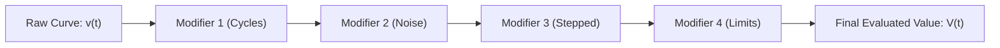

# Blender-ELT Animation System: Curve Evaluation & Playback Engine

**Document Version:** 1.0.0  
**Target Packages:** `@blender-elt/animation`  
**Status:** Mathematical & Algorithmic Reference

---

## 1. Mathematical Formulation of Cubic Bezier Curves

For a segment between keyframe $K_0 = (t_0, v_0)$ and keyframe $K_1 = (t_1, v_1)$, the 2D curve is defined by four control points:

- $\mathbf{P}_0 = (t_0, v_0)$
- $\mathbf{P}_1 = (t_0 + \Delta t_{0R}, v_0 + \Delta v_{0R})$ (Right handle of $K_0$)
- $\mathbf{P}_2 = (t_1 + \Delta t_{1L}, v_1 + \Delta v_{1L})$ (Left handle of $K_1$)
- $\mathbf{P}_3 = (t_1, v_1)$

Where $\mathbf{B}(u) = (B_t(u), B_v(u))$ for parameter $u \in [0, 1]$:

$$\mathbf{B}(u) = (1-u)^3 \mathbf{P}_0 + 3(1-u)^2 u \mathbf{P}_1 + 3(1-u) u^2 \mathbf{P}_2 + u^3 \mathbf{P}_3$$

Expanding into component Bernstein polynomials:

$$B_t(u) = (1-u)^3 t_0 + 3(1-u)^2 u t_1^{\text{ctrl}} + 3(1-u) u^2 t_2^{\text{ctrl}} + u^3 t_1$$

$$B_v(u) = (1-u)^3 v_0 + 3(1-u)^2 u v_1^{\text{ctrl}} + 3(1-u) u^2 v_2^{\text{ctrl}} + u^3 v_1$$

---

## 2. Solving for Time $t$ via Newton-Raphson Iteration

To evaluate the scalar value $v$ at an arbitrary frame $t \in [t_0, t_1]$:

### 2.1 First Derivative with respect to $u$:

$$B'_t(u) = 3(1-u)^2 (t_1^{\text{ctrl}} - t_0) + 6(1-u) u (t_2^{\text{ctrl}} - t_1^{\text{ctrl}}) + 3u^2 (t_1 - t_2^{\text{ctrl}})$$

### 2.2 Numerical Iteration:

1. **Initial Estimate:**
   $$u_0 = \frac{t - t_0}{t_1 - t_0}$$
2. **Iterative Step ($k = 0, 1, \dots, N\_{\max}$):**
   $$u_{k+1} = u_k - \frac{B_t(u_k) - t}{B'_t(u_k)}$$
3. **Bisection Fallback:** If $|B'_t(u_k)| < \varepsilon$ (vanishing derivative) or $u_{k+1} \notin [0, 1]$, the algorithm automatically switches to binary bisection:
   $$u_{\text{mid}} = \frac{u_{\text{low}} + u_{\text{high}}}{2}$$
4. **Value Evaluation:** Once $|B_t(u^*) - t| \le 10^{-6}$, evaluate the curve value:
   $$v(t) = B_v(u^*)$$

---

## 3. Automatic Tangent Slope Calculation (Catmull-Rom & Clamping)

When `handleType` is set to `'auto'`, the tangent slope $S_i$ at keyframe $K_i$ is computed from its predecessor $K_{i-1}$ and successor $K_{i+1}$:

$$S_i = \frac{v_{i+1} - v_{i-1}}{t_{i+1} - t_{i-1}}$$

The handle offsets are partitioned symmetrically over the time spans:

- **Left Handle:** $\Delta t_L = -\frac{t_i - t_{i-1}}{3}, \quad \Delta v_L = S_i \cdot \Delta t_L$
- **Right Handle:** $\Delta t_R = \frac{t_{i+1} - t_i}{3}, \quad \Delta v_R = S_i \cdot \Delta t_R$

**Overshoot Clamping (Fritsch-Carlson):** If adjacent keyframe values are monotonic, handles are clamped so that local extrema are not artificially introduced. If $v_i = v_{i+1}$, the outgoing slope is flattened ($S_i = 0$).

---

## 4. Extrapolation Modes

For frames $t < t_0$ (before the first keyframe) or $t > t_n$ (after the last keyframe):

| Extrapolation Mode  | Formulation for $t > t_n$                                                                                | Use Case                                         |
| :------------------ | :------------------------------------------------------------------------------------------------------- | :----------------------------------------------- |
| **`constant`**      | $v(t) = v_n$                                                                                             | Default hold behavior                            |
| **`linear`**        | $v(t) = v_n + (t - t_n) \cdot \frac{\Delta v_{nR}}{\Delta t_{nR}}$                                       | Continuous velocity projection                   |
| **`cyclic`**        | Period $T = t_n - t_0$<br>$t' = t_0 + ((t - t_0) \pmod T)$<br>$v(t) = v(t')$                             | Repeating stationary loops (idles, blinking)     |
| **`cyclic_offset`** | $k = \lfloor \frac{t - t_0}{T} \rfloor, \quad \Delta V = v_n - v_0$<br>$v(t) = v(t') + k \cdot \Delta V$ | Locomotion walk/run cycles with forward progress |

---

## 5. F-Curve Modifier Pipeline

Modifiers are evaluated sequentially after base curve sampling:



1. **Cycles Modifier:** Maps outer time back into the active cycle range before underlying sampling.
2. **Noise Modifier:** Adds pseudo-random procedural shake:
   $$\Delta v = \text{amplitude} \cdot \sin(\text{scale} \cdot t + \text{phase}) \cdot \text{influence}$$
3. **Stepped Modifier:** Quantizes time for stop-motion or anime framerates:
   $$t_{\text{step}} = \left\lfloor \frac{t - \text{offset}}{\text{stepSize}} \right\rfloor \cdot \text{stepSize} + \text{offset}$$
4. **Limits Modifier:** Clamps the resulting value within $[\text{minY}, \text{maxY}]$.

---

## 6. High-Resolution Playback Engine (`requestAnimationFrame`)

The `PlaybackEngine` in `@blender-elt/animation` eliminates JavaScript `setInterval` timer drift and background throttling using a delta-time accumulator pattern:

```typescript
public start(): void {
  if (this.animFrameId !== null) return;
  this.lastTimeMs = performance.now();
  this.accumulatorSec = 0;
  this.animFrameId = requestAnimationFrame(this.loop.bind(this));
}

private loop(currentTimeMs: number): void {
  const deltaSec = Math.min((currentTimeMs - this.lastTimeMs) / 1000, 0.1);
  this.lastTimeMs = currentTimeMs;

  const state = this.store.getState();
  if (!state.isPlaying) {
    this.stop();
    return;
  }

  const frameDurationSec = 1 / state.fps;
  this.accumulatorSec += deltaSec;

  while (this.accumulatorSec >= frameDurationSec) {
    this.store.getState().tick();
    this.accumulatorSec -= frameDurationSec;

    if (!this.store.getState().isPlaying) {
      this.stop();
      return;
    }
  }

  this.animFrameId = requestAnimationFrame(this.loop.bind(this));
}
```

### Performance Characteristics:

- **0% Cumulative Drift:** Tracks real elapsed wall-clock seconds.
- **Spike Clamping:** Caps frame spikes to $100\text{ms}$ when returning from minimized windows.
- **Adaptive Catch-Up:** Drains accumulated time in exact whole frame increments without fractional jitter.
