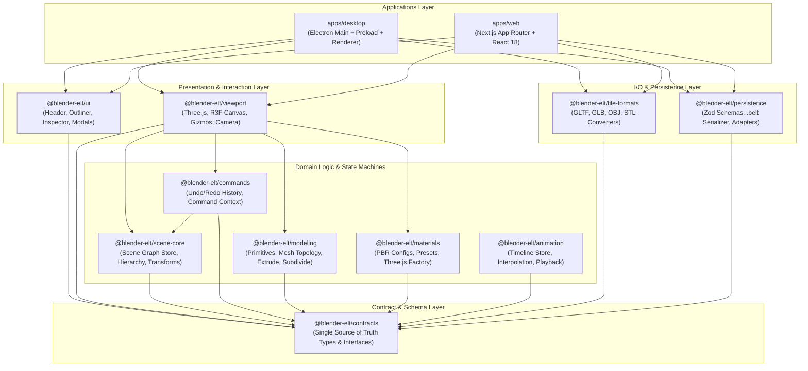

# Blender-ELT Code Reuse & Architecture Audit

## 1. Executive Summary & Audit Objectives

The **Blender-ELT** project is designed as a modular, lightweight 3D suite inspired by Blender. The monorepo architecture decouples domain logic, scene graph state, procedural modeling, shader materials, commands, and viewport rendering into headless packages under `packages/*`.

This audit assesses the feasibility and strategy for maximizing code reuse between the existing desktop application (`apps/desktop`) and the web application (`apps/web` powered by Next.js App Router).

### Key Findings

1. **Core Domain & Math (100% Reusable)**: `@blender-elt/contracts`, `@blender-elt/scene-core`, `@blender-elt/commands`, `@blender-elt/modeling`, `@blender-elt/materials`, and `@blender-elt/animation` are purely platform-agnostic TypeScript packages. They have zero dependencies on Node.js or Electron and execute seamlessly in browser runtimes.
2. **Visual & UI Systems (100% Reusable in Client Runtimes)**: `@blender-elt/ui` and `@blender-elt/viewport` are React and React Three Fiber components. They require standard browser DOM and WebGL contexts (`'use client'` directive in Next.js).
3. **Storage & Persistence (Adaptable)**: `@blender-elt/persistence` defines schemas, serialization, and storage abstractions (`IStorageAdapter`). However, `storage.ts` imports Node.js `fs` and `path` for `FileStorageAdapter`. In browser and Next.js environments, bundler aliasing/shims (`node-shims.ts`) or browser-native adapters (`LocalStorageAdapter`, `IndexedDBStorageAdapter`) are utilized.
4. **File Import / Export (Adaptable / Reusable)**: `@blender-elt/file-formats` supports GLTF, GLB, OBJ, and STL. Its Three.js exporters and loaders operate in browser memory (ArrayBuffer/Blob). `polyfill.ts` contains Node.js shims for headless tests; standard browsers use native `FileReader` and Web APIs.
5. **Platform Boundaries**: Desktop-specific Electron APIs (`desktop-ipc.ts`, `apps/desktop/src/main`, `apps/desktop/src/preload`) are isolated. The desktop renderer already implements graceful browser fallbacks for file dialogs and blob downloads.

---

## 2. Architecture & Monorepo Topology



---

## 3. Package-by-Package Classification

| Package                         | Classification                   | Dependencies                                                           | Browser Portability Notes                                                                                                                                                                                                                             |
| :------------------------------ | :------------------------------- | :--------------------------------------------------------------------- | :---------------------------------------------------------------------------------------------------------------------------------------------------------------------------------------------------------------------------------------------------- |
| **`@blender-elt/contracts`**    | **Reusable directly**            | None (Types only)                                                      | Single source of truth. Zero runtime dependencies, 100% universal across Node, Electron, and Web.                                                                                                                                                     |
| **`@blender-elt/scene-core`**   | **Reusable directly**            | `three`, `zustand`                                                     | Pure state graph and math logic. No DOM or Node.js dependencies. Implements tree traversal, world transform computation, and scene lifecycle.                                                                                                         |
| **`@blender-elt/commands`**     | **Reusable directly**            | `@blender-elt/scene-core`, `@blender-elt/contracts`                    | Implements command pattern and undo/redo stacks. Independent of any platform or rendering framework.                                                                                                                                                  |
| **`@blender-elt/modeling`**     | **Reusable directly**            | `three`, `@blender-elt/contracts`                                      | Procedural primitive generators (cube, sphere, cylinder, cone, plane, torus), mesh topology half-edge representation, and mesh operations (extrude, subdivide, bevel). Pure math and array buffers.                                                   |
| **`@blender-elt/materials`**    | **Reusable directly**            | `three`, `@blender-elt/contracts`                                      | PBR material configurations, preset dictionaries, and Three.js material factory. Pure in-memory shaders and material definitions.                                                                                                                     |
| **`@blender-elt/animation`**    | **Reusable directly**            | `zustand`, `@blender-elt/contracts`                                    | Timeline store, property tracks, keyframe evaluation, interpolation math (linear, step, ease-in-out), and playback timers.                                                                                                                            |
| **`@blender-elt/ui`**           | **Reusable directly** _(Client)_ | `react`, `clsx`, `tailwind-merge`, `lucide-react`                      | Blender-styled React components (Header, MenuBar, OutlinerPanel, PropertiesPanel, TimelineBar, DockLayout, Modals, CommandPalette). Requires `'use client'` in Next.js.                                                                               |
| **`@blender-elt/viewport`**     | **Reusable directly** _(Client)_ | `@react-three/fiber`, `@react-three/drei`, `three`, `react`, `zustand` | Interactive 3D WebGL canvas, camera manager (orbit/pan/zoom, viewpoints), transform gizmos, grid floor, coordinate axes, and scene renderers. Requires client-only dynamic loading (`ssr: false`).                                                    |
| **`@blender-elt/file-formats`** | **Adaptable**                    | `three`, `zod`, `@blender-elt/contracts`                               | Exporters and loaders for GLTF, GLB, OBJ, and STL. Browser-compatible via in-memory Blobs and ArrayBuffers. `polyfill.ts` contains fallback code referencing `Buffer`; requires bundler awareness.                                                    |
| **`@blender-elt/persistence`**  | **Adaptable**                    | `zod`, `@blender-elt/contracts`, `fs`, `path`                          | `schema.ts` and `serializer.ts` are 100% universal. `storage.ts` imports Node `fs` and `path` for `FileStorageAdapter`. Requires webpack alias / shim in web bundlers, alongside browser adapters (`LocalStorageAdapter`, `IndexedDBStorageAdapter`). |
| **`apps/desktop`**              | **Platform-specific**            | `electron`, Node.js                                                    | Desktop Electron shell (Main process window management, native menus, IPC bridge). Renderer logic and file fallback utilities provide reusable patterns for `apps/web`.                                                                               |

---

## 4. Node.js & Electron Dependencies Audit

A comprehensive codebase audit was conducted to locate all Node.js and Electron specific imports:

```
packages/file-formats/src/utils/polyfill.ts:57   -> Buffer.from(buf).toString('base64')
packages/persistence/src/storage.ts:1           -> import { promises as fs } from 'fs';
packages/persistence/src/storage.ts:2           -> import { dirname } from 'path';
apps/desktop/src/main/index.ts:1                -> import { app, BrowserWindow, ipcMain, dialog, Menu, shell } from 'electron';
apps/desktop/src/main/index.ts:2                -> import { join } from 'path';
apps/desktop/src/main/index.ts:3                -> import { promises as fs } from 'fs';
apps/desktop/src/preload/index.ts:1             -> import { contextBridge, ipcRenderer } from 'electron';
apps/desktop/src/renderer/src/shims/node-shims.ts -> Provides mock fs/path for electron-vite renderer
```

### Analysis of Shims & Bundler Interaction

1. **`packages/persistence/src/storage.ts`**:
   - `FileStorageAdapter` provides file reading and writing on desktop using Node `fs.promises`.
   - Because `packages/persistence/src/index.ts` exports `* from './storage.js'`, any bundler (Vite or Webpack) importing `@blender-elt/persistence` attempts to resolve `fs` and `path`.
   - **Desktop Resolution**: In `apps/desktop/electron.vite.config.ts`, Vite defines aliases for `fs` and `path` pointing to `apps/desktop/src/renderer/src/shims/node-shims.ts`.
   - **Web Resolution**: In `apps/web/next.config.mjs`, Webpack must define aliases for `fs` and `path` pointing to `apps/web/src/shims/node-shims.ts`, and set `fallback: { fs: false, path: false, crypto: false }` for client bundles.

2. **`packages/file-formats/src/utils/polyfill.ts`**:
   - Implements `ensureNodePolyfills()` to support running Three.js GLTFExporter in headless Node.js test environments (such as Vitest).
   - In browser environments, `globalThis.FileReader` and `globalThis.ProgressEvent` are natively defined, so the polyfill block is skipped at runtime.
   - However, Webpack parses the static AST and detects `Buffer.from`. In Webpack 5, `Buffer` is not globally available by default. Next.js can safely handle this when `polyfill.ts` is transpiled through `transpilePackages: ['@blender-elt/file-formats']`.

3. **`apps/desktop/src/renderer/src/utils/fileOperations.ts`**:
   - Demonstrates the ideal dual-mode architecture:
     - Checks `if (window.electronBridge || window.electronAPI)`:
       - True: delegates to Electron IPC for native file dialogues and file system operations.
       - False: falls back to browser `<input type="file">`, `Blob`, `URL.createObjectURL`, and `<a download>`.
   - This exact utility pattern is directly portable to `apps/web`.

---

## 5. Next.js Integration Guidelines for `apps/web`

To guarantee seamless integration of `@blender-elt/*` packages into `apps/web` without build or SSR hydration errors, the following configuration practices are mandated:

### 5.1 Next.js Configuration (`next.config.mjs`)

- **`transpilePackages`**: Include all workspace packages (`@blender-elt/*`) and Three.js peer dependencies (`three`, `@react-three/fiber`, `@react-three/drei`).
- **Webpack Aliasing & Fallbacks**:
  ```javascript
  webpack: (config, { isServer }) => {
    config.resolve.alias = {
      ...config.resolve.alias,
      fs: path.resolve(__dirname, 'src/shims/node-shims.ts'),
      path: path.resolve(__dirname, 'src/shims/node-shims.ts'),
    };
    if (!isServer) {
      config.resolve.fallback = {
        ...config.resolve.fallback,
        fs: false,
        path: false,
        crypto: false,
      };
    }
    return config;
  };
  ```

### 5.2 Server-Side Rendering (SSR) & Dynamic Imports

- **Viewport Canvas**: WebGL contexts and Three.js canvas components cannot execute on the Node.js server. Any component rendering `@blender-elt/viewport` must:
  - Reside in a file with `'use client';`
  - Be imported dynamically with `ssr: false` when mounted in Next.js page components:
    ```typescript
    const ViewportContainer = dynamic(
      () => import('@blender-elt/viewport').then((mod) => mod.ViewportContainer),
      { ssr: false },
    );
    ```

### 5.3 Web Storage Adapters

- Implement `IndexedDBStorageAdapter` adhering to `IStorageAdapter` for persistent browser project storage.
- Provide auto-save triggers into IndexedDB every 30 seconds or upon command execution.
- Retain `LocalStorageAdapter` for user settings, UI panel layouts, and recent project metadata.
