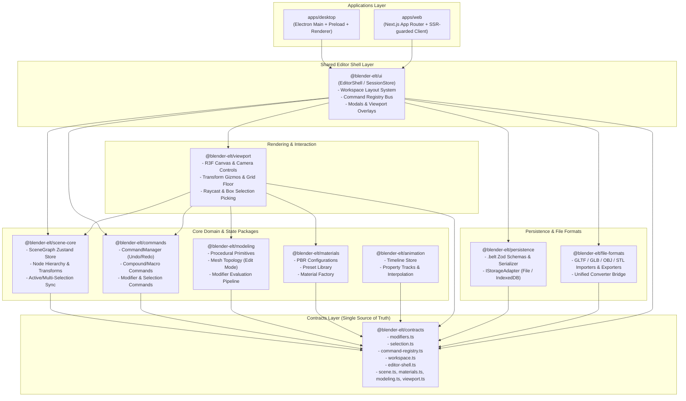

# Blender-ELT Architectural Blueprint & Contracts Specification (Milestones 1 & 2)

## 1. Executive Summary & Objectives

This document establishes the official architectural blueprints, contract extensions, and integration schemas for **Milestone 1** and **Milestone 2** of the **Blender-ELT** 3D suite expansion across Desktop (Electron) and Web (Next.js App Router).

Following the core architectural principles defined in [`AGENTS.md`](file:///d:/data/Doc/.content/blender-elt/AGENTS.md):

1. **Single Source of Truth (`@blender-elt/contracts`)**: All domain interfaces, modifier schemas, selection models, command metadata, workspace layout descriptors, and platform bridges are defined strictly in `packages/contracts`.
2. **Right-Handed, Y-Up Coordinate System**: Angles in radians internally, Three.js & glTF standard coordinates ($+X$ Right, $+Y$ Up, $+Z$ Forward).
3. **Vanilla State Machines**: Decoupled from React or DOM dependencies to ensure headless execution and 100% testability.
4. **Command Pattern & Undo/Redo**: Every scene mutation is an encapsulated, reversible `ICommand`.
5. **Universal Web & Desktop Parity**: Unified editor shell architecture eliminating code duplication between `apps/desktop` and `apps/web`.

---

## 2. Monorepo Dependency & Layer Architecture



---

## 3. Milestone 1: Unified Domain Contracts Specification

Milestone 1 extends `@blender-elt/contracts` to provide comprehensive schemas for all advanced 3D workflows:

### 3.1 Modifiers Schema (`packages/contracts/src/modifiers.ts`)

Modifiers in Blender-ELT are non-destructive geometry operations arranged in an ordered stack on `MeshNode`.

```typescript
export type ModifierType =
  | 'subdivision'
  | 'mirror'
  | 'array'
  | 'bevel'
  | 'solidify'
  | 'boolean'
  | 'displace'
  | 'decimate'
  | 'wireframe'
  | 'smooth';

export interface BaseModifier {
  id: string;
  name: string;
  type: ModifierType;
  enabled: boolean;
  showInViewport: boolean;
  showInRender: boolean;
  showInEditMode?: boolean;
  order: number;
}
```

#### Modifier Configurations (Discriminated Union):

1. **SubdivisionModifier**: Catmull-Clark and Simple subdivision surface with viewport and render levels.
2. **MirrorModifier**: Axis-aligned mirroring (X, Y, Z) with merge threshold and clipping bounds.
3. **ArrayModifier**: Linear object duplication with relative or constant 3D offsets and count.
4. **BevelModifier**: Edge and vertex beveling with custom segments, widths, and profile curvature.
5. **SolidifyModifier**: Hollow-to-solid mesh extrusion with shell thickness and rim generation.
6. **BooleanModifier**: Constructive Solid Geometry (Union, Difference, Intersect) referencing target mesh nodes.
7. **DisplaceModifier**: Normal-based or vector displacement using numerical heightmaps or procedural textures.
8. **DecimateModifier**: Polygon reduction algorithms (Collapse, Unsubdivide, Planar) with target ratio.
9. **WireframeModifier**: Shell conversion of mesh faces into wireframe struts.
10. **SmoothModifier**: Laplacian and simple vertex coordinate smoothing.

#### Evaluation Pipeline Contract:

```typescript
export interface ModifierEvaluationResult {
  geometry: IMeshData;
  appliedModifierIds: string[];
  durationMs: number;
}

export interface IModifierEvaluator {
  evaluate(
    sourceGeometry: IMeshData,
    modifiers: ModifierConfig[],
  ): Promise<ModifierEvaluationResult> | ModifierEvaluationResult;
}
```

---

### 3.2 Selection Model (`packages/contracts/src/selection.ts`)

Blender's multi-level selection system requires clean separation between object-level hierarchy selection and edit-mode sub-element selection:

```typescript
export type SelectionMode = 'set' | 'add' | 'subtract' | 'invert';

export type PivotPoint =
  'bounding-box-center' | 'median-point' | 'individual-origins' | '3d-cursor' | 'active-element';

export interface Cursor3D {
  position: Vector3;
  rotation: Euler;
}

export interface ObjectSelectionState {
  activeNodeId: string | null; // Primary node (yellow outline in Blender)
  selectedNodeIds: string[]; // All selected nodes (orange outline)
  selectionOrder: string[]; // Chronological selection sequence
}

export interface EditMeshSelectionState {
  elementModes: EditElementMode[]; // Simultaneous mask: ['vertex', 'edge', 'face']
  selectedVertexIndices: number[];
  selectedEdgeIndices: number[];
  selectedFaceIndices: number[];
  activeVertexIndex: number | null;
  activeEdgeIndex: number | null;
  activeFaceIndex: number | null;
}

export interface UnifiedSelectionModel {
  object: ObjectSelectionState;
  edit: EditMeshSelectionState;
  pivotPoint: PivotPoint;
  cursor3D: Cursor3D;
}
```

---

### 3.3 Command Registry & Action System (`packages/contracts/src/command-registry.ts`)

Decoupled command execution bus connecting UI triggers (header menus, shortcut keys, command palette, context menus) to undoable commands:

```typescript
export type CommandCategory =
  | 'object'
  | 'mesh'
  | 'edit'
  | 'transform'
  | 'view'
  | 'file'
  | 'select'
  | 'modifier'
  | 'material'
  | 'animation'
  | 'system';

export interface KeyBinding {
  key: string; // e.g. 'g', 'r', 's', 'x', 'Delete'
  ctrl?: boolean;
  shift?: boolean;
  alt?: boolean;
  meta?: boolean;
  scope?: ViewportMode | 'global';
  description?: string;
}

export interface CommandActionDefinition<TPayload = unknown> {
  id: string;
  name: string;
  description?: string;
  category: CommandCategory;
  icon?: string;
  shortcuts?: KeyBinding[];
  menuPath?: string[];
  keywords?: string[];
  isAvailable?: (ctx: CommandContext) => boolean;
  execute: (ctx: CommandContext, payload?: TPayload) => Promise<void> | void;
}

export interface ICommandRegistry {
  register(action: CommandActionDefinition): void;
  registerBatch(actions: CommandActionDefinition[]): void;
  unregister(id: string): void;
  get(id: string): CommandActionDefinition | undefined;
  getAll(): CommandActionDefinition[];
  getByCategory(category: CommandCategory): CommandActionDefinition[];
  getAvailable(ctx: CommandContext): CommandActionDefinition[];
  search(query: string, ctx?: CommandContext): CommandActionDefinition[];
  findActionByShortcut(
    event: {
      key: string;
      ctrlKey?: boolean;
      shiftKey?: boolean;
      altKey?: boolean;
      metaKey?: boolean;
    },
    mode?: ViewportMode,
  ): CommandActionDefinition | undefined;
}

export interface ICompoundCommand extends ICommand {
  type: 'compound';
  commands: ICommand[];
}
```

---

### 3.4 Workspace Layout System (`packages/contracts/src/workspace.ts`)

Blender-like workspace layouts using a recursive binary split tree supporting flexible docking and area resizing:

```typescript
export type EditorAreaType =
  | 'viewport-3d'
  | 'outliner'
  | 'properties'
  | 'timeline'
  | 'shader-editor'
  | 'uv-editor'
  | 'graph-editor'
  | 'asset-browser'
  | 'console';

export type SplitDirection = 'horizontal' | 'vertical';

export interface DockSplitNode {
  id: string;
  type: 'split';
  direction: SplitDirection;
  ratio: number; // 0.05 to 0.95
  first: DockAreaNode;
  second: DockAreaNode;
}

export interface DockPanelNode {
  id: string;
  type: 'panel';
  areaType: EditorAreaType;
  activeTabId?: string;
  tabs?: EditorAreaType[];
  collapsed?: boolean;
  minWidth?: number;
  minHeight?: number;
}

export type DockAreaNode = DockSplitNode | DockPanelNode;

export interface WorkspaceDefinition {
  id: string;
  name: string; // 'Layout', 'Modeling', 'Sculpting', 'Shading', 'Animation'
  icon?: string;
  defaultMode: ViewportMode;
  layout: DockAreaNode;
  viewportConfig?: Partial<ViewportConfig>;
  order: number;
}
```

---

### 3.5 Platform Bridge & Editor Shell (`packages/contracts/src/editor-shell.ts`)

Abstracts native Electron desktop facilities vs browser Web facilities behind a single typed bridge:

```typescript
export type PlatformType = 'desktop' | 'web';

export interface PlatformCapabilities {
  nativeMenus: boolean;
  fileSystemAccess: boolean;
  windowControls: boolean;
  systemDialogs: boolean;
  offlineStorage: boolean;
}

export interface PlatformFileSystemBridge {
  saveProject(
    doc: ProjectDocument,
    filePath?: string,
  ): Promise<{ success: boolean; filePath?: string; error?: string }>;
  openProject(
    filePath?: string,
  ): Promise<{ success: boolean; document?: ProjectDocument; filePath?: string; error?: string }>;
  exportScene(payload: ExportPayload): Promise<ExportResult>;
  importScene(
    options?: Partial<ImportOptions>,
  ): Promise<{ success: boolean; document?: ProjectDocument; error?: string }>;
}

export interface IPlatformBridge {
  platform: PlatformType;
  capabilities: PlatformCapabilities;
  fileSystem: PlatformFileSystemBridge;
  window?: {
    minimize?(): void;
    maximize?(): void;
    close?(): void;
    setTitle?(title: string): void;
  };
  clipboard: {
    readText(): Promise<string>;
    writeText(text: string): Promise<void>;
  };
  notifications?: {
    notify(message: string, type?: 'info' | 'warning' | 'error' | 'success'): void;
  };
}
```

---

## 4. Milestone 2: Shared Editor Shell & System Integration

### 4.1 Eliminating Application Shell Duplication

Currently, `apps/desktop/src/renderer/src/App.tsx` (794 lines) and `apps/web/src/app/editor/[projectId]/EditorClient.tsx` (942 lines) replicate virtually identical state wiring:

- SceneStore instantiation and external subscription
- CommandManager undo/redo state synchronization
- Viewport interaction mode and shading toggles
- Timeline playback loops and frame stepping
- Modal dialog states (About, Preferences, Shortcuts, CommandPalette)

#### Unified Architecture:

1. **`packages/ui/src/shell/EditorShell.tsx`**:
   - Accepts an `IPlatformBridge` instance and initial project options.
   - Hosts the `DockLayout`, `Header`, `MenuBar`, `OutlinerPanel`, `PropertiesPanel`, `TimelineBar`, and `CommandPalette`.
   - Delegates platform-dependent file dialogs, window controls, and alerts to the platform bridge.
2. **Desktop Shell Integration**:
   - `apps/desktop/src/renderer/src/App.tsx` instantiates `createDesktopPlatformBridge()` and passes it to `<EditorShell bridge={desktopBridge} />`.
3. **Web Shell Integration**:
   - `apps/web/src/app/editor/[projectId]/EditorClient.tsx` instantiates `createWebPlatformBridge()` (with IndexedDB auto-save and HTML5 file blobs) and mounts `<EditorShell bridge={webBridge} />`.

### 4.2 Modifier Stack Runtime Pipeline

1. `MeshNode` maintains an ordered array of `ModifierConfig` objects.
2. The modifier stack evaluation pipeline runs in `@blender-elt/modeling/src/modifiers`:
   - Evaluates modifiers sequentially from index `0` to `n - 1`.
   - Caches intermediate evaluated geometries when modifier parameters remain unchanged.
   - Generates non-destructive Three.js `BufferGeometry` for the viewport renderer.
3. Providing standard modifier commands:
   - `AddModifierCommand`, `RemoveModifierCommand`, `UpdateModifierCommand`, `ReorderModifierCommand`, `ApplyModifierCommand` (collapses modifier destructively into raw geometry).

### 4.3 Multi-Selection & 3D Cursor Integration

1. **Selection Sync**:
   - Updating `@blender-elt/scene-core` to maintain `activeNodeId` (primary target) alongside `selectedNodeIds` (set of all selections).
   - Viewport transform gizmo calculates the pivot point according to active `PivotPoint` setting (Median point of all selected objects, Active object origin, or 3D Cursor).
2. **3D Cursor**:
   - Rendered as an interactive red/white crosshair gizmo in the 3D viewport.
   - Positionable via `Shift + Right Click` or the Cursor tool.
   - Provides origin snapping for newly spawned primitives.

---

## 5. Verification & Testing Matrix

To guarantee strict compliance with monorepo standards before any pull request:

| Step                     | Command                                          | Verification Invariant                                                                                                                                              |
| :----------------------- | :----------------------------------------------- | :------------------------------------------------------------------------------------------------------------------------------------------------------------------ |
| 1. Contract Typing       | `pnpm --filter @blender-elt/contracts typecheck` | 0 errors; strict compiler compliance with clean `.d.ts` generation.                                                                                                 |
| 2. Monorepo Build        | `pnpm build`                                     | All packages (`contracts`, `scene-core`, `commands`, `modeling`, `materials`, `viewport`, `ui`, `persistence`, `file-formats`) and apps build with 0 bundle errors. |
| 3. Unit Tests            | `pnpm test`                                      | Vitest passes 100% across all packages.                                                                                                                             |
| 4. Cross-Platform Parity | `apps/desktop` & `apps/web` test runs            | Identical command execution, undo/redo stacks, and serialization behavior.                                                                                          |
