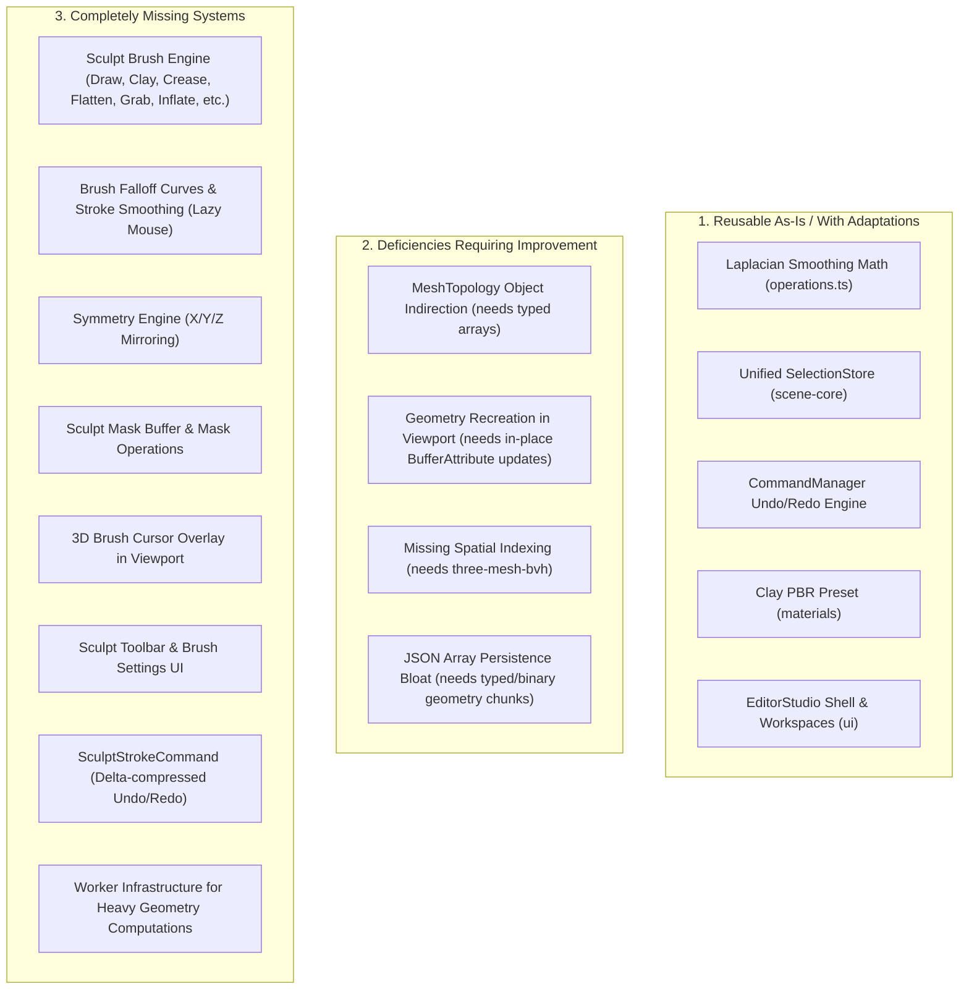

# Blender-ELT Professional Sculpt Mode: Repository & Architecture Audit

**Repository:** `blender-elt` (Turbo-orchestrated pnpm monorepo)  
**Initiative:** Professional Sculpt Mode  
**Auditor:** `@auditor` (Swarm Agent)  
**Date:** 2026-11-12

---

## 1. Executive Summary

This audit provides an exhaustive evaluation of the **Blender-ELT** codebase to inform the architectural design and implementation plan for the **Professional Sculpt Mode** initiative.

Blender-ELT possesses a clean, modular, headless monorepo structure decoupled from Electron and DOM specifics across core domain logic. However, while **Sculpt Mode** is referenced in enum contracts (`ViewportMode = 'sculpt'`) and in the UI workspace layout tabs (`workspaces.ts`), there is currently **no functional sculpting engine, no brush algorithms, no sculpt stroke pointer handler, no spatial indexing (BVH/Octree), and no sculpt undo commands**.

This document details the current state across 11 key architectural domains, identifies capabilities to reuse and overhaul, and presents a phased, non-breaking implementation roadmap starting with Milestone 1.

---

## 2. Exhaustive Investigation Across 11 Key Domains

### 2.1 Scene and Editable Mesh Data Structures

- **Current Contracts (`packages/contracts/src/modeling.ts` & `scene.ts`):**
  - Raw mesh data is specified as `IMeshData`:
    ```typescript
    export interface IMeshData {
      vertices: Float32Array | number[];
      normals?: Float32Array | number[];
      uvs?: Float32Array | number[];
      indices?: Uint32Array | Uint16Array | number[];
    }
    ```
  - `MeshNode` in `contracts/src/scene.ts` contains `geometryId: string`, `primitiveType?: string`, and `modifiers?: ModifierConfig[]`. Custom mesh data is optionally embedded in `metadata.meshData`.
  - Edit mode elements are modeled via individual TypeScript interfaces: `VertexData` (`{ index, position: Vector3, normal?, uv?, selected? }`), `EdgeData`, and `FaceData`.
- **Topology in `packages/modeling/src/topology/mesh-topology.ts`:**
  - `MeshTopology` converts `IMeshData` into object arrays (`this.vertices: VertexData[]`, `this.edges: EdgeData[]`, `this.faces: FaceData[]`).
  - **Limitation for Sculpting:** Individual object allocations for tens or hundreds of thousands of vertices induce severe garbage collection (GC) pressure and pointer indirection. Sculpting requires contiguous typed array buffers (`Float32Array` for positions and normals).
- **Masks Representation:**
  - In `contracts/src/selection.ts`, the term "mask" exists solely as `elementModes: EditElementMode[]` (filtering edit mode vertex/edge/face selection).
  - **Zero vertex sculpt mask representation exists** (no scalar mask weight buffer $0.0 \dots 1.0$, mask brush settings, or mask clipping contracts).
- **`packages/sculpting`:** Does not yet exist in the monorepo.

### 2.2 Three.js Rendering & R3F Integration (`packages/viewport`)

- **Mesh Rendering (`renderer/MeshObject.tsx`):**
  - Meshes are rendered using React Three Fiber `<mesh geometry={geometry} material={material} />`.
  - `geometry` is constructed via `useMemo` from `node.metadata.meshData` (or `createPrimitiveGeometry(node.primitiveType)`).
  - **Critical Performance Issue:** On every `node.metadata` update, `useMemo` disposes the existing `BufferGeometry` and allocates a brand new one. In dynamic sculpting at 60–120 FPS, this causes catastrophic VRAM reallocations, frame drops, and pipeline stalls.
  - In-place buffer updates (`positionAttribute.needsUpdate = true`, `geometry.computeVertexNormals()`, dirty range updates) are not implemented.
- **Raycasting:**
  - Currently relies strictly on React Three Fiber's built-in synthetic event raycasting (`onClick`, `onPointerOver`, `onPointerOut`) and `onPointerMissed` on `<Canvas>`.
  - No spatial indexing or ray acceleration (such as `three-mesh-bvh`) is present on meshes. On dense meshes (50k–500k vertices), linear raycasting against every triangle drops frame rates severely.
- **Navigation Interference:**
  - `OrbitControls` in `camera/NavigationControls.tsx` is only disabled when `isGizmoDragging` is true. Sculpt pointer drags on the mesh surface would unintentionally rotate or pan the camera unless suppressed.

### 2.3 Existing Geometry Operations (`packages/modeling`)

- **`packages/modeling/src/topology/operations.ts`:**
  - Implements `extrude`, `subdivide` (quad split), `smooth` (Laplacian smoothing on vertex neighbors via edge adjacency), `flip-normals`, and `delete`.
  - The Laplacian smoothing algorithm provides a direct algorithmic foundation for the **Smooth brush** and **Relax brush**.
- **`packages/modeling/src/modifiers/evaluator.ts`:**
  - `ModifierStackEvaluator` executes an ordered stack of modifiers: `array`, `mirror`, `solidify`, `wireframe`, `subdivision`, `smooth`.

### 2.4 Object Selection & Active-Object Management

- **`packages/scene-core`:**
  - `SceneGraphState` (`store.ts`) manages `selectedNodeIds: string[]` and `activeNodeId: string | null`.
  - `SelectionStore` (`selection-store.ts`) provides full `UnifiedSelectionModel`, tracking active object, 3D cursor (`Cursor3D`), transform pivot points, and sub-element selection.
- **`packages/ui`:**
  - `EditorStudio.tsx` binds `sceneStore` selection directly to `OutlinerPanel` and `PropertiesPanel`.
  - The active `MeshNode` is already properly identified across the UI and viewport.

### 2.5 Viewport Pointer & Keyboard Input Handling

- **Pointer Events:**
  - Handled via R3F mesh event props. No pointer capture API (`setPointerCapture`), pressure sensitivity handling (`PointerEvent.pressure`), or stroke interpolation (Bézier/spline interpolation between mouse move events) exists.
- **Keyboard Hotkeys (`packages/viewport/src/hooks/useViewportHotkeys.ts`):**
  - Standard hotkeys mapped: `G` (translate), `R` (rotate), `S` (scale), `X`/`Y`/`Z` (axis constraints), `F` (focus camera), `Shift+Tab` (snapping), `Numpad` views.
  - **Hotkey Collisions:** In sculpt mode, `F` is the standard Blender hotkey for interactive brush radius adjustment, and `Shift+F` for brush strength. Currently, `F` triggers camera framing (`focusSelection()`).
  - Missing modifier keys for sculpting: `Ctrl` (invert brush / subtract) and `Shift` (instant switch to Smooth brush).

### 2.6 Command Registry & Undo/Redo (`packages/commands`)

- **`CommandManager` & `CommandRegistry`:**
  - Robust command pattern architecture with `execute()`, `undo()`, `redo()`, and compound/macro support.
  - Existing commands: `CreateObject`, `DeleteObject`, `TransformObject`, `DuplicateObject`, `ReparentObject`, `AssignMaterial`, `RenameObject`, `SetVisibility`.
- **Mesh Modifications:**
  - **Zero mesh modification commands currently exist.**
  - `TransformObjectCommand` uses deep JSON serialization (`JSON.parse(JSON.stringify(transform))`). Applying this naive approach to sculpt meshes (e.g. 100k vertices) would exhaust memory and cause multi-second GC pauses.
  - Sculpting requires a dedicated `SculptStrokeCommand` storing typed array index/displacement deltas or bounded spatial chunks.

### 2.7 Worker Infrastructure

- **Status:** **Zero worker infrastructure currently exists.**
- All modeling, topology operations, modifier evaluation, and serialization run synchronously on the main thread.
- Heavy operations (remeshing, voxel booleans, multiresolution decimation) will block UI interactions unless offloaded to Web Workers / Worker threads.

### 2.8 Project Serialization & Migrations (`packages/persistence`)

- **Format (`.belt`):**
  - Zod schema (`packages/persistence/src/schema.ts`).
  - `IMeshDataSchema` converts Float32Array into standard JSON number arrays (`Array.from(v)`).
  - Serializing dense sculpt meshes (100k–500k vertices) to JSON strings produces 20MB–100MB files and causes severe performance bottlenecks during `JSON.stringify` / `JSON.parse`.
- **Migrations:**
  - No migration runner exists; files must strictly match `version: '1.0.0'`.

### 2.9 Existing Sculpting Tools & UI

- **Current State:**
  - `ViewportMode` contains `'sculpt'`.
  - `workspaces.ts` defines the `'sculpting'` workspace.
  - `Header.tsx` includes "Sculpt Mode" in the mode selector dropdown.
  - **Missing:** No brush algorithms, no falloff curves, no brush stroke engine, no symmetry engine, no brush cursor visualizer, and no sculpt toolbar or inspector panels.

### 2.10 Desktop & Web Platform Adapters

- **Unified Architecture:**
  - Both `apps/desktop` and `apps/web` use the identical `@blender-elt/ui` `EditorStudio` component.
  - Desktop uses `createDesktopPlatformBridge()` (Electron IPC).
  - Web uses `createWebPlatformBridge()` (IndexedDB, Web File System API).
  - Core domain packages are 100% universal. Any sculpt package integrated into `@blender-elt/ui`, `packages/viewport`, and `packages/commands` will automatically achieve desktop/web parity.

### 2.11 Current Tests & Performance Benchmarks

- **Verification Health:**
  - 22 Turbo tasks passing monorepo-wide.
  - 129 Vitest tests passing across packages.
  - `@blender-elt/ui` has unit tests for `EditorStudio`.
- **Benchmarks:**
  - **Zero performance benchmarks or stress test suites exist.** No frame-rate, stroke throughput, or memory leak regression suites are configured.

---

## 3. Synthesis & Gap Analysis



---

## 4. Platform Constraints Matrix

| Consideration              | Desktop (Electron 33)                | Web Browser (Next.js 14 / Client)                       | Architectural Solution                                                 |
| :------------------------- | :----------------------------------- | :------------------------------------------------------ | :--------------------------------------------------------------------- |
| **Memory Limit**           | System RAM (multi-GB headroom)       | Browser tab limit (typically 2GB–4GB)                   | Sparse delta undo/redo buffers; avoid full-mesh copies                 |
| **Worker Threads**         | Node `worker_threads` or Web Workers | Web Workers (`new Worker()`)                            | Standard Web Worker API with transferable ArrayBuffers                 |
| **Pointer Events**         | Mouse, Wacom tablet, Stylus          | Mouse, Touch, Stylus (`PointerEvent.pressure`)          | PointerEvent standard with pressure normalization fallback             |
| **Storage & Persistence**  | Direct disk I/O (`fs.promises`)      | IndexedDB / OPFS / Blob downloads                       | `IStorageAdapter` abstraction with binary payload support              |
| **Cross-Origin Isolation** | Local `file://` / custom protocol    | Requires COOP/COEP HTTP headers for `SharedArrayBuffer` | Rely on Transferable `ArrayBuffer` rather than raw `SharedArrayBuffer` |

---

## 5. Safest Incremental Implementation Plan

### Milestone 1: Contracts, High-Performance Geometry & Core Sculpt Engine

1. **Extend `@blender-elt/contracts`**:
   - Define `SculptBrushType` (`draw`, `clay`, `clay-strips`, `crease`, `smooth`, `flatten`, `pinch`, `grab`, `snake-hook`, `inflate`, `mask`).
   - Define `BrushFalloffType` (`smooth`, `sharp`, `linear`, `constant`, `custom-curve`).
   - Define `SculptBrushConfig`, `StrokeSettings`, `SymmetryConfig`, `SculptMaskData`.
2. **High-Performance Mesh Representation (`packages/modeling` or new `packages/sculpting`)**:
   - Provide `SculptMeshBuffer`: flat `Float32Array` for positions, normals, and vertex masks.
   - Integrate spatial acceleration (`three-mesh-bvh` or spatial octree) for sub-millisecond radius queries.
3. **Core Brush Algorithms**:
   - Implement deformation algorithms for Draw, Clay, Smooth (Laplacian), Flatten, Grab, Inflate, and Mask.
   - Implement falloff curve evaluation functions.
4. **Sculpt Undo/Redo (`packages/commands`)**:
   - Implement `SculptStrokeCommand` recording sparse index/displacement deltas.

### Milestone 2: Viewport Sculpt Interaction & Visualizer

1. **In-Place Buffer Updating in `packages/viewport`**:
   - Update Three.js `BufferAttribute` in-place with `needsUpdate = true` on RAF.
   - Bounding sphere/box refit and localized normal recomputations.
2. **Brush Pointer & Stroke Controller**:
   - Suppress `OrbitControls` during active sculpt strokes.
   - Pointer capture and pressure sensitivity support.
   - Distance-based stroke spacing and stroke interpolation.
3. **3D Brush Cursor Overlay**:
   - Surface-projected circular ring visualizer oriented to mesh surface normal with radius ring and strength indicator.
4. **Symmetry Engine**:
   - Mirror stroke deformations across X/Y/Z planes simultaneously.

### Milestone 3: UI, Toolbars & Workflow Integration

1. **Sculpt Toolbar & Brush Presets (`packages/ui`)**:
   - Blender-styled vertical left toolbar for brush selection.
   - Top header/tool settings bar: Radius (px or world units), Strength, Falloff selector, Symmetry toggles.
2. **Sculpt Settings Panel**:
   - Inspector tab for advanced brush parameters, falloff curve editor, and stroke stabilization.
3. **Sculpt Mode Hotkeys**:
   - Mode-aware keybindings: `F` (brush radius modal), `Shift+F` (brush strength), `Ctrl` (subtract), `Shift` (smooth).

### Milestone 4: Masking, Dynamic Remeshing & Performance Benchmarks

1. **Sculpt Masking System**:
   - Vertex mask buffer ($0.0 \dots 1.0$), mask rendering shader overlay, mask invert/clear/blur commands.
2. **Worker Offloading & Remeshing**:
   - Offload heavy operations (remeshing, decimation) to Web Workers.
3. **Automated Test Suites & Benchmarks**:
   - Vitest unit tests for all brushes and commands.
   - Performance benchmark suite measuring deformation throughput on 10k, 50k, 100k, and 250k vertex meshes.
