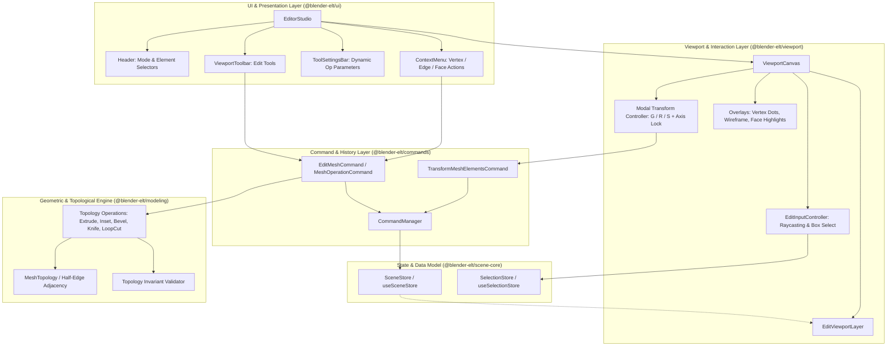
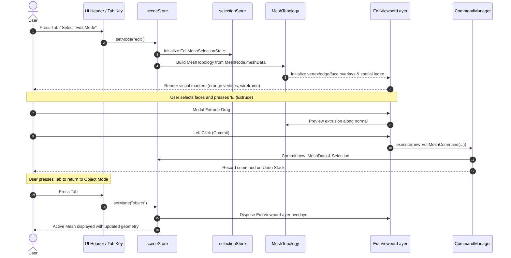

# Blender-ELT Edit Mode Architecture

**Version:** 1.0.0  
**Target:** Monorepo Workspaces (`@blender-elt/contracts`, `@blender-elt/modeling`, `@blender-elt/commands`, `@blender-elt/viewport`, `@blender-elt/ui`, `apps/desktop`, `apps/web`)  
**Author:** `@verifier` (Quality, Test & Verification Specialist)  
**Status:** Approved Architectural Specification

---

## 1. Executive Summary & Design Philosophy

The **Edit Mode** subsystem in Blender-ELT provides a high-performance, non-destructive, and interactive environment for granular sub-element 3D mesh modeling. Drawing inspiration from Blender's industry-standard workflow, Blender-ELT decouples pure topological algorithms and command state from rendering and user interface layers. This guarantees headless testability, deterministic undo/redo reversibility, and 100% cross-platform parity across the Electron desktop application and the Next.js web application.

---

## 2. Core Subsystems & Responsibilities

### 2.1 Contracts & Shared Schemas (`@blender-elt/contracts`)

As mandated by Monorepo Architectural Principle 3.1, `@blender-elt/contracts` acts as the single source of truth for all types and schemas:

- **Geometry Definitions**: `Vector3`, `Euler`, `Matrix4`, `IMeshData`.
- **Edit Mode Element Primitives**: `VertexData`, `EdgeData`, `FaceData`, and `EditElementMode` (`'vertex' | 'edge' | 'face'`).
- **Selection State Contract**: `EditMeshSelectionState`, `UnifiedSelectionModel`, `SelectionMode` (`'set' | 'add' | 'subtract' | 'invert'`).
- **Operation Signatures**: `MeshOperationType` (`'extrude' | 'inset' | 'bevel' | 'subdivide' | 'loopcut' | 'knife' | 'merge' | 'smooth' | 'flip-normals' | 'delete'`).
- **Command & Undo Signatures**: `ICommand`, `UndoRedoState`, `CommandDescriptor`.

### 2.2 Scene Graph & Selection State (`@blender-elt/scene-core`)

State management is decoupled into reactive vanilla Zustand stores:

- **`sceneStore`**: Manages the authoritative scene graph hierarchy (`SceneNode`, `MeshNode`), holding active node references and geometry data (`meshData: IMeshData`).
- **`selectionStore`**: Tracks active selection across Object Mode (`selectedNodeIds`, `activeNodeId`) and Edit Mode (`selectedVertexIndices`, `selectedEdgeIndices`, `selectedFaceIndices`, active element index, and `elementModes`).
- **Headless Execution**: These stores have zero dependencies on React or the DOM, making them directly executable and testable in NodeJS/Vitest environments.

### 2.3 Topology & Geometric Engine (`@blender-elt/modeling`)

The modeling package houses pure mathematical and topological algorithms:

- **`MeshTopology`**: An indexed and adjacency-rich topological structure constructed from `IMeshData` or Three.js `BufferGeometry`. It maintains bidirectional maps:
  - Vertex $\leftrightarrow$ Edges
  - Vertex $\leftrightarrow$ Faces
  - Edge $\leftrightarrow$ Faces
  - Face $\leftrightarrow$ Edges
- **Boundary & Manifold Analysis**: Identifies boundary loops, non-manifold edges (edges shared by $>2$ faces), and degenerate elements.
- **Topological Operators**: Implements robust operations (extrude, inset, bevel, loop cut, knife, dissolve, merge, normal orientation) while maintaining Euler-Poincaré invariants.

### 2.4 Command & Undo/Redo Engine (`@blender-elt/commands`)

All mesh transformations in Edit Mode are encapsulated inside transactional `ICommand` instances:

- **`EditMeshCommand`**: Stores lightweight differential states or complete topology snapshots before and after operation execution. Calling `undo()` restores the exact vertices, indices, normals, and selection indices in `sceneStore`.
- **`TransformMeshElementsCommand`**: Dispatched when translating (G), rotating (R), or scaling (S) vertices. Aggregates delta transformations into a single atomic undoable transaction upon mouse confirmation.

### 2.5 Viewport & Raycasting Engine (`@blender-elt/viewport`)

Rendered via React Three Fiber (R3F) and Three.js:

- **`EditViewportLayer`**: Conditionally active when `mode === 'edit'` and an active `MeshNode` exists.
- **Picking & Raycasting**: Raycasts screen-space coordinates against:
  - **Vertices**: Screen-space distance to projected points with hit radius tolerance ($8\text{px}$).
  - **Edges**: Distance to projected 3D segments with threshold tolerance ($6\text{px}$).
  - **Faces**: Standard triangle/polygon ray intersection.
- **Visual Overlays**:
  - Vertex point cloud with status colors (unselected: `#111111` / dark gray; selected: `#f49b42` orange; hovered: `#ffffff` white).
  - Wireframe edges with status highlighting.
  - Selected faces highlighted with translucent orange overlay (`#f49b42`, opacity $0.35$).
  - Surface normal needles (visualized when `showNormalsOverlay` is enabled).

### 2.6 User Interface System (`@blender-elt/ui`)

Provides the dark-themed Blender UI widgets:

- **Header Mode Switcher**: Seamless switching between Object, Sculpt, and Edit modes (`Tab` key shortcut).
- **Element Selector**: Toggles Vertex (1), Edge (2), and Face (3) modes.
- **Tool Settings Panel**: Real-time parameter controls for the active tool (extrude distance, inset thickness, bevel segments, merge threshold).
- **Context Menus & Delete Modal**: Interactive right-click menus and Delete/Dissolve options triggered via `X` or `Delete`.

---

## 3. Edit Mode Lifecycle & State Transitions

The lifecycle of an Edit Mode session is structured to ensure zero data loss, high framerate interaction, and instant sync back to the scene graph:

---

## 4. Cross-Platform Parity Contract

To ensure that both desktop (`Electron`) and web (`Next.js`) implementations behave identically, Edit Mode adheres to strict architectural parity contracts:

1. **Identical Viewport Interaction**:
   The canvas and R3F canvas components are identical in desktop and web shells. Both render through `@blender-elt/viewport` using WebGL / WebGPU backends supported by Three.js.
2. **Unified Hotkey Mapping**:
   Hotkeys are registered at the canvas level via `useViewportHotkeys.ts`, preventing browser conflicts (e.g., standard browser shortcuts for `Ctrl+B`, `Ctrl+R`, `Tab` are intercepted and cleanly prevented when the 3D viewport canvas has focus).
3. **Storage & Serialization**:
   Any mesh modified in Edit Mode serializes to the identical `.belt` project file schema, readable and writable seamlessly in desktop file systems and browser IndexedDB storage.
