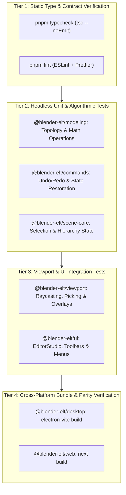

# Blender-ELT Edit Mode Testing & Quality Assurance Guide

**Version:** 1.0.0  
**Target:** Monorepo Workspaces (`@blender-elt/contracts`, `@blender-elt/modeling`, `@blender-elt/commands`, `@blender-elt/viewport`, `@blender-elt/ui`, `apps/desktop`, `apps/web`)  
**Author:** `@verifier` (Quality, Test & Verification Specialist)  
**Status:** Approved Testing Standard

---

## 1. Overview & Quality Gates

The Edit Mode subsystem in Blender-ELT introduces complex geometric, topological, and interactive workflows. To prevent subtle regressions—such as non-manifold geometries, inverted surface normals, undo history corruption, or dropped browser keyboard events—Blender-ELT employs an automated, multi-tiered testing strategy:



---

## 2. Test Suite Breakdown by Package

### 2.1 `@blender-elt/modeling` (Topology & Operations)

_Test Runner: Vitest_  
_Location: `packages/modeling/test/`_

Key test files:

- **`test/topology.test.ts`**:
  - `MeshTopology` instantiation from primitive `IMeshData` (cube, plane, cylinder, sphere).
  - Adjacency structure correctness: verifying that `vertexToEdges`, `vertexToFaces`, `edgeToFaces`, and `faceToEdges` have matching bidirectional links.
  - Manifold checking: detecting boundary edges (edges with 1 incident face) and non-manifold edges (edges with $>2$ incident faces).
  - Euler-Poincaré characteristic: verifying $V - E + F = 2$ for closed genus-0 polyhedra (e.g. cube: $8 - 12 + 6 = 2$).
- **`test/edit-operations.test.ts`**:
  - **Extrude Operations**:
    - Connected-region extrusion: ensuring perimeter boundary edges create side quads while internal shared edges generate no duplicate internal walls.
    - Individual face extrusion: verifying each face detaches and extrudes along its individual normal.
  - **Inset Faces**:
    - Validating inner face shrinkage and generation of perimeter quad strips without self-intersection.
  - **Bevel Operations**:
    - Verifying vertex and edge chamfering/filleting with configurable segments.
  - **Vertex Merging**:
    - Merge at center: centroid calculation, collapsing duplicate edges/faces.
    - Merge by distance: spatial hash clustering, distance threshold validation.
  - **Topology Tools**:
    - Loop cut: quad ring detection, relative factor $\lambda$ placement, edge insertion.
    - Knife cut: edge bisection and polygon face splitting.

### 2.2 `@blender-elt/commands` (Command Pattern & Undo/Redo)

_Test Runner: Vitest_  
_Location: `packages/commands/test/`_

Key test suites:

- **`EditMeshCommand` Reversibility**:
  - For every operation $Op$, asserts:
    $$\text{undo}(\text{execute}(S)) \equiv S$$
  - Checks vertex coordinates, index buffers, normal vectors, and selection indices before and after an undo/redo cycle.
- **`TransformMeshElementsCommand`**:
  - Translation along X, Y, Z and view planes.
  - Rotation around median point with axis locks.
  - Scaling relative to pivot center.
  - Transactional aggregation: verifying that dragging produces only one recorded command upon commit.
- **Selection State Conversion & Restoration**:
  - Switching between Vertex $\leftrightarrow$ Edge $\leftrightarrow$ Face preserves topological selections.
  - History stack preserves active element indices (`activeVertexIndex`, `activeEdgeIndex`, `activeFaceIndex`).

### 2.3 `@blender-elt/viewport` (Raycasting & Interactivity)

_Test Runner: Vitest_  
_Location: `packages/viewport/test/`_

Key test suites:

- **Screen-Space Element Raycasting**:
  - Hit testing projected vertices within $8\text{px}$ threshold.
  - Hit testing projected edge line segments within $6\text{px}$ threshold.
  - Hit testing face polygons via camera ray intersection.
- **Box Selection (Marquee)**:
  - Selecting elements enclosed within 2D bounding boxes in NDC space.
  - Testing selection modes (`set`, `add`, `subtract`, `invert`).
- **Hotkey & Shortcut Dispatch**:
  - Triggering `Tab`, `1`, `2`, `3`, `G`, `R`, `S`, `E`, `I`, `Ctrl+B`, `Ctrl+R`, `K`, `A`, `Alt+A`.

### 2.4 `@blender-elt/ui` (Components & Design System)

_Test Runner: Vitest_  
_Location: `packages/ui/test/`_

Key test suites:

- **Header Mode Selector**:
  - Correct rendering of 'Object Mode', 'Edit Mode', and 'Sculpt Mode' options.
  - Dynamic appearance of Element Mode toggles (Vertex, Edge, Face) exclusively in Edit Mode.
- **Tool Settings Bar**:
  - Parameter binding: changing Extrude Distance, Inset Thickness, or Bevel Segments dispatches updates.
- **Context Menus & Delete Modal**:
  - Right-click menu options for vertex, edge, and face elements.
  - Delete dialog options: Delete Vertices, Delete Edges, Delete Faces, Dissolve Vertices, Dissolve Edges, Dissolve Faces.

### 2.5 Cross-Platform Parity Tests (`apps/desktop` & `apps/web`)

_Test Runner: Vitest & Production Bundlers_

- **Web Storage & Persistence (`apps/web/test/`)**:
  - Saving and loading `.belt` project documents to/from `IndexedDB`.
  - Exporting and importing GLTF / OBJ / STL assets in headless environments.
- **Desktop Production Build (`electron-vite build`)**:
  - Main, preload, and renderer bundles build without TypeScript or bundling warnings.
- **Web Production Build (`next build`)**:
  - Static generation of pages and dynamic editor route compilation (`/editor/[projectId]`).

---

## 3. Mandatory Invariant Assertions Checklist

When contributing or reviewing Edit Mode features, all automated tests must assert the following invariant conditions:

- [ ] **Symmetric Undo Reversibility**:
  - Mesh node vertices and indices must match bit-for-bit after `command.undo()`.
  - Active selection indices must match bit-for-bit after `command.undo()`.
- [ ] **Manifold Surface Conservation**:
  - No operation may generate non-manifold edges ($|\text{faces}(e)| > 2$) unless explicitly initiated by non-manifold cutting.
- [ ] **Euler Characteristic Invariant**:
  - Watertight genus-0 meshes must maintain $V - E + F = 2$ after subdivision, extrusion, or beveling.
- [ ] **No Internal Duplicate Walls**:
  - Region extrusion must not duplicate shared interior faces between adjacent selected polygons.
- [ ] **Winding Consistency**:
  - Triangulated polygon normals must point consistently in counter-clockwise order with outward facing orientation.

---

## 4. How to Run Verifications

Developers and CI systems must execute the following commands in the monorepo root:

```bash
# 1. Typecheck the entire monorepo
pnpm typecheck

# 2. Run unit & integration tests across all packages
pnpm test

# 3. Run specific package tests (e.g. modeling or commands)
pnpm --filter @blender-elt/modeling test
pnpm --filter @blender-elt/commands test
pnpm --filter @blender-elt/viewport test
pnpm --filter @blender-elt/ui test

# 4. Verify production builds for Electron and Next.js
pnpm build

# 5. Check formatting
pnpm format:check
```
