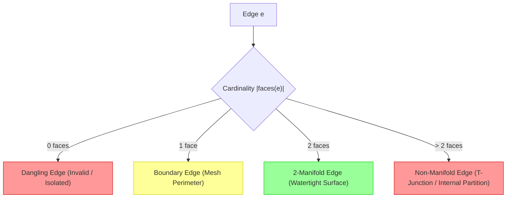

# Blender-ELT Mesh Topology & Data Model Specification

**Version:** 1.0.0  
**Target:** Monorepo Workspaces (`@blender-elt/contracts`, `@blender-elt/modeling`, `@blender-elt/scene-core`, `@blender-elt/viewport`)  
**Author:** `@verifier` (Quality, Test & Verification Specialist)  
**Status:** Approved Technical Specification

---

## 1. Overview & Data Model Goals

In 3D authoring applications, the low-level rendering representation (flat arrays of vertices, normals, and triangle indices formatted for WebGL/GPU buffers) is poorly suited for interactive mesh editing. Operations such as edge splitting, face extrusion, loop cuts, and Laplacian smoothing require immediate knowledge of neighborhood relationships—such as "which faces share this edge?" or "which vertices form the one-ring neighborhood of vertex $v$?".

Blender-ELT solves this challenge by maintaining a bidirectional, indexed topology layer—**`MeshTopology`**—that bridges low-level GPU buffer representations (`IMeshData` / `BufferGeometry`) with high-level topological operations.

```mermaid
flowchart LR
    subgraph GPU_Representation["GPU Buffer Model (IMeshData / Three.js)"]
        POS[Float32Array: positions [x,y,z...]]
        NORM[Float32Array: normals [nx,ny,nz...]]
        UV[Float32Array: uvs [u,v...]]
        IDX[Uint32Array: indices [i0,i1,i2...]]
    end

    subgraph Topological_Representation["Topological Graph Model (MeshTopology)"]
        VTX[VertexData: index, pos, uv, normal]
        EDG[EdgeData: index, v1, v2]
        FAC[FaceData: index, vertexIndices, edgeIndices, normal]
    end

    subgraph Adjacency_Graphs["Bidirectional Adjacency Graphs"]
        V2E[vertexToEdges: Map<number, Set<number>>]
        V2F[vertexToFaces: Map<number, Set<number>>]
        E2F[edgeToFaces: Map<number, Set<number>>]
        F2E[faceToEdges: Map<number, number[]>]
    end

    GPU_Representation <-->|Rebuild / Ingest / Extract| Topological_Representation
    Topological_Representation --- Adjacency_Graphs
```

---

## 2. Core Topology Data Structures

### 2.1 Low-Level Mesh Representation (`IMeshData`)

The `@blender-elt/contracts` package defines `IMeshData` as the portable format stored in the `sceneStore`:

```typescript
export interface IMeshData {
  /** Flat array of contiguous vertex coordinates: [x0, y0, z0, x1, y1, z1, ...] */
  vertices: Float32Array | number[];
  /** Flat array of normal vectors: [nx0, ny0, nz0, ...] */
  normals?: Float32Array | number[];
  /** Flat array of texture UV coordinates: [u0, v0, u1, v1, ...] */
  uvs?: Float32Array | number[];
  /** Flat array of triangle face vertex indices: [i0, i1, i2, i3, i4, i5, ...] */
  indices?: Uint32Array | Uint16Array | number[];
}
```

### 2.2 Topological Element Records

The `MeshTopology` structure decomposes the mesh into explicit discrete entities:

```typescript
export interface VertexData {
  index: number;
  position: Vector3; // { x: number, y: number, z: number }
  normal?: Vector3;
  uv?: [number, number];
  selected?: boolean;
}

export interface EdgeData {
  index: number;
  v1: number; // Index of first endpoint (always v1 < v2 for canonical hashing)
  v2: number; // Index of second endpoint
  selected?: boolean;
}

export interface FaceData {
  index: number;
  vertexIndices: number[]; // Ordered polygon vertices (CCW winding order)
  edgeIndices?: number[]; // Ordered edge indices bounding the polygon
  normal?: Vector3; // Geometric face normal computed via Newells method / cross product
  selected?: boolean;
}
```

---

## 3. Adjacency Relations & Neighborhood Queries

To enable $O(1)$ neighborhood lookups during modeling operations, `MeshTopology` maintains pre-indexed adjacency maps:

| Adjacency Map               | TypeScript Type            | Description & Primary Use Case                                                                                          |
| :-------------------------- | :------------------------- | :---------------------------------------------------------------------------------------------------------------------- |
| **Vertex-to-Edges** (`v2e`) | `Map<number, Set<number>>` | Identifies all edges incident to a vertex. Used for vertex star evaluation, Laplacian smoothing, and vertex bevel.      |
| **Vertex-to-Faces** (`v2f`) | `Map<number, Set<number>>` | Identifies all polygons sharing a vertex. Used for smooth normal averaging and vertex deletion.                         |
| **Edge-to-Faces** (`e2f`)   | `Map<number, Set<number>>` | Maps an edge to the faces incident to it. Essential for manifold checking, boundary edge detection, and edge extrusion. |
| **Face-to-Edges** (`f2e`)   | `Map<number, number[]>`    | Lists the oriented perimeter edges of each polygon face. Used for boundary extrusion and inset generation.              |

### 3.1 Canonical Edge Hashing

Because edges are undirected in an unoriented adjacency graph, edge keys are uniquely normalized such that:

$$\text{edgeKey}(a, b) = \min(a, b) \ll 32 \lor \max(a, b) \quad \text{or string} \quad `\min(a, b)_\max(a, b)`$$

This prevents duplicate edge records when opposite directed half-edges are encountered in adjacent faces.

---

## 4. Manifold Properties & Topological Classifications

A clean 3D mesh must satisfy two-manifold topological criteria for predictable subdivision and 3D printing. `MeshTopology` evaluates element manifoldness based on `edgeToFaces` cardinality:



1. **Boundary Edge**: An edge incident to exactly one face ($|\text{faces}(e)| = 1$). A closed sequence of boundary edges forms a **Boundary Loop** (hole).
2. **2-Manifold Edge**: An edge incident to exactly two faces ($|\text{faces}(e)| = 2$). If the faces traverse the edge in opposite directions, the surface is consistently oriented.
3. **Non-Manifold Edge**: An edge incident to three or more faces ($|\text{faces}(e)| > 2$), creating an illegal internal sheet or self-intersecting volume.
4. **Boundary Loop Filling**: Holes in a mesh are identified by tracing boundary edges: starting at edge $e_0$, finding adjacent boundary edge $e_1$ sharing a vertex, and iterating until the loop closes.

---

## 5. Topological Invariants & Validation

To prevent corrupt geometry and viewport crashes, `MeshTopology` provides an invariant validation engine:

- **Referential Integrity**: Every index referenced in `FaceData.vertexIndices` must point to an active, valid `VertexData`.
- **Degenerate Geometry Check**: No polygon may contain duplicate consecutive vertices (e.g. $[v_0, v_1, v_1]$) or zero-area triangles where all vertices are collinear.
- **Normal Consistency**: Face normals are calculated using Newell's Method to correctly handle arbitrary planar n-gons:

$$N = \sum_{i=0}^{n-1} \begin{pmatrix} (y_i - y_{i+1})(z_i + z_{i+1}) \\ (z_i - z_{i+1})(x_i + x_{i+1}) \\ (x_i - x_{i+1})(y_i + y_{i+1}) \end{pmatrix}, \quad \hat{N} = \frac{N}{\|N\|}$$

- **Euler Characteristic Invariance**:
  For any closed, orientable surface of genus $g$:

$$\chi = V - E + F = 2 - 2g$$

---

## 6. Conversion Pipeline: Three.js $\leftrightarrow$ MeshTopology

The conversion pipeline is designed for minimal allocation and high performance:

```typescript
// 1. Ingestion: Extract topology from Three.js BufferGeometry or IMeshData
const topology = MeshTopology.fromMeshData(node.meshData);

// 2. Interactive Editing: Apply in-place topological or transform modifications
topology.extrudeFaces(selectedFaceIndices, extrusionVector);

// 3. Serialization: Export back to IMeshData for SceneStore and GPU upload
const updatedMeshData: IMeshData = topology.toMeshData();

// 4. In-Place GPU Attribute Update (in Three.js Viewport):
geometry.setAttribute('position', new THREE.BufferAttribute(updatedMeshData.vertices, 3));
geometry.setIndex(new THREE.BufferAttribute(updatedMeshData.indices, 1));
geometry.computeVertexNormals();
geometry.computeBoundingBox();
geometry.computeBoundingSphere();
```

---

## 7. Memory & Performance Characteristics

- **Contiguous Array Buffers**: Coordinate extraction produces standard typed arrays (`Float32Array`, `Uint32Array`) directly consumable by WebGL without intermediate boxing.
- **Incremental Adjacency Invalidation**: When an isolated vertex is translated, topological adjacency graphs are preserved ($O(1)$ update). When topology is modified (splits, merges), only the local one-ring neighborhood graphs are updated rather than rebuilding the full mesh graph.
