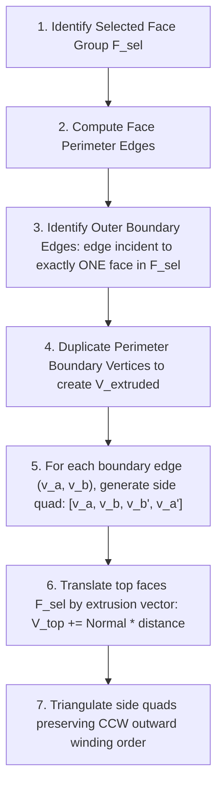

# Blender-ELT Modeling Operations & Geometric Algorithms

**Version:** 1.0.0  
**Target:** Monorepo Workspaces (`@blender-elt/modeling`, `@blender-elt/contracts`, `@blender-elt/commands`)  
**Author:** `@verifier` (Quality, Test & Verification Specialist)  
**Status:** Approved Algorithmic Specification

---

## 1. Overview

Modeling operations in Blender-ELT manipulate the geometry and topology of `MeshTopology`. Operations are categorized into:

1. **Vertex Operations**: Spatial transformation, merging, and smoothing of 0-dimensional points.
2. **Edge Operations**: Splitting, beveling, sliding, and topology traversal across 1-dimensional segments.
3. **Face Operations**: Extrusion, inset, beveling, triangulation, and normal manipulation of 2-dimensional polygons.
4. **Topology Tools**: Loop cuts, knife tool, and loop bridging.

All operations satisfy **Euler-Poincaré topological invariance** and maintain valid winding order and outward-facing normals.

---

## 2. Vertex Operations

### 2.1 Merge Vertices at Center

- **Algorithm**:
  1. Computes the geometric centroid $C$ of the selected vertex indices $V_s$:
     $$C = \frac{1}{|V_s|} \sum_{v \in V_s} P(v)$$
  2. Creates a target vertex at position $C$ (or reuses the first vertex index $v_0$).
  3. Re-indexes all incident edges and faces that reference any $v \in V_s$ to point to $v_0$.
  4. Removes degenerate faces (faces where vertices collapse into collinear points or duplicated indices).
  5. Removes degenerate edges ($v_0 \leftrightarrow v_0$).
  6. Removes dangling vertices from the topology.

### 2.2 Merge by Distance (Spatial Hashing)

- **Algorithm**:
  To achieve $O(N)$ runtime instead of naive $O(N^2)$ pairwise distance checks, a **uniform spatial hash grid** is utilized:
  1. Hash cell coordinate:
     $$\text{cell}(x, y, z) = \left( \lfloor x / d \rfloor, \lfloor y / d \rfloor, \lfloor z / d \rfloor \right)$$
     where $d$ is the merge threshold distance.
  2. Vertices are inserted into grid buckets.
  3. For each vertex, only neighbor vertices in the $3 \times 3 \times 3 = 27$ adjacent buckets are tested against Euclidean distance threshold:
     $$\|P(v_i) - P(v_j)\| \le d$$
  4. Matching vertices are unified via disjoint-set (union-find) clustering and collapsed to their cluster centroid.

### 2.3 Laplacian Vertex Smoothing

- **Algorithm**:
  Moves each vertex towards the mean position of its 1-ring adjacent neighbors:
  $$P_{new}(v) = P(v) + \lambda \left( \frac{1}{|N(v)|} \sum_{u \in N(v)} P(u) - P(v) \right)$$
  where $\lambda \in [0, 1]$ is the smoothing factor and $N(v)$ is the set of topological neighbors of $v$.

### 2.4 Dissolve Vertex vs. Delete Vertex

- **Delete Vertex**: Removes the vertex, all connected edges, and all faces sharing those edges. Leaves a topological hole.
- **Dissolve Vertex**: Removes the vertex and collapses the incident edges, merging adjacent faces into a single combined n-gon without tearing the surface.

---

## 3. Edge Operations

### 3.1 Edge Subdivision

- **Algorithm**:
  1. For each selected edge $e = (v_1, v_2)$, computes midpoint:
     $$M = \frac{P(v_1) + P(v_2)}{2}$$
  2. Inserts new vertex $v_m$ at position $M$.
  3. Replaces edge $(v_1, v_2)$ with two sub-edges $(v_1, v_m)$ and $(v_m, v_2)$.
  4. For each face $f$ sharing $e$, splits the polygon to include $v_m$, triangulating or converting triangles into quads.

### 3.2 Edge Bevel (Chamfer & Fillet)

- **Algorithm**:
  1. Displaces each edge endpoint along its incident faces by distance $w$ (width).
  2. Replaces the single sharp edge with an angled bevel planar quad (chamfer) or multiple interpolated segments (fillet profile).
  3. Resolves miter corners where multiple beveled edges intersect at a common vertex.

### 3.3 Edge Loop & Ring Traversal

- **Edge Loop**: A sequence of contiguous edges where at every valence-4 quad vertex, the loop continues along the **opposite edge** across the quad face.
- **Edge Ring**: A sequence of parallel edges that face each other across a sequence of quad faces.

```mermaid
graph LR
    subgraph Edge_Loop["Edge Loop (Contiguous Line)"]
        e1[Edge 1] --- v1((Vertex)) --- e2[Edge 2 (Opposite)] --- v2((Vertex)) --- e3[Edge 3]
    end

    subgraph Edge_Ring["Edge Ring (Parallel Rungs)"]
        q1[Face Quad 1] -->|cross| q2[Face Quad 2] -->|cross| q3[Face Quad 3]
    end
```

---

## 4. Face Operations

### 4.1 Connected-Region Extrusion (Core Feature)

Extruding a connected region of multiple selected faces requires generating outer side-walls without creating unwanted internal geometry:



**Key Invariant**:

- Internal shared edges between adjacent faces in $F_{sel}$ are **never** duplicated as side walls.
- Only edges with $|\text{faces}(e) \cap F_{sel}| = 1$ generate quad side walls.

### 4.2 Individual Face Extrusion

When the user chooses "Extrude Individual", each face in $F_{sel}$ is detached from its neighbors:

1. All vertices of each face are duplicated independently.
2. Quad side-walls are constructed around the full perimeter of each face.
3. Each face translates along its own individual geometric face normal $N_f$.

### 4.3 Inset Faces (Region & Individual)

- **Algorithm**:
  1. For each polygon, computes the polygon centroid $C$ and inset boundary edges.
  2. Offsets each vertex along the angle bisector of its adjacent edges by inset thickness $t$:
     $$P'(v) = P(v) - t \cdot \frac{e_1 + e_2}{\|e_1 + e_2\| \cdot \sin(\theta/2)}$$
  3. Constructs a border ring of quad faces connecting the original perimeter to the inset perimeter.
  4. Keeps the central polygon face intact at the inset vertices.

### 4.4 Normal Operations: Recalculate & Invert

- **Recalculate Normals (Outward)**: Traverses connected components, ensuring consistent CCW winding order. Evaluates signed volume of closed mesh to guarantee normals point outward away from the center of mass.
- **Flip Normals**: Reverses vertex ordering in all selected face records:
  $$[v_0, v_1, v_2] \longrightarrow [v_0, v_2, v_1]$$

---

## 5. Advanced Topology Tools

### 5.1 Loop Cut (`Ctrl+R`)

1. **Raycast / Hover Detection**: Projects cursor onto mesh edge $e_0$.
2. **Ring Detection**: Identifies the quad edge ring perpendicular to $e_0$.
3. **Interactive Factor**: The mouse position determines cut offset $\lambda \in (0, 1)$ along each rung of the ring.
4. **Topology Split**: Splits each edge in the ring at factor $\lambda$ and connects the new vertices with a continuous closed loop of new edges and faces.

### 5.2 Knife Cut (`K`)

1. **Interactive Raycast**: Projects knife cut segments across screen-space coordinates into 3D world rays.
2. **Intersection Calculation**:
   - Computes ray-edge intersections.
   - Computes ray-face plane cuts.
3. **Topological Split**:
   - Inserts split vertices on intersected edges.
   - Subdivides traversed polygon faces along the cutting plane.

---

## 6. Algorithmic Complexity Matrix

| Operation                      |     Time Complexity     |    Space Complexity     | Topological Modifications                             |
| :----------------------------- | :---------------------: | :---------------------: | :---------------------------------------------------- |
| **Translate / Rotate / Scale** |           $O(           |           V_s           | )$                                                    | $O(1)$           | Pure geometric coordinate displacement; zero topology change. |
| **Merge at Center**            |           $O(           |           V_s           | +                                                     | \text{star}(V_s) | )$                                                            | $O( | V_s                                                 | )$  | Vertex removal, edge collapse, face re-indexing. |
| **Merge by Distance**          |     $O(N)$ expected     |         $O(N)$          | Spatial hash bucket insertion, union-find clustering. |
| **Connected Region Extrude**   |           $O(           |           F_s           | +                                                     | \partial F_s     | )$                                                            | $O( | \partial F_s                                        | )$  | Generates $2 \cdot                               | \partial F_s | $ triangles and $ | \partial F_s | $ new vertices. |
| **Inset Faces**                |           $O(           |           F_s           | \cdot \text{deg}(f))$                                 | $O(              | F_s                                                           | )$  | Ring quads creation around polygon interior.        |
| **Subdivide Edges**            |           $O(           |           E_s           | )$                                                    | $O(              | E_s                                                           | )$  | Vertex insertion, edge splitting, face subdivision. |
| **Loop Cut**                   | $O(\text{Ring Length})$ | $O(\text{Ring Length})$ | Edge bisecting and quad splitting along ring.         |
| **Triangulate / Flip**         |           $O(           |           F_s           | )$                                                    | $O(1)$ in-place  | Re-ordering index buffers.                                    |
