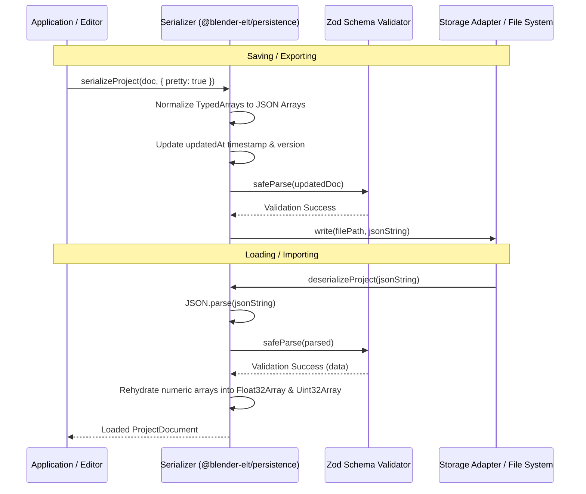

# Blender-ELT Project File Format Specification (.belt)

## 1. Overview

The **Blender-ELT Project Format (`.belt`)** is an open, human-readable, JSON-based document specification designed for storing complete 3D scene states, object hierarchies, procedural and custom mesh geometries, PBR material definitions, scene collections, and animation tracks.

Files adhering to this specification use the `.belt` extension (MIME type: `application/json` or `application/x-blender-elt`). The format is designed for universal portability between desktop environments (`apps/desktop`) and browser environments (`apps/web`).

---

## 2. Specification Versioning

- **Format Version (`CURRENT_PROJECT_VERSION`)**: `1.0.0`
- **Application Baseline (`APP_VERSION`)**: `0.1.0`
- **Coordinate System**: Right-handed, Y-Up (standard Three.js / glTF convention)
- **Angular Units**: Radians internally (converted to degrees only for UI display)

Backward compatibility and schema migrations are handled through semantic version checks upon file deserialization.

---

## 3. Document Structure & Schema

A valid `.belt` document is a single JSON object conforming to `ProjectDocumentSchema` defined in `@blender-elt/persistence` and `@blender-elt/file-formats`.

```
ProjectDocument
├── version: string ("1.0.0")
├── metadata: ProjectMetadata
├── root: SceneRoot
├── nodes: Record<string, SceneNode>
├── geometries: Record<string, IMeshData>
├── materials: Record<string, MaterialDefinition>
├── collections: Record<string, SceneCollection>
├── timeline?: AnimationTimeline (optional)
└── viewport?: ViewportConfig (optional)
```

### 3.1 Metadata (`ProjectMetadata`)

Stores provenance, authorship, creation timestamps, and tool versions.

| Property      | Type     | Required | Description                                      |
| :------------ | :------- | :------- | :----------------------------------------------- |
| `name`        | `string` | Yes      | Human-readable project title.                    |
| `version`     | `string` | Yes      | Project specification version (e.g., `"1.0.0"`). |
| `author`      | `string` | No       | Author or creator name.                          |
| `createdAt`   | `string` | Yes      | ISO 8601 creation timestamp.                     |
| `updatedAt`   | `string` | Yes      | ISO 8601 last-modified timestamp.                |
| `appVersion`  | `string` | Yes      | Blender-ELT application version.                 |
| `description` | `string` | No       | Optional project description.                    |

### 3.2 Scene Root (`SceneRoot`)

The anchor node of the scene graph.

| Property          | Type       | Required | Description                                  |
| :---------------- | :--------- | :------- | :------------------------------------------- |
| `id`              | `string`   | Yes      | Identifier, typically `"root"`.              |
| `name`            | `string`   | Yes      | Display name (default `"Scene Root"`).       |
| `type`            | `"root"`   | Yes      | Fixed discriminator `"root"`.                |
| `childrenIds`     | `string[]` | Yes      | IDs of direct root children.                 |
| `backgroundColor` | `string`   | No       | Hex color code for viewport clear color.     |
| `environment`     | `object`   | No       | Preset name, background blur, and intensity. |

### 3.3 Scene Nodes (`SceneNode`)

Nodes represent items in the scene graph. `SceneNode` is a discriminated union over `type`:

#### Common Node Properties (`BaseNode`)

- `id`: Unique string identifier (`mesh-xxx`, `light-xxx`, `camera-xxx`).
- `name`: Display name.
- `type`: `'mesh' | 'camera' | 'light' | 'group' | 'collection' | 'root'`.
- `transform`: `{ position: Vector3, rotation: Euler, scale: Vector3 }`.
- `visible`: `boolean` (visibility toggle).
- `locked`: `boolean` (selection/transform lock).
- `parentId`: Parent node ID or `null`/`"root"`.
- `childrenIds`: Array of child node IDs.
- `collectionId`: Associated collection ID (optional).
- `metadata`: Arbitrary key-value store for plugin or custom state.

#### Mesh Node (`MeshNode`)

- `type`: `"mesh"`
- `geometryId`: Key referencing `geometries` dictionary.
- `primitiveType`: Optional primitive identifier (`cube`, `sphere`, `cylinder`, `cone`, `plane`, `torus`).
- `materialId`: Key referencing `materials` dictionary.
- `castShadow`: `boolean` (default: `true`).
- `receiveShadow`: `boolean` (default: `true`).

#### Camera Node (`CameraNode`)

- `type`: `"camera"`
- `projection`: `"perspective" | "orthographic"`.
- `fov`: Field of view in degrees (default: `50`).
- `near`: Near clipping plane distance (default: `0.1`).
- `far`: Far clipping plane distance (default: `1000`).
- `zoom`: Zoom factor (default: `1.0`).

#### Light Node (`LightNode`)

- `type`: `"light"`
- `lightType`: `"directional" | "point" | "spot" | "ambient" | "hemisphere"`.
- `color`: Hex color string (e.g. `"#ffffff"`).
- `intensity`: Lumen / candela intensity float.
- `castShadow`: `boolean`.
- `distance`, `decay`, `angle`, `penumbra`: Type-specific lighting parameters.

### 3.4 Geometries (`IMeshData`)

Mesh vertex buffers are stored as standard JSON numeric arrays during serialization and restored into typed arrays (`Float32Array`, `Uint32Array`) in memory:

```typescript
export interface IMeshData {
  vertices: Float32Array | number[];
  normals?: Float32Array | number[];
  uvs?: Float32Array | number[];
  indices?: Uint32Array | Uint16Array | number[];
}
```

- **`vertices`**: Consecutive `[x, y, z]` coordinates.
- **`normals`**: Consecutive `[nx, ny, nz]` vertex normals.
- **`uvs`**: Consecutive `[u, v]` texture mapping coordinates.
- **`indices`**: Triangle face indices referencing vertex triplets.

### 3.5 Materials (`MaterialDefinition`)

Defines PBR shading properties based on the standard metallic-roughness model:

```typescript
export interface MaterialDefinition {
  id: string;
  name: string;
  type: 'pbr' | 'basic' | 'standard';
  preset?: string;
  config: PBRMaterialConfig;
}

export interface PBRMaterialConfig {
  color: string; // Hex color, e.g. "#808080"
  roughness: number; // 0.0 (smooth) to 1.0 (rough)
  metalness: number; // 0.0 (dielectric) to 1.0 (metallic)
  emission: string; // Hex emission color
  emissionIntensity?: number; // Emission multiplier
  opacity: number; // 0.0 (transparent) to 1.0 (opaque)
  transparent: boolean; // Transparency flag
  wireframe: boolean; // Wireframe rendering flag
  doubleSided?: boolean; // Render front and back faces
}
```

### 3.6 Collections (`SceneCollection`)

Logical groupings of scene nodes, mimicking Blender collections:

- `id`: Unique collection ID.
- `name`: Collection title.
- `visible`: Visibility toggle cascading to contained nodes.
- `locked`: Lock toggle cascading to contained nodes.
- `color`: Visual tag color in Outliner.
- `nodeIds`: Array of contained node IDs.

---

## 4. Serialization & Deserialization Flow



---

## 5. Canonical Reference Example

```json
{
  "version": "1.0.0",
  "metadata": {
    "name": "Default Startup Scene",
    "author": "Blender-ELT User",
    "version": "1.0.0",
    "createdAt": "2026-11-12T08:00:00.000Z",
    "updatedAt": "2026-11-12T08:00:00.000Z",
    "appVersion": "0.1.0",
    "description": "Standard default startup scene containing Cube, Camera, and Light."
  },
  "root": {
    "id": "root",
    "name": "Scene Root",
    "type": "root",
    "childrenIds": ["cube-default", "light-default", "camera-default"],
    "backgroundColor": "#1d1e22"
  },
  "collections": {
    "col-main": {
      "id": "col-main",
      "name": "Collection",
      "visible": true,
      "locked": false,
      "color": "#4772b3",
      "nodeIds": ["cube-default", "light-default", "camera-default"]
    }
  },
  "nodes": {
    "cube-default": {
      "id": "cube-default",
      "name": "Cube",
      "type": "mesh",
      "geometryId": "geo-cube",
      "primitiveType": "cube",
      "materialId": "mat-default",
      "transform": {
        "position": { "x": 0, "y": 0, "z": 0 },
        "rotation": { "x": 0, "y": 0, "z": 0, "order": "XYZ" },
        "scale": { "x": 1, "y": 1, "z": 1 }
      },
      "visible": true,
      "locked": false,
      "parentId": "root",
      "childrenIds": [],
      "collectionId": "col-main",
      "castShadow": true,
      "receiveShadow": true
    },
    "light-default": {
      "id": "light-default",
      "name": "Point Light",
      "type": "light",
      "lightType": "point",
      "color": "#ffffff",
      "intensity": 1000,
      "decay": 2,
      "castShadow": true,
      "transform": {
        "position": { "x": 4, "y": 6, "z": 4 },
        "rotation": { "x": 0, "y": 0, "z": 0, "order": "XYZ" },
        "scale": { "x": 1, "y": 1, "z": 1 }
      },
      "visible": true,
      "locked": false,
      "parentId": "root",
      "childrenIds": [],
      "collectionId": "col-main"
    },
    "camera-default": {
      "id": "camera-default",
      "name": "Camera",
      "type": "camera",
      "projection": "perspective",
      "fov": 50,
      "near": 0.1,
      "far": 1000,
      "zoom": 1,
      "transform": {
        "position": { "x": 7, "y": 5, "z": 7 },
        "rotation": { "x": -0.5, "y": 0.7, "z": 0.35, "order": "XYZ" },
        "scale": { "x": 1, "y": 1, "z": 1 }
      },
      "visible": true,
      "locked": false,
      "parentId": "root",
      "childrenIds": [],
      "collectionId": "col-main"
    }
  },
  "geometries": {
    "geo-cube": {
      "vertices": [
        -1, -1, 1, 1, -1, 1, 1, 1, 1, -1, 1, 1, -1, -1, -1, -1, 1, -1, 1, 1, -1, 1, -1, -1
      ],
      "normals": [0, 0, 1, 0, 0, 1, 0, 0, 1, 0, 0, 1, 0, 0, -1, 0, 0, -1, 0, 0, -1, 0, 0, -1],
      "uvs": [0, 0, 1, 0, 1, 1, 0, 1, 0, 0, 1, 0, 1, 1, 0, 1],
      "indices": [0, 1, 2, 0, 2, 3, 4, 5, 6, 4, 6, 7]
    }
  },
  "materials": {
    "mat-default": {
      "id": "mat-default",
      "name": "Default Clay",
      "type": "pbr",
      "preset": "default-clay",
      "config": {
        "color": "#b0b0b0",
        "roughness": 0.6,
        "metalness": 0.0,
        "emission": "#000000",
        "emissionIntensity": 0.0,
        "opacity": 1.0,
        "transparent": false,
        "wireframe": false
      }
    }
  }
}
```
