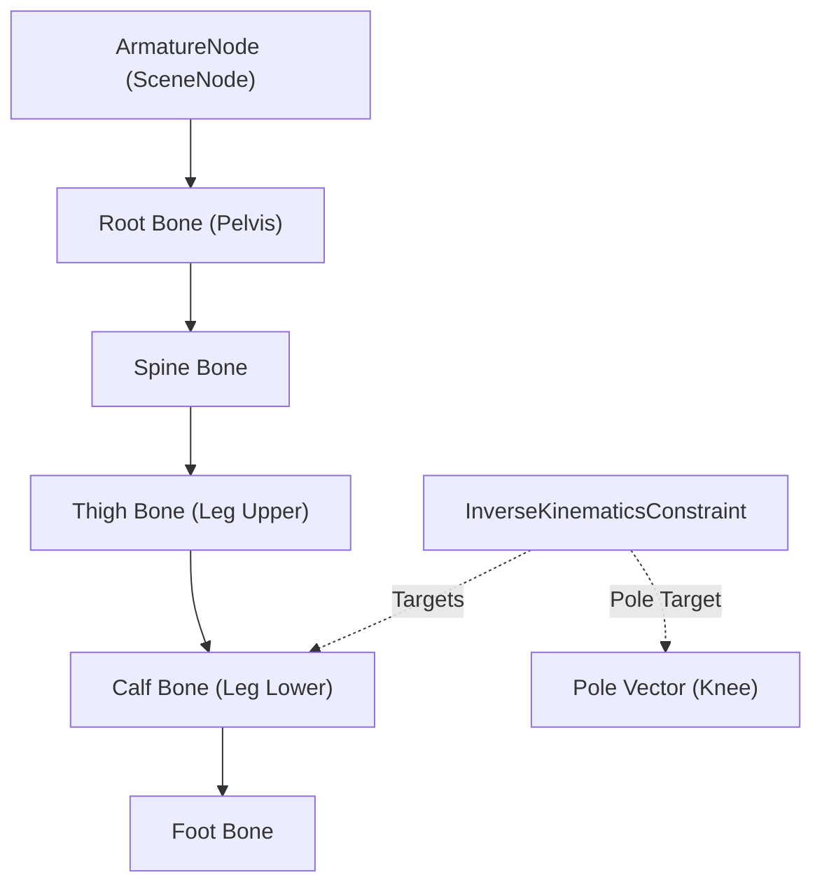

# Blender-ELT Animation System: Rigging, Armatures & Inverse Kinematics (IK)

**Document Version:** 1.0.0  
**Target Packages:** `@blender-elt/contracts`, `@blender-elt/animation`, `@blender-elt/viewport`  
**Status:** Rigging & Kinematics Specification

---

## 1. Skeletal Data Architecture

In Blender-ELT, skeletal deformation and mechanical rigging are structured through **Armature Nodes** and hierarchical **Bone Definitions**:



### 1.1 Bone Definition (`IBone`)

```typescript
export interface IBone {
  id: string;
  name: string;
  parentId: string | null;
  childrenIds: string[];
  head: Vector3; // Joint base position in armature local space
  tail: Vector3; // Joint tip position in armature local space
  roll: number; // Roll angle in radians around longitudinal bone axis
  length: number; // Distance from head to tail: ||tail - head||
  connected: boolean; // True if bone head is rigidly bound to parent tail
  deform: boolean; // Whether bone vertices will be influenced during skinning
}

export interface ArmatureNode extends BaseSceneNode {
  type: 'armature';
  bones: Record<string, IBone>;
  rootBoneIds: string[];
}
```

---

## 2. 3D Viewport Bone Visualization (`ArmatureVisualizer.tsx`)

Bones are rendered in the 3D viewport using Blender's classic **Octahedral Bone Mesh**:

```
          Tail (0, L, 0)
               /\
              /  \
             /    \
            /      \
           /        \
  Waist (-r, 0.15L)───(+r, 0.15L)
           \        /
            \      /
             \    /
              \  /
               \/
          Head (0, 0, 0)
```

- **Octahedral Body Geometry:**
  - Length: $L = \|\text{tail} - \text{head}\|$.
  - Waist position: at $y = 0.15 \times L$.
  - Waist width: $r = 0.08 \times L$.
  - 8 triangular faces connecting head to waist and waist to tail.
- **Joint Spheres:**
  - Head joint radius: $0.06 \times L$.
  - Tail joint radius: $0.04 \times L$.
- **Wireframe Contour:** Blender dark contour lines outline the octahedral edges for crisp visibility in solid and wireframe shading modes.
- **Color Coding:**
  - Unselected bone: `#e6d690` (Pale bone yellow).
  - Selected bone: `#5588ee` (Electric blue).

---

## 3. Inverse Kinematics (IK) Solvers (`@blender-elt/animation`)

### 3.1 Two-Bone Analytical IK Solver

For standard limb chains (thigh-calf or upperarm-forearm), the analytical solver provides an exact, closed-form geometric solution without numerical convergence delay:

#### Law of Cosines Formulation:

Given root joint $\mathbf{A}$, middle joint $\mathbf{B}$, end effector $\mathbf{C}$, target position $\mathbf{T}$, and lengths $L_1 = \|\mathbf{B} - \mathbf{A}\|$, $L_2 = \|\mathbf{C} - \mathbf{B}\|$:

1. Calculate target distance $D = \min(\|\mathbf{T} - \mathbf{A}\|, L_1 + L_2 - \varepsilon)$.
2. Compute internal joint angle $\theta_B$ at middle joint (knee/elbow):
   $$\cos(\theta_B) = \frac{L_1^2 + L_2^2 - D^2}{2 L_1 L_2}$$
3. Compute base joint elevation angle $\alpha$:
   $$\cos(\alpha) = \frac{L_1^2 + D^2 - L_2^2}{2 L_1 D}$$
4. **Pole Target Constraint:** Orient the bend plane so that joint $\mathbf{B}$ faces toward the pole vector $\mathbf{P}$ (knee or elbow direction).

```typescript
export function solveTwoBoneIK(
  rootPos: Vector3,
  midPos: Vector3,
  endPos: Vector3,
  targetPos: Vector3,
  poleTargetPos?: Vector3,
): { midPos: Vector3; endPos: Vector3 };
```

---

### 3.2 FABRIK Solver (Forward And Backward Reaching Inverse Kinematics)

For arbitrary multi-link kinematic chains ($N \ge 3$ bones, spines, tentacles):

1. **Forward Reaching:**
   - Set end joint $\mathbf{P}_N = \mathbf{T}$ (target position).
   - For $i = N-1$ down to $1$:
     - Find direction from $\mathbf{P}_i$ to $\mathbf{P}_{i+1}$.
     - Position $\mathbf{P}_i$ along this ray at distance $L_i$.
2. **Backward Reaching:**
   - Set root joint $\mathbf{P}_1 = \mathbf{P}_{\text{root}}$ (fixed origin).
   - For $i = 1$ up to $N-1$:
     - Find direction from $\mathbf{P}_{i+1}$ to $\mathbf{P}_i$.
     - Position $\mathbf{P}_{i+1}$ along this ray at distance $L_i$.
3. Repeat iterations until $\|\mathbf{P}_N - \mathbf{T}\| < \text{tolerance}$ or max iterations reached.

---

## 4. Animation Constraints Architecture

Constraints dynamically modify node or bone transformations during evaluation:

| Constraint Type          | Parameters                                                     | Function                                     |
| :----------------------- | :------------------------------------------------------------- | :------------------------------------------- |
| **`inverse_kinematics`** | `targetNodeId`, `poleTargetNodeId`, `poleAngle`, `chainLength` | Solves limb or chain towards target position |
| **`copy_transforms`**    | `targetNodeId`, `space: 'world' \| 'local'`                    | Copies translation, rotation, and scale      |
| **`look_at`**            | `targetNodeId`, `trackAxis`, `upAxis`                          | Orients bone/node towards target             |
| **`limit_distance`**     | `targetNodeId`, `distance`, `mode: 'inside' \| 'outside'`      | Constrains distance boundary                 |
