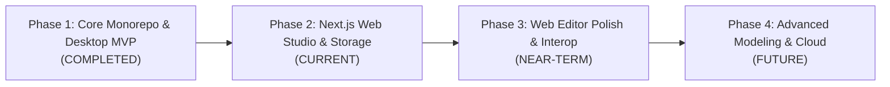

# Blender-ELT Monorepo Implementation Status & Technical Roadmap

## 1. Monorepo Status Matrix

| Component                       | Path                    |     Status      | Direct Web Reusability |  Test Status  | Key Capabilities                                                                                                                            |
| :------------------------------ | :---------------------- | :-------------: | :--------------------: | :-----------: | :------------------------------------------------------------------------------------------------------------------------------------------ |
| **`@blender-elt/contracts`**    | `packages/contracts`    |  **Complete**   |          100%          |   Verified    | Single source of truth for domain interfaces, IPC schemas, math types, and file format definitions.                                         |
| **`@blender-elt/scene-core`**   | `packages/scene-core`   |  **Complete**   |          100%          | Vitest Passed | Zustand scene graph store, node factories, tree traversal, world transform computation, collection management.                              |
| **`@blender-elt/commands`**     | `packages/commands`     |  **Complete**   |          100%          | Vitest Passed | Command pattern implementation with undo/redo history (Create, Delete, Transform, Duplicate, Parent, Visibility).                           |
| **`@blender-elt/modeling`**     | `packages/modeling`     |  **Complete**   |          100%          | Vitest Passed | Procedural primitive generators (cube, sphere, cylinder, cone, plane, torus), mesh topology data structure, extrude & subdivide operations. |
| **`@blender-elt/materials`**    | `packages/materials`    |  **Complete**   |          100%          | Vitest Passed | PBR material configurations, standard preset library (gray, clay, plastic, metal, chrome, glass, gold, rubber), Three.js material factory.  |
| **`@blender-elt/animation`**    | `packages/animation`    |  **Complete**   |          100%          | Vitest Passed | Timeline store, property tracks, keyframe evaluation, interpolation algorithms (linear, step, ease-in-out), playback controller.            |
| **`@blender-elt/viewport`**     | `packages/viewport`     |  **Complete**   |     100% (Client)      | Vitest Passed | React Three Fiber 3D canvas, camera controls (orbit/pan/zoom/viewpoints), transform gizmos, grid/axes overlays, lighting rigs.              |
| **`@blender-elt/ui`**           | `packages/ui`           |  **Complete**   |     100% (Client)      |   Verified    | Blender dark theme design system: Header, MenuBar, OutlinerPanel, PropertiesPanel, TimelineBar, DockLayout, Modals, CommandPalette.         |
| **`@blender-elt/file-formats`** | `packages/file-formats` |  **Complete**   |    95% (Adaptable)     | Vitest Passed | GLTF/GLB exporter/importer, OBJ/MTL parser, STL exporter/importer, unified `exportScene` & `importScene`, `.belt` serialization.            |
| **`@blender-elt/persistence`**  | `packages/persistence`  |  **Complete**   |    90% (Adaptable)     | Vitest Passed | Zod schemas, `.belt` serializer/deserializer, `IStorageAdapter`, `MemoryStorageAdapter`, `LocalStorageAdapter`, `FileStorageAdapter`.       |
| **`@blender-elt/desktop`**      | `apps/desktop`          |  **Complete**   |     N/A (Desktop)      |   Verified    | Electron desktop application (Main, Preload, Vite Renderer, native menus, IPC bridge, file fallback utility).                               |
| **`@blender-elt/web`**          | `apps/web`              | **In Progress** |   100% (Web Target)    |  Active Dev   | Next.js App Router web application, landing page, dashboard, project manager, full browser-based 3D studio editor.                          |

---

## 2. Multi-Phased Product Roadmap

### Phase 1: Core Monorepo & Desktop MVP (Completed)

- [x] Turbo monorepo scaffolding with strict TypeScript configurations.
- [x] Decoupled domain contracts in `@blender-elt/contracts`.
- [x] Vanilla Zustand scene graph state machine with tree traversal in `@blender-elt/scene-core`.
- [x] CommandManager with undo/redo execution in `@blender-elt/commands`.
- [x] Procedural primitive generators and mesh topology in `@blender-elt/modeling`.
- [x] PBR shader generation and preset configurations in `@blender-elt/materials`.
- [x] Timeline track evaluation and interpolation in `@blender-elt/animation`.
- [x] React Three Fiber viewport with transform gizmos in `@blender-elt/viewport`.
- [x] Blender-themed UI components in `@blender-elt/ui`.
- [x] Export/Import pipelines for GLTF, GLB, OBJ, STL, and `.belt` in `@blender-elt/file-formats`.
- [x] Electron desktop application shell in `apps/desktop`.

### Phase 2: Web Platform & App Router Integration (Current)

- [x] Code reuse and architecture audit (`docs/architecture/code-reuse-audit.md`).
- [x] Specification of `.belt` format (`docs/project-format/specification.md`).
- [ ] Next.js 14+ App Router scaffold under `apps/web`.
- [ ] Transpile and Webpack configuration with Node shims (`fs`, `path`) in `next.config.mjs`.
- [ ] Web routes:
  - `/`: Product landing page showcasing Blender-ELT Web capabilities.
  - `/dashboard` & `/projects`: Project manager with template picker, recent files, and `.belt` import.
  - `/editor/[projectId]`: Full interactive 3D studio with dynamic client-only viewport.
  - `/settings`: Preferences modal and editor defaults.
- [ ] IndexedDB storage adapter for client-side auto-saving.
- [ ] Browser-based file import/export using HTML5 File API and Blobs.

### Phase 3: Web Editor Experience Polish & Interop (Near-Term)

- [ ] Full keyboard shortcut parity (G, R, S, X, Y, Z axis constraints, Numpad views).
- [ ] Mobile and tablet touch navigation support in 3D viewport.
- [ ] Drag-and-drop file import directly onto the WebGL canvas (dropping `.glb`, `.obj`, `.stl`, `.belt`).
- [ ] Real-time project autosave indicator and version history rollback.
- [ ] Offline PWA support with service workers.

### Phase 4: Advanced Modeling & Cloud Collaboration (Future)

- [ ] Interactive mesh editing mode (vertex, edge, and face selection and extrusion on canvas).
- [ ] CSG boolean operations (Union, Subtract, Intersect) directly in browser.
- [ ] WebGL texture baking and environment HDR map lighting presets.
- [ ] WebRTC / WebSocket real-time multiplayer scene collaboration.
- [ ] Cloud project sync and asset library integration.

---

## 3. Technical Debt & Architectural Risk Tracking

1. **Top-Level `fs` Import in `@blender-elt/persistence`**:
   - _Risk_: `packages/persistence/src/storage.ts` imports Node `fs` and `path` at top level. This forces any web bundler (Vite or Webpack) to configure fallback shims.
   - _Resolution_: In an upcoming refactoring, split `storage.ts` into `storage-base.ts` (with `IStorageAdapter`, `MemoryStorageAdapter`, `LocalStorageAdapter`) and export `FileStorageAdapter` through a dedicated subpath export (e.g. `@blender-elt/persistence/node`).
2. **Buffer Reference in `@blender-elt/file-formats/src/utils/polyfill.ts`**:
   - _Risk_: Webpack AST scanning detects `Buffer.from(buf).toString('base64')` in `NodeFileReader`.
   - _Mitigation_: Ensure `polyfill.ts` guards with `typeof Buffer !== 'undefined'`, and ensure `next.config.mjs` transpiles `@blender-elt/file-formats`.
3. **SSR Hydration Guarding**:
   - _Risk_: `@blender-elt/viewport` uses WebGL and canvas elements which fail if rendered during server-side evaluation.
   - _Mitigation_: Strictly enforce `dynamic(() => import(...), { ssr: false })` on all viewport components in `apps/web`.
