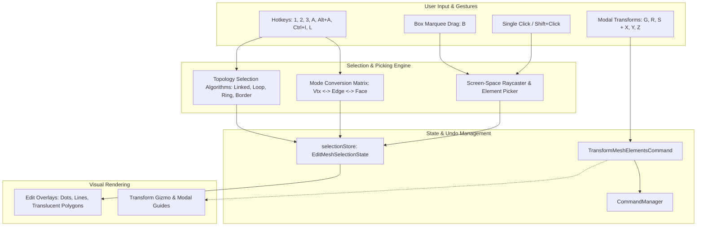
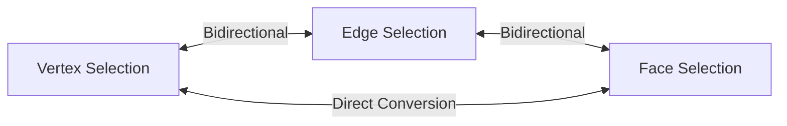
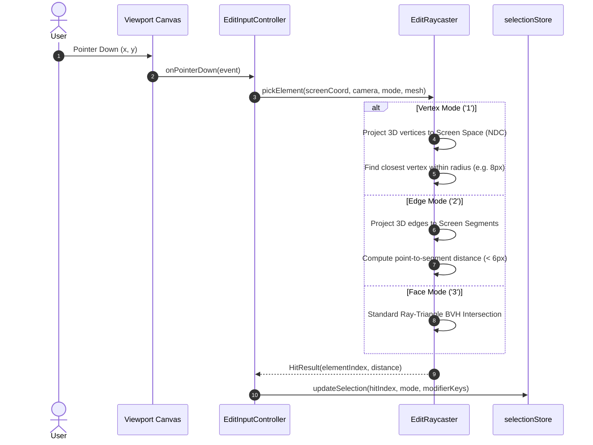

# Blender-ELT Selection & Transform System Specification

**Version:** 1.0.0  
**Target:** Monorepo Workspaces (`@blender-elt/contracts`, `@blender-elt/scene-core`, `@blender-elt/commands`, `@blender-elt/viewport`)  
**Author:** `@verifier` (Quality, Test & Verification Specialist)  
**Status:** Approved Technical Specification

---

## 1. Overview

The Selection & Transform System in Blender-ELT coordinates user input (mouse clicks, marquee drags, keyboard hotkeys) with the sub-element topology of the active 3D mesh. It ensures that selecting vertices, edges, or faces feels identical to Blender's desktop experience while maintaining transactional integrity through the undo/redo command stack.

---

## 2. Element Selection Modes & Conversion Rules

Blender-ELT supports three discrete element selection modes accessible via hotkeys `1`, `2`, and `3` or header toggle buttons:

- **Vertex Mode (`1`)**: Selects 0D coordinate vertices.
- **Edge Mode (`2`)**: Selects 1D line segments between vertex pairs.
- **Face Mode (`3`)**: Selects 2D planar/curved polygon faces.

### 2.1 Cross-Mode Conversion Logic

When switching between selection modes, element sets convert according to rigorous topological subset rules:

1. **Vertex $\longrightarrow$ Edge**:
   An edge $e = (v_a, v_b)$ becomes selected if and only if **both** endpoints $v_a \in V_{sel}$ and $v_b \in V_{sel}$.
2. **Edge $\longrightarrow$ Face**:
   A face $f$ becomes selected if and only if **all** of its perimeter edges $e \in \text{edges}(f)$ are selected.
3. **Face $\longrightarrow$ Edge**:
   All perimeter edges bounding any selected face $f \in F_{sel}$ become selected:
   $$E_{sel} = \bigcup_{f \in F_{sel}} \text{edges}(f)$$
4. **Edge $\longrightarrow$ Vertex**:
   All endpoint vertices of all selected edges become selected:
   $$V_{sel} = \bigcup_{e \in E_{sel}} \{v_1(e), v_2(e)\}$$
5. **Face $\longrightarrow$ Vertex**:
   All vertices of all selected faces become selected:
   $$V_{sel} = \bigcup_{f \in F_{sel}} \text{vertices}(f)$$

---

## 3. Selection Algorithms & Topology Walkers

Blender-ELT implements standard Blender selection operators:

### 3.1 Select Linked (`L`)

- **Behavior**: Hovering over an element and pressing `L` (or clicking with `Ctrl+L`) selects the entire connected manifold mesh island.
- **Implementation**: Breadth-First Search (BFS) starting at the picked element, traversing across all incident edges and faces until all reachable topology vertices are added to the selection.

### 3.2 Select All (`A`) & Deselect All (`Alt+A`)

- **Select All (`A`)**: Instantly adds all element indices $[0, \dots, N-1]$ of the active mode to `selectedIndices`.
- **Deselect All (`Alt+A` or double-tap `A`)**: Clears `selectedIndices`, setting active element to `null`.
- **Invert Selection (`Ctrl+I`)**: Replaces the active selection set $S$ with its complement $\mathcal{U} \setminus S$.

### 3.3 Grow & Shrink Selection (`Ctrl + NumPad +/-`)

- **Grow Selection**: Expands the current selection to include all immediate 1-ring neighbors (e.g. all vertices sharing an edge with any currently selected vertex).
- **Shrink Selection**: Removes boundary elements whose 1-ring neighborhood contains any unselected element.

### 3.4 Edge Loop & Ring Selection (`Alt+Click`, `Ctrl+Alt+Click`)

- **Edge Loop (`Alt+Click`)**: Follows continuous paths through quad vertices, selecting collinear opposite edges. Stops at non-quad junctions (poles) or mesh boundaries.
- **Edge Ring (`Ctrl+Alt+Click`)**: Traverses across facing edges in parallel quad strips.

---

## 4. Viewport Raycasting & Picking Pipeline

Element picking in Edit Mode requires precise screen-space hit testing to handle sub-pixel selections gracefully:

### 4.1 Screen-Space Distance Formulas

- **Vertex Distance**:
  $$d_{\text{screen}} = \| \mathbf{p}_{\text{screen}} - \Pi(\mathbf{V}_i) \|_2 \le R_{\text{threshold}} \quad (R \approx 8\text{px})$$
- **Edge Distance**:
  Calculated as the shortest perpendicular distance between screen coordinate $\mathbf{p}_{\text{screen}}$ and the projected line segment $[ \Pi(\mathbf{V}_1), \Pi(\mathbf{V}_2) ]$:
  $$t = \text{clamp}\left( \frac{(\mathbf{p} - \mathbf{A}) \cdot (\mathbf{B} - \mathbf{A})}{\|\mathbf{B} - \mathbf{A}\|^2}, 0, 1 \right), \quad d_{\text{segment}} = \| \mathbf{p} - (\mathbf{A} + t(\mathbf{B} - \mathbf{A})) \|$$

---

## 5. Modal Transform System (G / R / S)

Blender-ELT features a modal transform controller matching Blender's hotkey workflow:

### 5.1 Transform Hotkeys & Modals

- **`G` (Grab / Translate)**: Moves selected elements in the plane perpendicular to the view camera.
- **`R` (Rotate)**: Rotates selected elements around the median point in the view plane.
- **`S` (Scale)**: Scales selected elements relative to the median point.
- **Axis Locking (`X`, `Y`, `Z`)**: Constrains the active transformation strictly to the global (or local) X, Y, or Z axis. Pressing the axis key repeatedly toggles between Global, Local, and Unconstrained modes.
- **Plane Exclusion (`Shift+X`, `Shift+Y`, `Shift+Z`)**: Locks transformation to the remaining two axes (e.g., `Shift+Z` translates exclusively along the XY plane).
- **Numeric Input**: Direct typing during modal transform sets exact numeric offsets (e.g., `G` $\to$ `Z` $\to$ `2.5` moves selection $+2.5$ units along Z).

### 5.2 Median Point Calculation

Transformations pivot around the geometric median point $M$:
$$M = \frac{1}{|V_{sel}|} \sum_{v \in V_{sel}} \mathbf{P}(v)$$

When rotating by angle $\theta$ around axis $\mathbf{u}$ with pivot $M$:
$$\mathbf{P}'(v) = M + R_{\mathbf{u}}(\theta) \cdot (\mathbf{P}(v) - M)$$

When scaling by factor $s$ relative to pivot $M$:
$$\mathbf{P}'(v) = M + s \cdot (\mathbf{P}(v) - M)$$

---

## 6. Undo/Redo Transactional Integration

To ensure zero UI lag during interactive dragging, modal transforms are split into two phases:

1. **Interactive Phase**: Pointer move updates transient vertex buffer positions directly on the GPU without writing to the command stack.
2. **Commit Phase**: On mouse click / Enter key:
   - A single `TransformMeshElementsCommand` is created, storing the exact pre-transform and post-transform coordinates of the modified vertices.
   - The command is pushed onto the `CommandManager` stack.
   - `undo()` restores the original vertex positions and updates geometry bounds.
   - `redo()` reapplies the transformed vertex positions.
